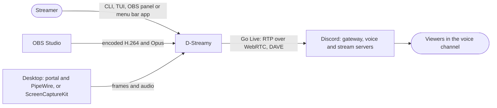
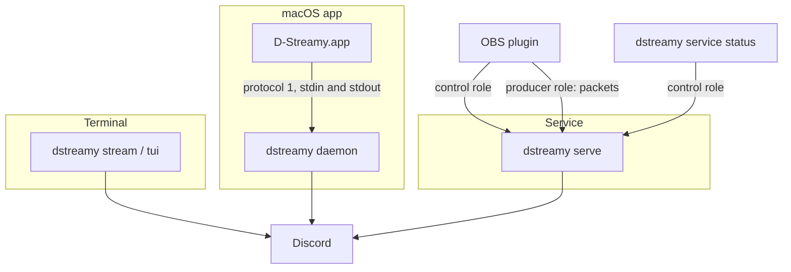
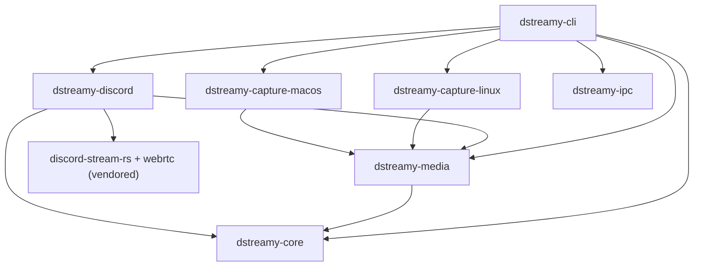
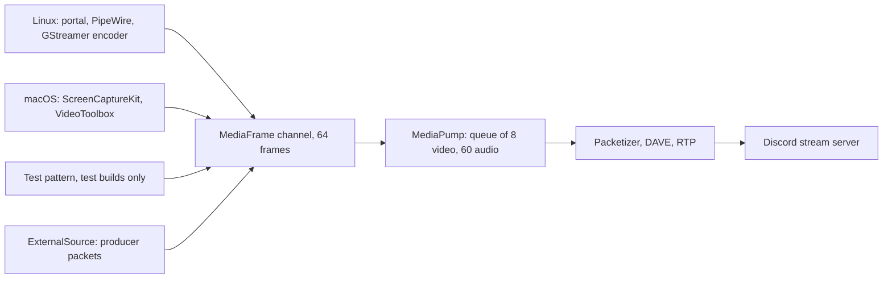

# Architecture

This page shows how D-Streamy fits together, from the outside in: the systems it talks to, the processes it runs as, and the crates inside them. Each component has its own chapter under [components/](components/).

## System context

D-Streamy acts as a Discord user. It holds the account's token, opens the gateway WebSocket, joins a voice channel and creates a Go Live stream. Media goes to Discord's stream server as RTP over a WebRTC connection, end-to-end encrypted with DAVE when Discord offers it. Viewers watch with normal Discord clients.

Media comes either from the desktop, through native capture, or from OBS, which encodes it and hands it over through the plugin.

## Processes

The same `dstreamy` binary runs in four roles. Which process runs the [session](../CONTEXT.md) depends on the frontend:

- **`dstreamy stream` and `dstreamy tui`** run a session in the foreground with native capture.
- **`dstreamy daemon`** is the macOS app's child. It speaks protocol 1, JSON lines on stdin and stdout, and runs one session at a time.
- **`dstreamy serve`** is the service. It listens on a private local socket, or a named pipe on Windows. Control clients send protocol 2 commands; producers such as the OBS plugin send encoded packets. A client disconnecting never stops serve or its session.
- **`dstreamy service`** installs serve as a systemd user unit on Linux. On Windows the OBS plugin starts the `dstreamy.exe` it ships instead.

One account runs at most one session at a time. A session lock in the account's directory enforces it across processes, so a second session on the same account fails with `already_running` and names the holder's PID. Two different accounts can stream at once ([ADR 0005](adr/0005-multiple-accounts.md)).

## Crates

| Crate | Role | Chapter |
|---|---|---|
| `dstreamy-cli` | The binary: commands, TUI, `daemon`, `serve`, `service`, the shared engine for `daemon` and `serve`, the session lock | [Command line and core](components/cli-and-core.md), [Service and IPC](components/service-and-ipc.md) |
| `dstreamy-core` | `config.toml`, file locations, saved accounts, logging, health levels | [Command line and core](components/cli-and-core.md) |
| `dstreamy-discord` | `DiscordClient`, `Session` and its states, the `MediaPump`, DAVE, reconnects, health snapshots | [Discord session](components/discord-session.md) |
| `dstreamy-media` | The `CaptureSource` interface, `MediaFrame`, the test pattern, `ExternalSource` | [Media and capture](components/media-and-capture.md) |
| `dstreamy-capture-linux`, `dstreamy-capture-macos` | Native capture and encoding per platform | [Media and capture](components/media-and-capture.md) |
| `dstreamy-ipc` | Endpoint selection, trust checks, Unix sockets and Windows named pipes, line and frame codecs | [Service and IPC](components/service-and-ipc.md) |
| `dstreamy-obs-producer`, `dstreamy-obs-packet` | The plugin's libobs-free half: packet ring, producer and control clients, panel models, Windows launcher | [OBS plugin](components/obs-plugin.md) |
| `dstreamy-obs`, `dstreamy-obs-sys` | The libobs module and its bindings, a separate Cargo workspace built through `obs/` | [OBS plugin](components/obs-plugin.md) |
| `dstreamy-mock-discord`, `dstreamy-test-producer` | Test doubles for Discord and for producers | [Build, test and release](components/build-test-release.md) |

The plugin workspace depends on `dstreamy-obs-producer`, which depends on `dstreamy-ipc` and `dstreamy-obs-packet`. It never links the Discord or capture crates: everything Discord-related happens in serve.

## The media path

Every source produces the same thing: a bounded stream of `MediaFrame`s carrying encoded H.264 (or H.265) access units and 20 ms Opus frames on one microsecond timeline. The session does not encode anything itself.

Every queue on the path is bounded, and each one has a stated drop policy ([ADR 0009](adr/0009-bounded-queues.md)). A slow consumer drops frames and asks the source for a keyframe instead of building up latency. The drops feed the health figures the frontends show.

## Cross-cutting design

- **One binary, many frontends.** The CLI, the macOS app and the OBS plugin all drive the same Rust session code. The UIs are thin: the app speaks protocol 1 to `daemon`, the plugin speaks protocol 2 to `serve` ([ADR 0001](adr/0001-rust-rewrite.md), [ADR 0003](adr/0003-macos-menu-bar-on-rust-daemon.md), [ADR 0004](adr/0004-persistent-service-and-external-producers.md)).
- **A persistent service for OBS.** The Discord session outlives OBS restarts and plugin crashes. When the producer goes away, the session keeps going for `grace_secs` (30 s by default) and sends Discord idle media (by default up to five 20 ms Opus silence packets), so OBS can come back without a new Go Live ([ADR 0004](adr/0004-persistent-service-and-external-producers.md)).
- **Stock OBS only.** The plugin runs on users' unpatched OBS. It registers its own output, creates its own encoders and never touches the user's own stream.
- **Local IPC with no secrets on the wire.** The socket lives in a directory only the user can enter, and both sides check the peer's user (uid on Unix, token user on Windows). There are no auth tokens; the Discord token never leaves serve.
- **Bounded everything.** Queues, connections, line lengths and per-connection work are capped, so a misbehaving client or a slow network cannot grow memory without limit ([ADR 0009](adr/0009-bounded-queues.md)).
- **Pinned external behaviour.** Every Discord, OS, GStreamer or OBS behaviour the code relies on has a sourced row in [specs.md](specs.md), and the mock Discord implements only those.
- **Golden fixtures as contracts.** The protocol 1 and 2 wire formats and the recorded OBS traces are checked against fixtures. Changing one needs a protocol bump or new provenance.
- **No patent-encumbered encoder in releases.** OpenH264 builds only into test builds, for the test pattern; release builds encode with the platform's encoders ([ADR 0010](adr/0010-openh264-licensing.md)).

## Decisions

| ADR | Decision |
|---|---|
| [0001](adr/0001-rust-rewrite.md) | Rewrite D-Streamy as a Rust CLI and TUI with per-OS capture backends |
| [0002](adr/0002-vendor-webrtc-for-discord-ssrcs.md) | Vendor webrtc-rs so RTP senders use Discord-assigned SSRCs |
| [0003](adr/0003-macos-menu-bar-on-rust-daemon.md) | Keep the macOS menu bar app as a frontend to `dstreamy daemon` |
| [0004](adr/0004-persistent-service-and-external-producers.md) | `dstreamy serve` with external producers, and an OBS output plugin |
| [0005](adr/0005-multiple-accounts.md) | Several saved Discord accounts |
| [0006](adr/0006-gstreamer-element-selection.md) | GStreamer element selection on Linux |
| [0007](adr/0007-obs-status-bar-panel.md) | OBS: a status-bar panel and a settings dialog instead of a dock |
| [0008](adr/0008-browser-login-webview.md) | Browser login through an embedded webview |
| [0009](adr/0009-bounded-queues.md) | Bounded queues between OBS and Discord |
| [0010](adr/0010-openh264-licensing.md) | How shipped binaries get their H.264 encoder |
| [0011](adr/0011-crypto-advisory-exceptions.md) | Crypto advisories without a compatible fix |
