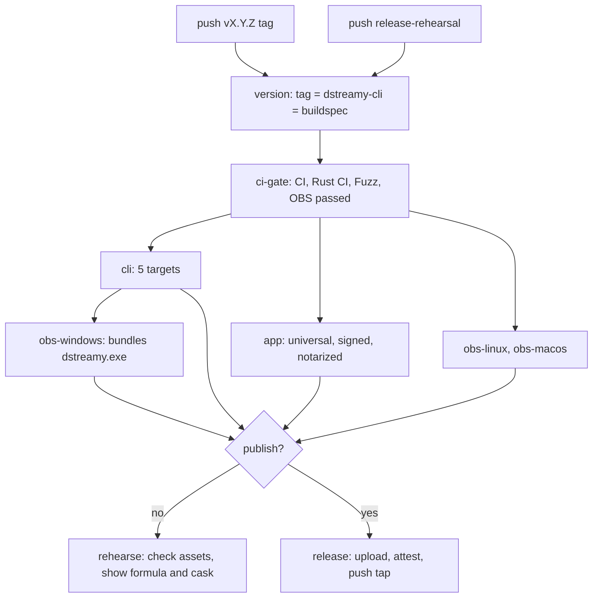

# Build, test and release

## Overview

D-Streamy ships three things from one repository: the `dstreamy` binary, the OBS plugin and the macOS menu bar app. They come from four build units: two Cargo workspaces, one CMake project and one Swift package. Four GitHub Actions workflows test them. A fifth, `release.yml`, builds every asset from a single `vX.Y.Z` tag and publishes them after CI has passed on the tagged commit.

Three rules hold across the chapter:

- Golden fixtures are contracts. Changing one needs a protocol bump or new provenance, not a regenerate (`CLAUDE.md`).
- Test-only code never reaches a release. Cargo features and a CMake option gate it, and CI and the release jobs check the built graph and binaries for it.
- Release builds contain no OpenH264 ([ADR 0010](../adr/0010-openh264-licensing.md)).

## Repository layout for builders

| Unit | Path | Builds | Tool |
|---|---|---|---|
| Main workspace | `rust/` | `dstreamy` (crate `dstreamy-cli`), the libraries, `mock-discord`, `mock-producer`, `obs-trace-check` | Cargo |
| Plugin workspace | `rust/crates/dstreamy-obs` with `dstreamy-obs-sys` | the plugin's `cdylib` | Cargo, driven by CMake |
| Plugin project | `obs/` | `obs-dstreamy` module, the Qt panel `obs-dstreamy-ui`, `obs-harness` | CMake (obs-plugintemplate) |
| App | `App/`, `AppTests/`, `Package.swift` | `D-Streamy.app` | Swift Package Manager |
| Fuzzing | `rust/fuzz` | three libFuzzer targets | cargo-fuzz |

Why they are separate:

- The plugin workspace links libobs, so it has its own `[workspace]` (`rust/crates/dstreamy-obs/Cargo.toml`). `rust/Cargo.toml` excludes `crates/dstreamy-obs`, `crates/dstreamy-obs-sys`, `fuzz` and `vendor/webrtc`. `cargo test --workspace` in `rust/` never touches the plugin.
- Cargo cannot inherit across workspaces. The plugin workspace copies `[workspace.package]` and `[workspace.lints]` from `rust/Cargo.toml`. The `obs-linux-checks` job fails when they differ, or when the plugin's version differs from `obs/buildspec.json`.
- The plugin is built only through `obs/`. `obs/cmake/common/rust_plugin.cmake` runs `cargo build --release --locked` with `DSTREAMY_OBS_CONFIG` pointing at a generated `obs-config-<config>.txt`, which lists libobs include paths, defines and the link library.
- `rust/fuzz` needs a nightly toolchain, so it has its own `Cargo.toml` and `Cargo.lock`.
- The app is a frontend over `dstreamy daemon` ([ADR 0003](../adr/0003-macos-menu-bar-on-rust-daemon.md)). `scripts/build.sh` builds it with `swift build` and bundles a `dstreamy` into `Contents/MacOS/`.

Toolchain pins:

- Rust 1.99.0 with `rustfmt` and `clippy`, profile `minimal` (`rust/rust-toolchain.toml`). `rustup toolchain install` in `rust/` installs it.
- Edition 2024, resolver 3, licence `GPL-3.0-or-later` (`rust/Cargo.toml`).
- Release profile: `lto = "thin"`, `strip = "symbols"`.
- Workspace lints: `unsafe_op_in_unsafe_fn = "deny"`; clippy `dbg_macro` and `todo` warn. CI runs clippy with `-D warnings`.
- OBS 32.2.2 is the build baseline (`obs/buildspec.json`, `OBS_TAG` and `OBS_COMMIT` in `obs-ci.yml` and `release.yml`).
- Xcode 27.1 on macOS.

## Local development

### Prerequisites

| OS | Needs | Source |
|---|---|---|
| Linux, `dstreamy` | `clang libclang-dev pkg-config libpipewire-0.3-dev libgstreamer1.0-dev libgstreamer-plugins-base1.0-dev` | `README.md` "Build from source", `rust-ci.yml` |
| Linux, tests | also `gstreamer1.0-plugins-base gstreamer1.0-plugins-good gstreamer1.0-plugins-bad gstreamer1.0-plugins-ugly` | `rust-ci.yml` (`rust-linux`) |
| Linux, `browser-login` | also `libwebkit2gtk-4.1-dev libgtk-3-dev libsoup-3.0-dev`; `xvfb` for the smoke test | `rust-ci.yml` (`browser-login-linux`) |
| Linux, plugin | an OBS 32.2.2 install prefix, CMake, Ninja, Qt 6 and the OBS build dependencies listed in `obs-ci.yml`; `xvfb` for tests | `obs-ci.yml` |
| macOS | Xcode 27.1 and rustup | `README.md`, all macOS jobs |
| Windows | rustup; the plugin needs Visual Studio 2026 (preset generator `Visual Studio 18 2026`) and LLVM's `libclang.dll` for bindgen | `obs/CMakePresets.json`, `obs-ci.yml` (`obs-windows`) |

Opus is encoded by `unsafe-libopus`, so no libopus package is needed (`README.md`).

`.github/scripts/obs-linux-build.sh` builds the OBS prefix the way CI does. It clones OBS at `OBS_TAG`, checks the commit against `OBS_COMMIT`, configures the `ubuntu` preset with browser, scripting, VLC, NVENC, QSV, new MPEG-TS, WebRTC and AJA off, and installs into `OBS_PREFIX`. It reads `RUNNER_TEMP`, `OBS_TAG`, `OBS_COMMIT` and `OBS_PREFIX` from the environment. On macOS and Windows, the plugin presets fetch OBS sources and the pinned `obs-deps` and Qt 6 prebuilts listed in `obs/buildspec.json`.

`rust/ci/linux.sh` runs a command in a Docker image with the pinned toolchain. Without arguments it runs `cargo fmt --check`, clippy and `cargo test --workspace --locked`. The target directory lives in the `dstreamy-linux-target` volume, not in `rust/target`.

### Building

`dstreamy`, from `rust/`:

```sh
cargo build --release -p dstreamy-cli                            # no webview
cargo build --release -p dstreamy-cli --features browser-login   # what the CLI archives ship; the app bundles a build without it
cargo build -p dstreamy-cli --features test-pattern              # test build with the test pattern (ADR 0010)
```

The plugin, from `obs/`. Presets in `obs/CMakePresets.json`:

| Preset | Platform | Build directory | Generator |
|---|---|---|---|
| `ubuntu-x86_64` / `ubuntu-ci-x86_64` | Linux | `build_x86_64` | Ninja |
| `macos` / `macos-ci` | macOS (universal) | `build_macos` | Xcode |
| `windows-x64` / `windows-ci-x64` | Windows | `build_x64` | Visual Studio 18 2026 |

Test presets exist only for `ubuntu-x86_64` and `ubuntu-ci-x86_64`. CI uses the `-ci` presets. Release builds use the plain ones.

```sh
cmake --preset ubuntu-x86_64 -DCMAKE_PREFIX_PATH="$OBS_PREFIX"
cmake --build --preset ubuntu-x86_64
```

CMake options:

- `DSTREAMY_PLUGIN_TEST_HOOKS` (default `OFF`): builds the crate with `--features test-hooks`. Tests only, never shipped.
- `DSTREAMY_UI=OFF`: builds the plugin without the Qt panel. CI checks that this also works without Qt.

The app, from the repository root: `bash scripts/build.sh` makes `bin/D-Streamy.app`. It builds `dstreamy` itself unless `DSTREAMY_DAEMON` points at a prebuilt one. `UNIVERSAL=1` builds both architectures. It signs with `CODESIGN_IDENTITY`, which defaults to the maintainer's Apple Development identity; set your own, or `SKIP_SIGN=1` to skip signing. `bash scripts/install.sh` builds and copies the app into `/Applications` (`DSTREAMY_INSTALL_DIR` overrides it; `--release` uses `scripts/release.sh`).

### Test commands

Rust, from `rust/`, as in `CLAUDE.md`:

```sh
cargo fmt --check
cargo clippy --workspace --all-targets --locked -- -D warnings
cargo build --locked -p dstreamy-cli -p dstreamy-test-producer --features dstreamy-cli/test-pattern --bin dstreamy --bin mock-producer
export DSTREAMY_BIN="$PWD/target/debug/dstreamy"
export DSTREAMY_MOCK_PRODUCER="$PWD/target/debug/mock-producer"
cargo nextest run --workspace --locked --profile ci -E 'not binary_id(dstreamy-cli::trace_replay)'
DSTREAMY_TRACE_REPLAY_STRICT=1 cargo test --workspace --locked --test trace_replay
cargo test --workspace --locked --doc
```

`trace_replay` must run under `cargo test`, not nextest, because it relies on in-process guards (`CONTRIBUTING.md`). `DSTREAMY_TRACE_REPLAY_STRICT=1` fails on the first inconclusive replay instead of retrying it (`rust/crates/dstreamy-cli/tests/trace_replay.rs`).

Browser login:

```sh
cargo clippy -p dstreamy-cli --features browser-login --all-targets --locked -- -D warnings
cargo test -p dstreamy-cli --features browser-login --locked --lib --test browser_login --test cli
xvfb-run -a -s "-screen 0 1280x720x24" cargo test -p dstreamy-cli --features browser-login --locked --test browser_smoke -- --nocapture
```

Public documentation, in each Cargo workspace: `RUSTDOCFLAGS="-D warnings" cargo doc --workspace --locked --no-deps`. This catches rustdoc warnings. It does not prove every public item has documentation.

Plugin, against an OBS 32.2.2 prefix in `OBS_PREFIX`:

```sh
cd obs
cmake --preset ubuntu-ci-x86_64 -DCMAKE_PREFIX_PATH="$OBS_PREFIX" -DDSTREAMY_PLUGIN_TEST_HOOKS=ON
cmake --build --preset ubuntu-ci-x86_64
xvfb-run -a -s "-screen 0 1280x720x24" ctest --preset ubuntu-ci-x86_64
cd ../rust/crates/dstreamy-obs
export DSTREAMY_OBS_CONFIG="$PWD/../../../obs/build_x86_64/obs-config-RelWithDebInfo.txt"
cargo fmt --all --check
cargo clippy --workspace --all-targets --locked -- -D warnings
cargo clippy --workspace --all-targets --locked --features test-hooks -- -D warnings
xvfb-run -a -s "-screen 0 1280x720x24" cargo test --workspace --locked
```

On macOS use `macos-ci`, then `ctest --test-dir build_macos -C RelWithDebInfo -R dstreamy-ui --output-on-failure`.

App, on macOS:

```sh
(cd rust && cargo build --locked -p dstreamy-cli --features test-hooks -p dstreamy-mock-discord)
DSTREAMY_INTEGRATION=1 swift test
```

`AppTests/DaemonIntegrationTests.swift` drives a real `dstreamy daemon` against `mock-discord`. With `DSTREAMY_INTEGRATION=1`, missing binaries fail the test instead of skipping it.

Release script tests: `python3 scripts/test_release_semantics.py` (unittest). Rust CI runs it in the `release-scripts` job.

Two Rust integration gates change the host and run only in CI jobs built for them:

- Cross-user IPC: `DSTREAMY_CROSS_USER_TESTS=1 cargo test -p dstreamy-ipc --locked --test cross_user -- --ignored --skip nobody_helper`.
- The real systemd installer: `DSTREAMY_DISPOSABLE_HOST=1 cargo test -p dstreamy-cli --locked --test service -- --include-ignored --test-threads 1`. It installs, kills and restarts `dstreamy.service` in the runner's user manager. Do not run it against your own service setup.

## Test infrastructure

### Mock Discord (`rust/crates/dstreamy-mock-discord`)

An in-process fake of Discord's main gateway, voice gateway, WebRTC media server and DAVE peer (`src/lib.rs`). All listeners bind `127.0.0.1` and stop when the mock is dropped. `MockDiscord::start()` uses the defaults; `start_with(MockConfig)` takes custom ones.

`MockConfig` (`src/config.rs`):

| Field | Default | Meaning |
|---|---|---|
| `token` | `mock-user-token` | The only token IDENTIFY and RESUME accept |
| `user` | id `100000000000000001`, `mockuser` | The logged-in user |
| `guilds` | one guild with voice channels `General`, `Gaming` and text channel `general` | Servers and channels in READY |
| `heartbeat_interval_ms` | 41250 | Main gateway HELLO |
| `voice_heartbeat_interval_ms` | 13750 | Voice gateway HELLO |
| `dave_protocol_version` | `davey::DAVE_PROTOCOL_VERSION` | Highest DAVE version negotiated; 0 disables end-to-end encryption |
| `dave_participant_id` | `100000000000009999` | The simulated call member in the MLS group |
| `video_codec` | `H264` | Codec in SELECT_PROTOCOL_ACK; the media server accepts only this one |

What it records (`src/state.rs`): `Recorded` holds every received op, every depacketized video frame, every audio frame, and `dropped_frames` (frames lost to sequence gaps, depacketization or DAVE decryption errors). Tests read these with `received_ops()`, `recorded_video()`, `recorded_audio()`, `recorded()`, and wait with `wait_for(...)` and `wait_for_op(...)`. Snapshots cover the voice state, open voice sockets, streams, the session id, whether zlib-stream was requested and the DAVE state (`dave_active`, `voice_privacy_code`).

Faults and events a test can inject (`src/lib.rs`), among others:

- DAVE: a guest joins or leaves (re-key), downgrade to protocol 0, upgrade to a new epoch.
- Viewers: PLI and FIR requests, `set_viewers`.
- Voice moves and kicks: from another session or another user, a late VOICE_STATE_UPDATE, a move or kick during the next join, a held join answered later, ignored repeated joins.
- Streams: STREAM_CREATE that closes or resets the voice connection, ignored STREAM_CREATEs, op 22 without STREAM_UPDATE.
- Connections: dropped media while WebSockets stay up, dropped voice or gateway sockets (resumable), RECONNECT, INVALID_SESSION, a repeated SELECT_PROTOCOL.

The `mock-discord` binary (`src/launcher.rs`) serves the default mock until stdin closes. Its first stdout line is JSON with `gateway_url`, `token`, `guild_id` and `channel_id`. The Swift integration tests use it.

The client accepts the mock's `ws://` voice endpoint only with the `test-hooks` feature of the vendored `discord-stream-rs` (`rust/vendor/discord-stream-rs/Cargo.toml`). The mock models only behaviour pinned in `docs/specs.md` (`CLAUDE.md`).

### Test producer (`rust/crates/dstreamy-test-producer`)

Not shipped. Two binaries and a library:

- `mock-producer` feeds `dstreamy serve` as a producer ([ADR 0004](../adr/0004-persistent-service-and-external-producers.md)). `--pattern` encodes `TestPatternSource` live with OpenH264. `--replay <TRACE_DIR>` replays an `obs-harness` trace at real-time pace through `dstreamy-obs-packet`. Knobs: size, fps and bitrate; `--burst`; `--pad-keyframes`; `--duration`, `--until-bytes`; `--disconnect-after`, `--reconnect`; `--stall-after`, `--stall-for`; `--corrupt` (`no-start-code`, `idr-without-flag`, `keyframe-without-sps`, `pts-ne-dts`, `opus-40ms`, `oversized`) with `--corrupt-after`; `--report-sent` prints a hash per frame.
- `obs-trace-check` checks a trace: frame count, flashes, Opus tone and A/V marker alignment.
- `sync` (library) detects the A/V sync markers: one white video frame per second, paired with a 20 ms 1 kHz beep over a quiet 440 Hz tone. It decodes H.264 luma with OpenH264 and Opus with `unsafe-libopus`.
- `trace` (library) reads `DSTRACE1` traces and converts them through `dstreamy-obs-packet`.

### Fixtures are contracts

| Path | Protocol | Checked by | Regenerate (generated files only) |
|---|---|---|---|
| `rust/crates/dstreamy-cli/tests/fixtures/daemon/` | daemon, protocol 1 | `tests/daemon.rs`; the Swift tests decode every file | `DSTREAMY_UPDATE_FIXTURES=1 cargo test -p dstreamy-cli --test daemon` |
| `rust/crates/dstreamy-cli/tests/fixtures/serve/` | service control role, protocol 2 | `tests/serve.rs` | `DSTREAMY_UPDATE_FIXTURES=1 cargo test -p dstreamy-cli --test serve golden` |
| `rust/crates/dstreamy-ipc/tests/fixtures/` | control lines and producer frames | `tests/golden.rs`, `src/serve/producer.rs` | `DSTREAMY_BLESS=1 cargo test -p dstreamy-ipc --test golden` |
| `obs/tests/traces/` | recorded OBS encoder output | `dstreamy-obs-packet` unit tests, `trace_replay`, `dstreamy-media --test obs_traces`, `dstreamy-obs-producer/tests/serve.rs` | re-record (below) |

Each fixture directory has a `README.md` with the scenarios and the normalisation applied before comparing. Some IPC fixtures are hand-built (`malformed.ndjson`, `opus_keyframe_flag_ignored`) and are not regenerated. The IPC fixtures are shared by the Rust service and the plugin.

The regenerate switches exist to write an intended change. They are not a way to make a failing test pass. A change to a fixture's content needs a protocol bump or new provenance (`CLAUDE.md`).

### OBS traces

Each trace directory under `obs/tests/traces/` holds `packets.bin`, `video-extra.bin`, `audio-extra.bin`, `trace.json` and a `PROVENANCE.md`. The provenance records libobs version, OBS commit, CI run, OS, encoders, settings with defaults, packet counts and the exact `obs-harness` command line. `packets.bin` starts with `DSTRACE1`, then a 40-byte little-endian header per packet.

`obs/tests/record-traces.sh` records all nine traces: x264 baseline and main at 30 and 60 fps, B-frame and keyframe-interval variants, and the `ffmpeg_opus` and `ffmpeg_aac` audio encoders.

Re-record after an OBS pin, x264, FFmpeg or runner-image change, or when OBS CI reports drift. `obs-linux-checks` records fresh traces on every run. `obs/tests/check-trace-drift.py` compares their metadata and packet counts with the committed ones. Drift gives a warning and a step summary; only a missing trace fails. The fresh traces are uploaded as `obs-traces-linux`. Compare that artifact before replacing a fixture: encoded bytes are not stable across encoder builds.

`obs/tests/encoder-settings/` holds the expected H.264 encoder defaults. `obs/tests/check-encoder-settings.py` compares a fresh dump from `obs-harness --dump-encoder-settings` against them on Linux and both macOS slices.

### Test-only features and their guards

| Feature or option | Where | What it enables |
|---|---|---|
| `test-pattern` | `dstreamy-cli` | `dstreamy-media/openh264`: the diagnostic test pattern target |
| `test-hooks` | `dstreamy-cli` | `test-pattern` plus `dstreamy-discord/test-hooks` and `test-rtp-start` |
| `test-hooks`, `test-rtp-start` | `dstreamy-discord`, `discord-stream-rs` | a `ws://` voice endpoint for the mock; RTP timestamps that start at 0 |
| `openh264` | `dstreamy-media` | source-built OpenH264 encoder |
| `test-support` | `dstreamy-ipc` | test helpers, enabled only as a dev-dependency |
| `test-hooks` | `dstreamy-obs` | settings that force panics and delays |
| `DSTREAMY_PLUGIN_TEST_HOOKS` | `obs/` CMake | builds `dstreamy-obs` with `test-hooks` |

Guards that keep them out of releases:

- `rust-linux` ("Shipped crates never enable test-only features") runs `cargo tree -e features,normal` and fails if a normal dependency enables `test-support`, `test-hooks`, `test-rtp-start`, `test-pattern` or `openh264`.
- `rust-linux` ("Default binary links no webview") fails if the default `dstreamy-cli` tree contains `webkit2gtk`, `gtk`, `wry`, `tao` or `muda`, or the binary links WebKit, GTK or libsoup.
- `release.yml` `cli` and `app` refuse to build when any of those five features reaches the release graph for the target.
- `obs/cmake/common/check_test_hooks.cmake` greps the built plugin for known hook strings. With hooks `OFF`, any hook string or any `DSTREAMY_TEST_` string fails. With hooks `ON`, a missing hook fails. The release plugin jobs and `obs-linux-checks` run it with `TEST_HOOKS=OFF`.

### Fuzzing

`rust/fuzz` has three targets:

- `control_line`: `dstreamy_ipc::ControlCodec`.
- `producer_frame`: `ProducerCodec` frame decoding.
- `ingest`: `ProducerCodec` plus ingest validation.

`fuzz.yml` seeds the corpus from `rust/crates/dstreamy-ipc/tests/fixtures/` (control NDJSON, producer `.bin` files, and `av_stream`, `pts_extremes` and `ingest_*` for `ingest`). It restores and saves the corpus through the Actions cache and minimises it with `cargo fuzz cmin`. Each target runs 60 s on push and pull request, 900 s nightly, or the dispatch input. Crashing inputs are uploaded as `fuzz-artifacts-<run id>`. The toolchain is `nightly-2026-07-20` with cargo-fuzz 0.13.2, pinned in `docs/specs.md`. The cargo-fuzz download is checked by SHA-256.

### cargo-nextest

`rust/.config/nextest.toml` puts `dstreamy-cli::trace_replay` in a test group with `max-threads = 1` for the default profile. The `ci` profile sets `fail-fast = false`. CI installs cargo-nextest 0.9.148 from a checksummed release archive.

## CI

Runner labels `xcode-27` and `ubuntu-26.04` are declared as self-hosted labels in `.github/actionlint.yaml`.

Release jobs import the Developer ID certificate on `xcode-27`, so jobs on the self-hosted runners skip pull requests from forks. Push the branch to this repository to run them.

| Workflow | Job | Runner | Checks |
|---|---|---|---|
| `ci.yml` (CI) | `build-test` | `xcode-27` | Builds `dstreamy` with `test-hooks` and `mock-discord`, then `swift test` with `DSTREAMY_INTEGRATION=1` |
| `rust-ci.yml` (Rust CI) | `rust-macos` | `xcode-27` | fmt, clippy, clippy and lib/`browser_login` tests with `browser-login`, nextest, `trace_replay`, doc tests, cross-user IPC |
| | `rust-linux-x86_64`, `rust-linux-aarch64` | `ubuntu-24.04`, `ubuntu-24.04-arm` | fmt, clippy, nextest, `trace_replay`, doc tests, test-only feature guard, no-webview guard, cross-user IPC |
| | `rust-windows` | `windows-2025` | clippy and tests of `dstreamy-ipc` (named pipes), `cargo check --workspace --all-targets`, `cargo test --workspace --no-fail-fast` |
| | `browser-login-linux` | `ubuntu-24.04` | clippy and tests with `browser-login`, `browser_smoke` under Xvfb (must pass exactly once and with a display), binary links WebKitGTK 4.1 |
| | `service-linux` | `ubuntu-24.04` | Starts a user systemd manager, then installs, kills and restarts the real service |
| | `cargo-deny` | `ubuntu-24.04` | `cargo deny --locked check` in both workspaces (cargo-deny 0.20.2) |
| | `release-scripts` | `ubuntu-24.04` | `scripts/test_release_semantics.py` |
| `obs-ci.yml` (OBS) | `obs-linux-plugin` (OBS 32.2.2) | `ubuntu-24.04` | Plugin with test hooks; `dstreamy-cli --test obs_plugin`: OBS through the plugin to `serve` and mock Discord |
| | `obs-linux-plugin` (OBS 33.0.1) | `ubuntu-26.04` | Same end-to-end test against OBS 33.0.1; left out of the matrix for pull requests from forks |
| | `obs-linux-checks` | `ubuntu-24.04` | ctest; install layout; build without the panel and Qt; workspace settings match; plugin crate gates; release build has no hooks; frontend ABI check; 5 s harness trace with A/V marker check; trace recording, drift and spec checks; frontend smoke with and without the UI library; encoder settings |
| | `obs-macos` | `xcode-27` | Universal build with hooks; bundle checks (slices, install names, no `obs-frontend-api` link, minos 12.0, dependencies only from OBS.app or the system); install layout; panel ctest; crate gates for both slices; load and panic tests and encoder settings per slice; OBS.app loads the plugin |
| | `obs-windows` | `windows-2025` | Build with hooks; crate gates and tests; DLL exports and imports; install layout; panel ctest; load and panic tests; `obs64` loads the plugin; end-to-end: `obs64` starts the bundled `serve`, streams to mock Discord and ends `serve` on exit (`dstreamy-cli --test obs_windows`) |
| `fuzz.yml` (Fuzz) | `rust-fuzz` | `ubuntu-24.04` | `rust/fuzz/Cargo.lock` is current (`cargo metadata --locked`); the three fuzz targets (see Fuzzing) |

Triggers and filters:

- `ci.yml`: push to `main`, pull requests to any branch, dispatch.
- `rust-ci.yml`: push to `main`, pull requests to `main`, dispatch.
- `fuzz.yml`: push to `main`, pull requests to `main`, nightly at 03:17 UTC, dispatch with a `seconds` input.
- `obs-ci.yml`: push to `main` and `ci/obs-**`, and pull requests to `main`, only when these paths change: `obs/**`, `rust/crates/**`, `rust/vendor/**`, `rust/Cargo.toml`, `rust/Cargo.lock`, `rust/rust-toolchain.toml`, the workflow itself, `.github/actions/obs-prefix-*/**`, `.github/actions/apt-archives-save/**`, `.github/scripts/obs-*.sh` and `.github/scripts/apt-install.sh`.

A newer run on the same ref cancels an older one, except on `main`, where each commit gets its own concurrency group, so a later push neither cancels nor replaces a queued run. The release gate needs the tagged commit's runs to finish, so tag releases on `main`.

OBS prefixes: every OBS job restores a pinned OBS build with `.github/actions/obs-prefix-fetch`, first from a recent default-branch run's artifact, then from the Actions cache. It builds OBS only on a miss. Pushes and dispatches on the default branch publish the prefixes again with `obs-prefix-publish`. `OBS_BUILD_REV` in the cache key forces a rebuild.

Every OBS job on the 32.2.2 baseline checks that its OBS tag matches `obs/buildspec.json`. All third-party actions are pinned by commit SHA, and checkouts use `persist-credentials: false`.

## Release

### Flow



Triggers (`release.yml`): a tag matching `v[0-9]+.[0-9]+.[0-9]+`, any push to `release-rehearsal`, or a dispatch with a `publish` input.

1. `version` reads `dstreamy-cli`'s version with `cargo metadata`. It fails when `obs/buildspec.json` has another version, when the buildspec's OBS version is not `OBS_TAG`, or when the version is not `X.Y.Z`. A run publishes on a tag push or with `publish: true`, and then the ref must be exactly `v<version>`.
2. `ci-gate`, only when publishing, resolves the tag to its commit and waits up to 140 minutes for `ci.yml`, `rust-ci.yml`, `fuzz.yml` and `obs-ci.yml`. The newest push run for the commit decides, so a failed rerun overrides an older success. When OBS did not run for the commit, the gate accepts a passing ancestor run whose OBS push paths are unchanged since then. Rehearsals skip the gate.
3. Build jobs (below) run in parallel. `obs-windows` waits for `cli` because it bundles the Windows `dstreamy.exe`.
4. `rehearse` (not publishing) downloads all artifacts, runs `scripts/check-release-assets.sh` and writes the filled formula and cask to the step summary. It publishes nothing.
5. `release` (publishing) runs the same asset check, creates the GitHub release with generated notes if missing, uploads all assets with `--clobber`, attests build provenance for every `.tar.gz` and `.zip` (`actions/attest-build-provenance`), fills the formula and cask, and pushes them to `lkshrk/homebrew-tap` with the commit message `d-streamy: bump to <version>`.

### Build jobs

| Job | Runner | Does |
|---|---|---|
| `cli` | `xcode-27` (both macOS targets), `ubuntu-24.04` and `ubuntu-24.04-arm` in a `debian:bookworm` container, `windows-2025` | Refuses test-only features; `cargo build --release --locked -p dstreamy-cli --features browser-login --target <target>`; checks the Linux binary links WebKitGTK 4.1; signs and notarizes the macOS binary; runs `--version` (x86_64 macOS under Rosetta); packages with third-party notices |
| `app` | `xcode-27` | Refuses test-only features in the bundled daemon; builds both macOS slices and joins them with `lipo`; checks both slices report `dstreamy <version>`; builds and signs the app with `scripts/release.sh`, or unsigned with `scripts/build.sh` when the signing secrets are missing; notarizes and staples |
| `obs-linux` | `ubuntu-24.04` | Builds with `ubuntu-x86_64` against the cached OBS prefix; stages the install; appends Rust notices; checks only `obs-dstreamy.so` sits in the module folder; checks no test hooks |
| `obs-macos` | `xcode-27` | Universal `macos` preset; checks both slices; appends notices; checks no test hooks; signs the UI dylib then the bundle; notarizes and staples |
| `obs-windows` | `windows-2025` | `windows-x64` preset; verifies and unpacks the Windows CLI zip; copies `dstreamy.exe` next to `obs-dstreamy.dll`; merges plugin, panel and CLI notices; checks layout and no test hooks |

The Linux CLI builds in Debian 12 so glibc 2.36 sets the floor, not the runner's 2.39. Its rustup-init download is checked by SHA-256. macOS builds target `MACOSX_DEPLOYMENT_TARGET=14.0`.

### Assets

`scripts/check-release-assets.sh <version> <dir>` verifies every `.sha256` file and that every asset below and its `.sha256` are present. It checks contents only in part: all four entries of each CLI archive, the app's bundled `dstreamy`, the Linux plugin's `obs-dstreamy.so`, and the Windows plugin's DLL, `dstreamy.exe`, panel DLL and panel notices. It checks only that the macOS plugin zip exists. The rest of the table is what the build jobs stage.

| File | Contents |
|---|---|
| `dstreamy-<v>-aarch64-apple-darwin.tar.gz` | `dstreamy`, `README.md`, `LICENSE`, `THIRD_PARTY_NOTICES.txt` in a `dstreamy-<v>-<target>/` folder |
| `dstreamy-<v>-x86_64-apple-darwin.tar.gz` | same |
| `dstreamy-<v>-x86_64-unknown-linux-gnu.tar.gz` | same |
| `dstreamy-<v>-aarch64-unknown-linux-gnu.tar.gz` | same |
| `dstreamy-<v>-x86_64-pc-windows-msvc.zip` | `dstreamy.exe`, `README.md`, `LICENSE`, `THIRD_PARTY_NOTICES.txt` in a `dstreamy-<v>-x86_64-pc-windows-msvc/` folder |
| `D-Streamy-<v>-macos-universal.zip` | `D-Streamy.app` with `Contents/MacOS/dstreamy` |
| `obs-dstreamy-<v>-linux-x86_64.tar.gz` | An install tree for a Debian-style `/usr`: `lib/x86_64-linux-gnu/obs-plugins/obs-dstreamy.so` and `dstreamy-ui/`, plus `LICENSE` |
| `obs-dstreamy-<v>-macos-universal.zip` | `obs-dstreamy.plugin` for `~/Library/Application Support/obs-studio/plugins/` |
| `obs-dstreamy-<v>-windows-x64.zip` | `obs-dstreamy/` for `%ProgramData%\obs-studio\plugins\`: `bin/64bit/obs-dstreamy.dll`, `dstreamy.exe`, `dstreamy-ui/obs-dstreamy-ui.dll`, `dstreamy-ui/THIRD_PARTY_NOTICES.txt`, `LICENSE` |

### Reproducibility measures

- `--locked` everywhere; toolchain from `rust-toolchain.toml`.
- CLI archives only (`cli` job): `SOURCE_DATE_EPOCH` is the last commit's timestamp, and `RUSTFLAGS` remaps the workspace to `/d-streamy` and the Cargo home to `/cargo`.
- Tarballs (the Linux and macOS CLI and the Linux plugin) use GNU tar with sorted names, the last commit's timestamp as mtime, owner and group 0, and `gzip -n -9` (no gzip timestamp).

The app's bundled daemon and the three OBS plugin builds get no path remap, so they embed the runner's workspace and Cargo home paths. The zip assets (Windows CLI, app, macOS and Windows plugin) keep file mtimes. Signed macOS binaries also carry a signing timestamp. None of these are byte-for-byte reproducible.

### Cutting a release

Run `scripts/tag-release.sh major|minor|patch|vX.Y.Z` on a branch:

1. It pulls the branch fast-forward, or refuses when local changes sit on a branch behind origin.
2. It offers to commit remaining changes as a release prep commit.
3. It computes the new version from the latest `vX.Y.Z` tag and refuses a tag that exists locally or on origin.
4. After confirmation it sets the version in `[workspace.package]` of both workspaces (`rust/Cargo.toml` and `rust/crates/dstreamy-obs/Cargo.toml`), updates their `Cargo.lock` files, `rust/fuzz/Cargo.lock` and `obs/buildspec.json`, and commits `chore: release vX.Y.Z`.
5. It creates an annotated tag and pushes the branch and the tag in one atomic push, so origin gets both or neither. The branch must accept a direct push. When origin rejects the push, the script deletes the local tag and keeps the release commit; rerunning it after fixing the cause reuses that commit. When git reports a failure but origin already has the branch and the tag at the release commit, the push counts as done. When origin can't be checked, or has the tag but not the branch, the local tag is kept and the script says what to check.

The release workflow then publishes once CI passes on the tagged commit.

### Rehearsing

Push a commit to `release-rehearsal`:

```sh
git push -f origin HEAD:release-rehearsal
```

The run builds every asset, signs and notarizes when the secrets exist, checks the assets and shows the filled formula and cask. It creates no GitHub release and no tap commit. Signing and notarization may still contact Apple. A dispatch without `publish` also rehearses.

### Signing and notarization

Secrets, by name:

| Secret | Use |
|---|---|
| `SIGNING_IDENTITY` | Developer ID identity for `codesign` |
| `DEVELOPER_ID_CERT_P12`, `DEVELOPER_ID_CERT_PASSWORD` | The certificate, imported by `.github/actions/macos-signing-keychain` |
| `NOTARY_KEY_P8`, `NOTARY_KEY_ID`, `NOTARY_ISSUER_ID` | App Store Connect API key for `xcrun notarytool` (`.github/actions/macos-notarize`) |
| `TAP_TOKEN` | Push to `lkshrk/homebrew-tap` |

`.github/actions/macos-signing-keychain` creates a keychain under `$RUNNER_TEMP` with a random password, imports the certificate and exports the keychain's path as `SIGNING_KEYCHAIN`. Every `codesign --sign` passes `--keychain "$SIGNING_KEYCHAIN"` (`scripts/release.sh` does when the variable is set), so the action never changes the user's keychain search list and concurrent signing jobs under one macOS user can't drop each other's keychain. codesign still builds the certificate chain from the search list, so the runner must have Apple's Developer ID G2 intermediate; the action fails early when it is missing. Commands that carry a password go to `security -i` on stdin, so they never show in the process list; a certificate password containing a line break is refused. Its post step runs even when the job fails: it locks the keychain and deletes it with the decoded files. `macos-notarize` deletes the decoded `.p8` on every exit.

A publishing run fails on macOS when `SIGNING_IDENTITY` or `DEVELOPER_ID_CERT_P12` is missing. Everything is signed with the hardened runtime and a secure timestamp. Nested code is signed before its container. The app and the plugin bundle are stapled. The bare CLI binary cannot be stapled, so Gatekeeper checks its ticket online. Windows and Linux assets are not signed.

### Homebrew

- `Formula/dstreamy.rb`: the CLI for macOS arm64 and x86_64, `depends_on macos: :sonoma`. Its committed sha256 values are placeholders (all zeros, all ones).
- `Casks/d-streamy.rb`: the app zip, `depends_on macos: :sonoma`, with a `zap` list.
- `scripts/fill-formula.sh <v> <dist> Formula/dstreamy.rb` fills the version and both macOS sha256 lines from the release checksums. It refuses to print a formula with a placeholder left.
- `scripts/fill-cask.sh <v> <dist> Casks/d-streamy.rb` fills the version and the app's sha256.

The filled files go only to the tap. The copies in this repository stay templates.

### Release script tests

`scripts/test_release_semantics.py` checks `release.yml` and the scripts by reading or running them. It covers exact publication refs, that rehearsals never publish, the plugin and CLI version match, that the release script's version bump relocks every lockfile and passes OBS CI's workspace checks, that a rejected branch push leaves no tag on origin and a rerun succeeds, that a push git reported as failed but that landed counts as pushed, that the signing keychain keeps passwords off argv, is passed to every `codesign`, never touches the search list, refuses a password with a line break, fails early without the Developer ID intermediate and is deleted after success and failure, that the notary key is removed on every exit, that fork pull requests reach neither `xcode-27` nor a self-hosted matrix runner, the CI gate's decisions, the universal-binary check, the test-only feature guards, the OBS release layout, the Windows CLI bundled in the plugin, that the CI runs `ci-gate` waits for are never cancelled on `main`, that `scripts/install.sh` always runs the build before installing and stops only the installed app (also with a relative install directory), and the notice generator's graph selection and failure modes.

## Dependency and licence policy

### cargo-deny

`rust/deny.toml` serves both workspaces (the plugin passes `--config ../../deny.toml`). It checks the graph for the five release targets with all features:

- Advisories: yanked crates are denied. Unmaintained crates fail only when they are direct dependencies (`unmaintained = "workspace"`). Five advisories are ignored, each with a reason pointing at ADR 0011.
- Licences: an allow-list of licences compatible with GPL-3.0-or-later, confidence threshold 0.8; private crates are ignored.
- Bans: `openssl-sys` and `native-tls` are denied ("rustls only"). Duplicate versions warn.
- Sources: only crates.io; unknown registries and git sources are denied.

[ADR 0011](../adr/0011-crypto-advisory-exceptions.md) records why each advisory exception stands and what ends it. A passing `cargo deny` means the decisions are on record, not that the advisories are fixed. A dependency change to `davey`, `openmls_rust_crypto`, `hpke-rs` or the DAVE suite must check that table again.

### OpenH264

[ADR 0010](../adr/0010-openh264-licensing.md): release builds contain no OpenH264. `dstreamy-media` builds `OpenH264Encoder` only with its `openh264` feature, which `dstreamy-cli/test-pattern` enables. Tests, the macOS CI daemon and the test producers use source-built OpenH264; they are never distributed. A shipped feature that needs software H.264 must reopen the ADR.

### Third-party notices

`scripts/third-party-notices.py` writes `THIRD_PARTY_NOTICES.txt` from the normal and build dependency graph for a given manifest, package, features and targets (`cargo metadata` plus `cargo tree --edges normal,build`). Dev dependencies are excluded. Licence templates live in `scripts/licenses/`. `--append` merges other notice files: the plugin jobs append the Qt panel's notices, and the Windows plugin also appends the CLI's. It lists OpenH264 only when `openh264-sys2` is in the shipped graph. Empty or missing inputs fail without writing output (`scripts/test_release_semantics.py`).

## Related decisions

- [ADR 0003: macOS menu bar on the Rust daemon](../adr/0003-macos-menu-bar-on-rust-daemon.md): the daemon protocol behind the daemon fixtures and the app tests.
- [ADR 0004: persistent service and external producers](../adr/0004-persistent-service-and-external-producers.md): the IPC behind the serve and IPC fixtures, the mock producer and the fuzz targets.
- [ADR 0010: OpenH264 only in test builds](../adr/0010-openh264-licensing.md).
- [ADR 0011: crypto advisory exceptions](../adr/0011-crypto-advisory-exceptions.md).
- [docs/specs.md](../specs.md): pinned versions (Rust, cargo-fuzz, bindgen, systemd) and the measured CI runner behaviour the tests rely on.
- [CONTEXT.md](../../CONTEXT.md): the glossary.
