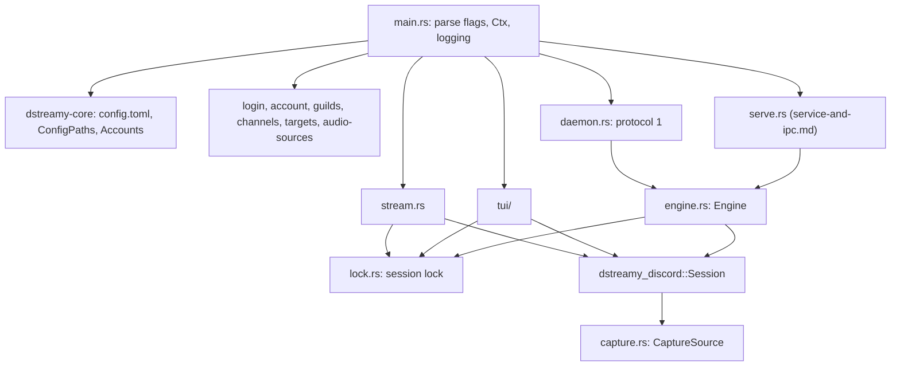

# Command line and core

## Overview

`dstreamy` is one binary built from `rust/crates/dstreamy-cli`. Its commands log in to Discord, list servers, channels, targets and audio devices, and run a session: `stream` in the foreground, `tui` interactively, `daemon` for the macOS app, and `serve` as the service. `rust/crates/dstreamy-core` holds what all of them share: `config.toml`, the paths of the config directory, the saved accounts, the log file writer and the health levels. This chapter covers everything except `serve` and `service`, which are in [service-and-ipc.md](service-and-ipc.md).

## Command reference

| Command | What it does |
|---|---|
| `login` | Log in by scanning a QR code with the Discord mobile app and save the account. `--token` reads a token instead; `--browser` opens Discord's login page in a window. |
| `account list` | List the saved accounts; the default one is marked with `*`. |
| `account use <NAME>` | Make an account the default for commands without `--account`. |
| `account remove <NAME>` | Remove the account and its saved token. |
| `guilds` | List the account's servers. |
| `channels <GUILD>` | List the voice channels of a server. |
| `targets` | List the windows and displays that can be captured. |
| `audio-sources` | List the audio devices `stream --audio-source` can capture. |
| `stream` | Go Live in a voice channel until interrupted. |
| `tui` | Pick a channel and target, adjust settings and watch stream health interactively. |
| `daemon` | Run as the macOS menu bar app's backend, speaking protocol 1 on stdin and stdout. |
| `serve` | Run as the service that control clients and producers connect to ([service-and-ipc.md](service-and-ipc.md)). |
| `service install\|uninstall\|status\|print` | Keep `dstreamy serve` running under systemd (Linux only). |

Source: the `Command` and `AccountCommand` enums in `rust/crates/dstreamy-cli/src/main.rs`.

Global flags, accepted by every command:

| Flag | Meaning |
|---|---|
| `--json` | Print JSON instead of text (one object per line while streaming). |
| `--config-dir <DIR>` | Directory holding `config.toml` and the saved accounts. Env: `DSTREAMY_CONFIG_DIR`. |
| `--account <NAME>` | Saved account to use instead of the default. The name is validated when parsed. |
| `-v`, `-vv` | Log more on stderr: `-v` info, `-vv` debug. |
| `-h`, `-V` | Help and version. |

`stream` flags (`rust/crates/dstreamy-cli/src/stream.rs`, `StreamArgs`):

| Flag | Values |
|---|---|
| `--guild <GUILD>` | Server id from `dstreamy guilds` (required). |
| `--channel <CHANNEL>` | Voice channel id from `dstreamy channels <GUILD>` (required). |
| `--target <TARGET>` | Target id from `dstreamy targets` (required). |
| `--crop <X,Y,W,H>` | Crop rectangle in source pixels. |
| `--codec <CODEC>` | `h264`, or `h265` (experimental: most viewers see no video). |
| `--fps <FPS>` | 15, 30 or 60. |
| `--res <RES>` | `WIDTHxHEIGHT` (even, at most 1920x1080), `720p`, `900p` or `1080p`. |
| `--bitrate <KBPS>` | 1000 to 15000. |
| `--gain <GAIN>` | 0.0 to 3.0. |
| `--audio-source <ID>` | A device from `dstreamy audio-sources`; by default what plays on the default output. |
| `--require-e2ee` | Refuse to stream unless Discord provides end-to-end encryption. |

### Common flows

```sh
dstreamy login                      # QR code; scan it with the Discord mobile app
dstreamy login --token              # type or paste a token (hidden input)
printf '%s' "$TOKEN" | dstreamy login   # a token piped on stdin
dstreamy login --browser            # needs a build with the browser-login feature

dstreamy guilds
dstreamy channels 123456789012345678
dstreamy targets                    # display:<id>, window:<id> (macOS) or portal (Linux)
dstreamy audio-sources

dstreamy stream --guild 1234 --channel 5678 --target display:1
dstreamy stream --guild 1234 --channel 5678 --target window:42 --res 720p --fps 60
dstreamy stream --guild 1234 --channel 5678 --target portal   # Linux: the portal dialog picks
dstreamy tui

dstreamy account list
dstreamy account use burner
dstreamy --account burner stream --guild 1234 --channel 5678 --target portal
dstreamy account remove burner
```

`stream` runs until SIGINT or SIGTERM. It installs its signal handling once the stream is live; before that, Ctrl-C ends the process at once. A second interrupt during shutdown exits at once with status 130.

## Architecture



- `main` parses the command line, builds a `Ctx` (config paths, gateway URL, `--account`), sets up logging and starts a multi-threaded Tokio runtime. Before every command except `targets`, `audio-sources` and `service` it runs the legacy token migration (`accounts::migrate`, 15 s limit; 5 s for `daemon` and `serve`).
- `stream` and `tui` drive a `Session` directly. `daemon` and `serve` share `Engine` (`src/engine.rs`): one Discord connection and at most one stream, commands as JSON (`hello`, `set_token`, `logged_in`, `guilds`, `channels`, `targets`, `start`, `update`, `stop`). `serve` turns on the external target, which protocol 1 never accepts.
- Every session first resolves the account's token (`accounts::resolve`) and takes that account's session lock (`accounts::session_lock`). Commands that only read (`guilds`, `channels`, `targets`) take no lock.
- `capture::source_for` picks the source for a target: the test pattern for `test-pattern`, otherwise the platform source (ScreenCaptureKit on macOS, the portal on Linux). Other platforms have none and fail with `NoPlatformCapture`.
- After a portal session, the portal's restore token is saved in `config.toml` (`capture::remember_portal_token`).

## Key files

| Path | Purpose |
|---|---|
| `rust/crates/dstreamy-cli/src/main.rs` | Command tree, global flags, logging setup, `login`, `account`, `guilds`, `channels`, `targets`, `audio-sources`. |
| `rust/crates/dstreamy-cli/src/lib.rs` | `Ctx` and `CliError`, the error type of every command. |
| `rust/crates/dstreamy-cli/src/stream.rs` | `stream`: flags, settings merge, event printing, silence warnings, exit status. |
| `rust/crates/dstreamy-cli/src/session.rs` | Starting, watching and tearing down a `Session`, shared by `stream`, `tui` and `Engine`. |
| `rust/crates/dstreamy-cli/src/tui/` | `tui`: `model.rs` holds state and key handling, `view.rs` draws it, `mod.rs` runs the loop. |
| `rust/crates/dstreamy-cli/src/daemon.rs` | `daemon`: protocol 1 framing, limits and shutdown. |
| `rust/crates/dstreamy-cli/src/engine.rs` | `Engine`, shared by `daemon` and `serve`; maps `CliError` to protocol error codes. |
| `rust/crates/dstreamy-cli/src/accounts.rs` | Choosing the account, session and removal locks, the legacy token migration. |
| `rust/crates/dstreamy-cli/src/lock.rs` | `SessionLock`: OS file lock plus `session.pid`. |
| `rust/crates/dstreamy-cli/src/login_capture.rs` | Login mode choice and the browser login's page protocol. |
| `rust/crates/dstreamy-cli/src/browser_login/` | `login --browser` window (`browser-login` feature, Linux and macOS): `session.rs` decides, `pages.rs` holds the pages and capture script, `window.rs` is the tao, wry and GTK glue. |
| `rust/crates/dstreamy-cli/src/capture.rs` | Target and audio-source listing, source choice, portal restore token. |
| `rust/crates/dstreamy-cli/src/discord.rs` | Connecting to the gateway with the resolved token: the per-token IDENTIFY ledger under `<config-dir>/identify/`, the brief retry policy of one-shot commands (3 attempts, backoff capped at 5 s) and the 30 s first-login window of `stream`, `tui`, `daemon` and `serve`. |
| `rust/crates/dstreamy-cli/src/output.rs` | `Out`: stdout and stderr that never fail, text tables, the daemon's queued stderr. |
| `rust/crates/dstreamy-cli/src/signals.rs` | SIGINT and SIGTERM, registered once. |
| `rust/crates/dstreamy-core/src/config.rs` | `Config`, `ServeConfig`, `ConfigPaths`, `ConfigError`, private file writes. |
| `rust/crates/dstreamy-core/src/stream_config.rs` | `StreamConfig`, `Resolution`, `Fps` and their limits. |
| `rust/crates/dstreamy-core/src/accounts.rs` | `Accounts`: names, storage, default account, token resolution, migration. |
| `rust/crates/dstreamy-core/src/logging.rs` | `RotatingFileWriter` for `dstreamy.log`, `QuietOnError`. |
| `rust/crates/dstreamy-core/src/health.rs` | Health scores and the `good`/`warn`/`bad` levels. |

## Configuration

### Where files live

`ConfigPaths::discover` uses `directories::ProjectDirs::from("me", "harke", "dstreamy")`. `--config-dir` or `DSTREAMY_CONFIG_DIR` replaces the directory.

| OS | Config directory |
|---|---|
| Linux | `$XDG_CONFIG_HOME/dstreamy`, else `~/.config/dstreamy` |
| macOS | `~/Library/Application Support/me.harke.dstreamy` |
| Windows | `%APPDATA%\harke\dstreamy\config` |

The directory holds `config.toml`, `config.toml.lock` (held while `Config::update` saves), `dstreamy.log`, `default-account`, `accounts.lock`, `accounts/`, `identify/` (each token's IDENTIFY count for the gateway's daily limit, one owner-only `<sha256 of the token>.json` per token, see [Reconnects and recovery](discord-session.md#reconnects-and-recovery)) and, while no account is chosen, `session.lock` and `session.pid` (see [Accounts and login](#accounts-and-login)).

### config.toml

A missing file means the defaults. Unknown keys are an error (`deny_unknown_fields`). The file is validated on load and written atomically and owner-only, because it may hold a portal restore token (`Config::save`). Read-modify-write updates (the portal token save, the TUI's start settings) go through `Config::update`, which holds an flock on `config.toml.lock` (waiting up to 5 s, then "another dstreamy is saving the settings") and unlocks it explicitly before closing.

| Key | Default | Notes |
|---|---|---|
| `[stream] resolution` | `"1920x1080"` | `WIDTHxHEIGHT`, even, at most 1920x1080; or `720p`, `900p`, `1080p`. |
| `[stream] fps` | `30` | 15, 30 or 60. |
| `[stream] bitrate_kbps` | `6000` | 1000 to 15000. |
| `[stream] codec` | `"H264"` | `"H264"` or `"H265"`. |
| `[stream] audio_gain` | `1.0` | 0.0 to 3.0. |
| `[stream] require_e2ee` | `false` | |
| `[target]` | unset | `kind = "display"` or `"window"` with `id`, or `kind = "portal"` with an optional `restore_token`. |
| `[crop]` | unset | `x`, `y`, `width`, `height`; width and height must be positive. |
| `audio_source` | unset | A device id; unset captures what plays on the default output. |
| `[serve] grace_secs` | `30` | See [service-and-ipc.md](service-and-ipc.md). |
| `[serve] idle` | `"documented"` | `documented`, `none` or `continuous`. |
| `[serve] stall_ms` | `2000` | |

Who reads and writes it:

- `stream` reads `[stream]`, `crop` and `audio_source`; its flags override them. `require_e2ee` is the flag OR the config, so a flag cannot turn off a configured requirement.
- `tui` starts from `[stream]`, `crop` and `audio_source`, and on each Go Live saves the chosen settings, crop and target back.
- `daemon` falls back to `[stream]` and `audio_source` for fields `start` leaves out.
- All three save a new portal restore token after the session.

### Environment variables

| Variable | Effect |
|---|---|
| `DSTREAMY_TOKEN` | A token that wins over every saved account. `--account` is then refused. |
| `DSTREAMY_CONFIG_DIR` | Same as `--config-dir`. |
| `RUST_LOG` | Extra `target=level` directives on top of `-v`. A bare level raises D-Streamy's own logs but never lowers them. An unparsable value is ignored with a warning. |

## Accounts and login

### Storage

`Accounts` in `rust/crates/dstreamy-core/src/accounts.rs`, layout from [ADR 0005](../adr/0005-multiple-accounts.md):

```
<config-dir>/
  default-account               the default account's name and a newline
  accounts.lock                 held while the saved accounts or the default change
  accounts/<name>/token         the token
  accounts/<name>/account.toml  id, username, global_name of the Discord user
  accounts/<name>/session.lock  the account's session lock, with session.pid
  session.lock, session.pid     the session lock when the token comes from DSTREAMY_TOKEN or the legacy file
  token                         legacy single token, moved into an account on first use
```

- Names are 1 to 32 characters of `a-z`, `0-9`, `_`, `.` and `-`, starting with a letter, digit or `_` (`validate_name`). Upper case is refused.
- Every write goes to a temporary file that is synced and renamed over the target; on Unix the directory is synced too (`write_private`).
- Changes of the accounts or the default hold `accounts.lock`, waiting at most 2 s (`STORE_LOCK_WAIT`). When another process holds it longer, the command fails with "another dstreamy is changing the saved accounts".

### Which account a command uses

`Accounts::resolve`:

1. `DSTREAMY_TOKEN`, when set and not blank. No account is chosen; `--account` fails with an error saying to unset the variable.
2. `--account <name>`. An unknown name fails and lists the saved names.
3. The default account: the name in `default-account` if that account exists, else the first account in name order.
4. The legacy `<config-dir>/token`, while its migration has not succeeded.
5. Otherwise: `not logged in: run dstreamy login or set DSTREAMY_TOKEN`.

The first account saved becomes the default. `account use` changes it. Removing the default account moves the default to the first remaining one, or deletes `default-account` when none is left. `account remove` takes the account's session lock first, so an account that is streaming in another process is refused with its PID.

### Login methods

`login_mode` in `rust/crates/dstreamy-cli/src/login_capture.rs` picks the method:

| Method | When | How |
|---|---|---|
| Browser | `--browser` | Discord's login page in a window; the token is read from its API requests and validated before it is returned ([ADR 0008](../adr/0008-browser-login-webview.md)). Only with the `browser-login` feature on Linux or macOS; otherwise it fails and points to the QR and token logins. After a failed or cancelled window the user can fall back to QR or token. |
| Token | `--token`, or stdin is not a terminal | From a terminal, a hidden prompt (`rpassword`). Otherwise all of stdin is read. Blank input fails with "no token given on stdin". |
| QR | otherwise | Discord's remote auth: the QR code is drawn in the terminal, the phone confirms. With `--json` the steps are `{"event":"qr","url":…}` and `{"event":"scanned","username":…}` lines. |

Every token is checked with one brief gateway connection before it is saved. The account it goes into:

- `--account <name>`: that account, created or replaced. If its `account.toml` names another Discord user, the login is refused and nothing is saved.
- Without `--account`: the account of the same Discord user, else a new one named after the username (lower-cased, foreign characters dropped, `-2`, `-3` … when taken).

A CLI login prints the account it saved into. When that is not the default it adds how to use it (`--account` or `dstreamy account use`). With `--json` it prints `id`, `username`, `global_name`, `token_file`, `account` and `default`.

### Token handling

- On Unix, token files are created mode 0600, and `accounts/` and each account directory 0700. Saving into an existing account directory sets it back to 0700.
- On Unix, reading a token file that group or others can access fails with `token file … is accessible by other users (mode …); run chmod 600 on it`. `account list` shows that error in place of the token state.
- On Windows the code sets and checks no file permissions.
- `ResolvedToken` prints `<redacted>` in its debug form. The token is never printed by `login` or `account list`.

## The daemon (protocol 1)

`dstreamy daemon` is the child the macOS app spawns ([ADR 0003](../adr/0003-macos-menu-bar-on-rust-daemon.md)). Each message is one JSON object per line. stdout carries protocol messages only.

- Commands, each with a string `id`: `hello`, `set_token`, `logged_in`, `guilds`, `channels`, `targets`, `start`, `update`, `stop`, `shutdown` (`COMMANDS` in `src/daemon.rs`).
- Replies are `{"type":"result","id":…,"data":…}` or `{"type":"error","id":…,"code":…,"message":…}`. Codes come from `impl From<CliError> for Failure` in `src/engine.rs`.
- Events are `{"type":"event","event":<SessionEvent>}`: state, health, channel moves, resumes, encryption and errors.
- `hello` answers `{"protocol":1,"version":…,"platform":…}`; `platform` is the OS name (`macos`, `linux`).
- `set_token` validates the token against the gateway, then saves it into the account chosen with `--account`, else the default account, else a new account named after the token's user.
- Limits: 64 queued input lines, 16 live commands (`overloaded` beyond), 64 queued output messages. Stderr diagnostics go through a 64-record queue, each record capped at 8 KiB (`Out::for_daemon`).
- EOF on stdin, `shutdown` or the first signal stops the stream and drains output within 5 s (`SHUTDOWN_LIMIT`). A second signal, or reaching that limit, exits with 130.

The contract is pinned by golden NDJSON fixtures in [`rust/crates/dstreamy-cli/tests/fixtures/daemon/`](../../rust/crates/dstreamy-cli/tests/fixtures/daemon/): `session`, `errors` and `unknown`. Their README explains the normalisation. Regenerate them with `DSTREAMY_UPDATE_FIXTURES=1 cargo test -p dstreamy-cli --test daemon`.

## TUI

`dstreamy tui` needs a terminal on stdin and stdout. It resolves the account up front, connects to Discord in the background and lists targets meanwhile. Its logs go to `dstreamy.log`, not the screen.

| Screen | Shows | Keys |
|---|---|---|
| Servers | The account's servers | `↑`/`↓` or `j`/`k`, `Enter` open |
| Channels | The server's voice channels | `Enter` next, `Esc` back |
| Targets | The capture targets | `Enter` next, `Esc` back |
| Stream settings | Resolution, frame rate, bitrate, codec, audio gain, crop, require E2EE | `↑`/`↓`/`Tab` field, `←`/`→` or `-`/`+` change, digits and `,` edit the crop, `Enter` go live, `Esc` back to targets |
| Live | State, server and channel, target, viewer count; a Health panel; the last six events | `s` or `Esc` stop; after a stop, `Enter` or `Esc` back to settings |

`q` or Ctrl-C quits from any screen; while live it stops the stream first. The bitrate steps by 500 kbps. The Health panel shows the video and audio scores and levels, E2EE state and DAVE version, sparklines for fps and audio frames, and rows for fps, jitter (p95 and max), drops, audio frames, bitrate and keyframe requests (built by `HealthView` in `src/tui/model.rs`, drawn by `src/tui/view.rs`). The session lock is taken when a stream starts and released when that session stops.

## Output and logging

- **Text and JSON.** `Out` in `src/output.rs` writes results to stdout and `error:`, `warning:` and notes to stderr. With `--json`, list commands print one JSON array, `login` one object, and `stream` one `SessionEvent` per line. Errors stay text on stderr. A closed stdout is not an error; `stream` stops when stdout breaks.
- **Text `stream` lines.** One line per state change and per health sample (fps, kbps, video and audio level and score, drops, capture drops, viewer keyframe requests, viewers). It warns once when the audio is silent for 10 s and when the audio device is lost.
- **Levels.** Without `-v`, D-Streamy's own targets (`dstreamy*`, `discord_stream_rs`) log at warn and others at error. `-v` is info and warn, `-vv` debug and info.
- **Where.** `tui` logs only to the file. `daemon` and `serve` log to the file, and also to stderr with `-v`. Every other command logs to stderr only.
- **Log file.** `<config-dir>/dstreamy.log`. It rotates at 10 MiB and keeps one old file, `dstreamy.log.1` (`DEFAULT_MAX_LOG_BYTES`, `DEFAULT_KEPT_LOGS`). Write errors are swallowed.

### Health levels

`StreamHealth::compute` in `rust/crates/dstreamy-core/src/health.rs` scores each one-second interval for video and audio as 1.0, 0.5 or 0.0. Video looks at fps against the target, p95 frame gap and drops; audio at Opus frames sent out of 50, frames dropped while the network was not ready, and encode errors. The score is the average over the intervals the session keeps (`health_history`, 60, so the last minute), 0 to 100. The level is the average of the last 10 intervals: `good` from 0.9, `warn` from 0.6, else `bad`.

## Errors and exit codes

| Status | When |
|---|---|
| 0 | Success. `stream` also exits 0 when interrupted, or when the session stopped as requested or because the capture ended. `--help` and `--version` exit 0. |
| 1 | Any `CliError` (`src/lib.rs`), printed as `error: …`. Includes `stream` ending for another reason (`stream stopped: …`). `daemon` also exits 1, logged rather than printed, when its shutdown could not deliver every message. |
| 2 | Invalid command line, reported by clap. |
| 3 | A browser login started with the hidden `--window-only` flag was cancelled; `serve` starts its login window this way. |
| 130 | A second interrupt cut the shutdown of `stream`, `tui`, `daemon` or `serve` short, or the daemon's 5 s shutdown limit was reached. |

Most `CliError` messages say what to run next, for example `unknown guild …; see dstreamy guilds`, `account … is streaming (pid …); stop that stream first`, or `another dstreamy session is live (pid …)`.

## Testing

Integration tests in `rust/crates/dstreamy-cli/tests/` run the built binary against `dstreamy-mock-discord`:

| Test | Covers |
|---|---|
| `cli.rs` | Login, token checks, guilds, channels, targets, `stream` settings and exit status, signals. |
| `accounts.rs` | Naming, `DSTREAMY_TOKEN`, removal while streaming, migration, insecure token files, default moves. |
| `lock.rs` | The session lock across `stream` and `daemon`. |
| `daemon.rs` | Protocol 1 against the golden fixtures. |
| `tui.rs` | Keys driving a test-pattern stream from picker to stop. |
| `browser_login.rs`, `browser_smoke.rs` | The browser login (`browser-login` feature). |

The TUI screens have `insta` snapshots in `rust/crates/dstreamy-cli/src/tui/snapshots/`. The test pattern needs the `test-pattern` feature, which `test-hooks` (and so the dev-dependency) turns on: only builds with it can stream `--target test-pattern` ([ADR 0010](../adr/0010-openh264-licensing.md)). Without it, `targets` lists no test pattern and starting one fails with an error that names the display, window and portal targets. CI's commands are in `CLAUDE.md`:

```sh
cd rust
cargo build --locked -p dstreamy-cli -p dstreamy-test-producer --features dstreamy-cli/test-pattern --bin dstreamy --bin mock-producer
cargo nextest run --workspace --locked --profile ci -E 'not binary_id(dstreamy-cli::trace_replay)'
cargo test -p dstreamy-cli --features browser-login --locked --lib --test browser_login --test cli
```

## Related decisions

- [ADR 0001](../adr/0001-rust-rewrite.md): the Rust rewrite.
- [ADR 0003](../adr/0003-macos-menu-bar-on-rust-daemon.md): the macOS app over `dstreamy daemon`, protocol 1.
- [ADR 0005](../adr/0005-multiple-accounts.md): saved accounts, default account, session lock per account.
- [ADR 0008](../adr/0008-browser-login-webview.md): browser login behind a feature.
- [ADR 0010](../adr/0010-openh264-licensing.md): OpenH264 and the test pattern only in test builds.
- [specs.md](../specs.md): external behaviour pins.
- [service-and-ipc.md](service-and-ipc.md): `serve`, `service` and the IPC.
