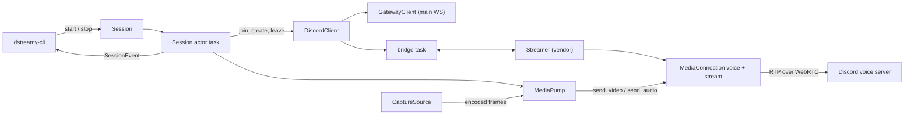
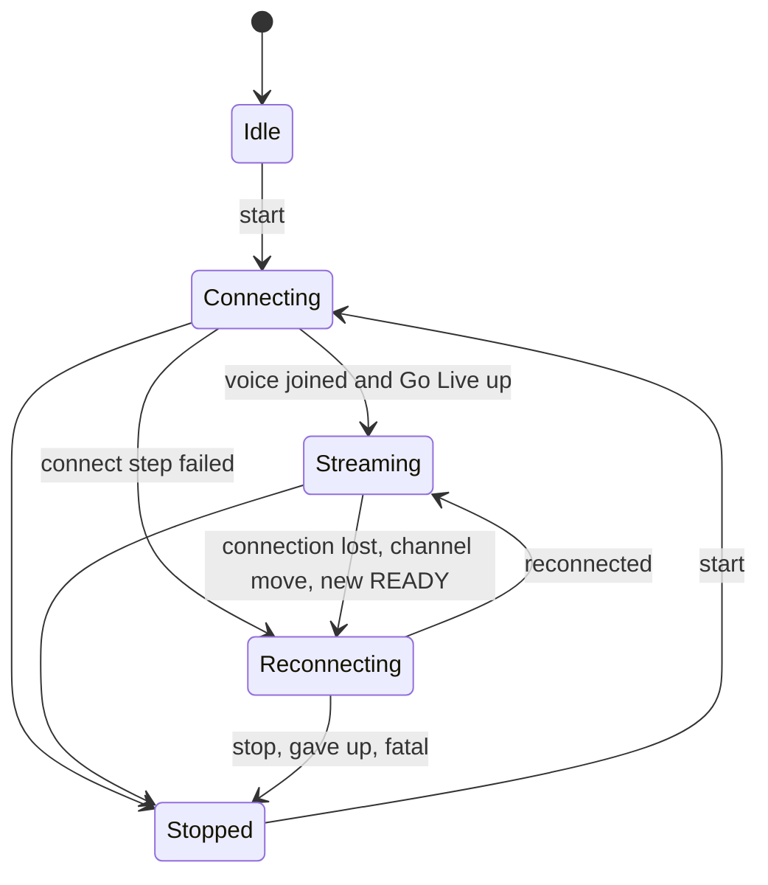
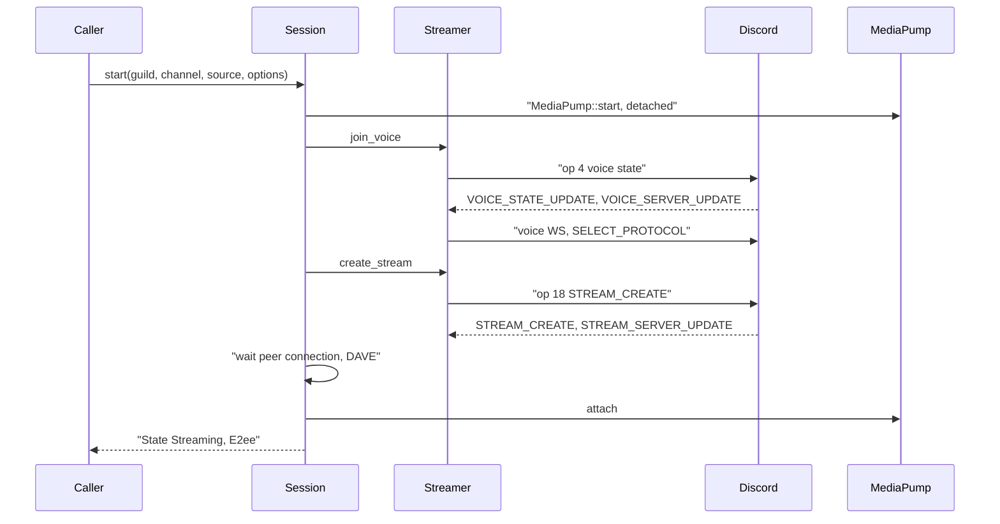
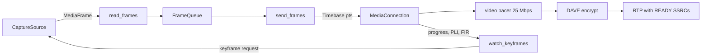

# Discord session

## Overview

`rust/crates/dstreamy-discord` is the Discord side of D-Streamy. It holds the user-account main gateway client, joins a voice channel, creates Go Live on it and moves a source's encoded frames to Discord as RTP. A `Session` supervises one Go Live run from `start` to `stopped`: it reconnects, follows voice-channel moves, reports health and end-to-end encryption, and stops with a reason. The voice gateway, WebRTC, DAVE and RTP packetizing come from the vendored transport `rust/vendor/discord-stream-rs`, which sits on the vendored `rust/vendor/webrtc` (ADR 0001, ADR 0002). `dstreamy-cli` drives it from `stream`, `tui`, `daemon` and `serve` (`rust/crates/dstreamy-cli/src/session.rs`, `src/stream.rs`, `src/tui/mod.rs`, `src/engine.rs`).

## Responsibilities

- Hold the main gateway connection for one account: IDENTIFY, heartbeats, RESUME, zlib-stream decompression, rate limiting, and a cache of servers (guilds in the code) and their voice channels.
- Bridge gateway dispatches into the transport's `Streamer` and send its outbound ops (voice join, Go Live create and delete) back over the gateway.
- Join voice, create Go Live, wait for the peer connection and DAVE, announce codec, speaking and video attributes.
- Run the media pump: queue a source's encoded video and audio without blocking it, map timestamps to one timeline, hand frames to the transport, and drop video to the next keyframe under pressure.
- Supervise the session: reconnect with backoff, recreate Go Live after a voice-channel move, stop when another device of the account joins voice, stop when `require_e2ee` cannot be met.
- Report health every second and the end-to-end encryption state whenever it changes.
- Run the QR login flow (`remote_auth`), which returns an account token.

## Architecture

- `DiscordClient` owns the `GatewayClient` and a `Streamer` behind a mutex. Its `bridge` task feeds every dispatch to `Streamer::handle_event` and writes the `Streamer`'s `GatewayPayload`s to the gateway (`rust/crates/dstreamy-discord/src/client.rs`).
- `Session` is a handle over an actor task. Commands go in on an unbounded channel; state goes out on a `watch`, events on a `broadcast` of capacity 256 (`session.rs`, `EVENT_CAPACITY`).
- Each run reads gateway events from `subscribe_unbounded`, so it never misses a voice state (`gateway/mod.rs`).
- `MediaPump` runs three tasks: `read_frames`, `send_frames` and `watch_keyframes` (`stream/pump.rs`).

## Key files

| File | Holds |
|---|---|
| `rust/crates/dstreamy-discord/src/lib.rs` | Public re-exports; `transport` is `discord_stream_rs` |
| `rust/crates/dstreamy-discord/src/client.rs` | `DiscordClient` and the dispatch/payload bridge |
| `rust/crates/dstreamy-discord/src/session.rs` | `Session`, `SessionState`, `StopReason`, `SessionEvent`, `Backoff`, the run loop |
| `rust/crates/dstreamy-discord/src/stream/mod.rs` | `StreamOptions`, `StreamError`, `E2ee`, `StreamStats`, the one-shot `start_stream`/`StreamHandle` |
| `rust/crates/dstreamy-discord/src/stream/link.rs` | `join_voice` and `open_stream`: the connect steps and their timeouts |
| `rust/crates/dstreamy-discord/src/stream/pump.rs` | `MediaPump` and its tasks, loss and keyframe handling, stats |
| `rust/crates/dstreamy-discord/src/stream/queue.rs` | `FrameQueue`, the bounded capture-to-transport queue |
| `rust/crates/dstreamy-discord/src/stream/timebase.rs` | `Timebase`: source pts to one increasing timeline per track |
| `rust/crates/dstreamy-discord/src/viewers.rs` | Viewer count from STREAM_CREATE, STREAM_UPDATE, STREAM_DELETE |
| `rust/crates/dstreamy-discord/src/gateway/mod.rs` | `GatewayClient`, `GatewayError`, session id tracking |
| `rust/crates/dstreamy-discord/src/gateway/connection.rs` | The gateway socket loop: identify, resume, heartbeats, close codes, backoff |
| `rust/crates/dstreamy-discord/src/gateway/options.rs` | `GatewayOptions`, `IdentifyProperties`, `DEFAULT_GATEWAY_URL` |
| `rust/crates/dstreamy-discord/src/gateway/cache.rs` | `Guild`, `VoiceChannel` cache |
| `rust/crates/dstreamy-discord/src/gateway/event.rs` | `GatewayEvent`, `Dispatch`, `VoiceState`, `CurrentUser` |
| `rust/crates/dstreamy-discord/src/gateway/inflate.rs` | zlib-stream decompression, 64 MiB message cap |
| `rust/crates/dstreamy-discord/src/remote_auth.rs` | QR login over the remote-auth gateway |
| `rust/vendor/discord-stream-rs/src/gateway/streamer.rs` | `Streamer`: voice and stream connection setup, main-gateway ops |
| `rust/vendor/discord-stream-rs/src/voice/connection.rs` | Voice WebSocket, `MediaConnection`, `VoiceEvent`, DAVE transitions |
| `rust/vendor/discord-stream-rs/src/voice/webrtc.rs` | WebRTC peer, video pacer, Discord SSRCs through `preferred_ssrc` |
| `rust/vendor/discord-stream-rs/src/dave.rs` | `DaveHandler` over `davey`: MLS session, encrypt, `require_e2ee` |

## How it works

### Session lifecycle

`SessionState` has five states (`session.rs`). Internally a run also tracks a `Phase` (`Starting` while the source starts, then `Connecting`, `Waiting`, `Streaming`) and a `Redo` (`Voice` rejoins voice, `Stream` recreates Go Live only).

- `Reconnecting { attempt }` counts from 1. A dropped voice or stream connection starts again from attempt 1 only if the stream stayed up for `SessionOptions::stable_streaming` (30 s); otherwise it continues from the attempt that brought the stream up. A removal from the channel and a new gateway READY rejoin from attempt 1.
- `Stopped { reason }` carries a `StopReason`. A stopped session keeps its source; `stop` hands it back, and the next `start` drops it.
- A second `start` while running is refused with `SessionError::AlreadyRunning` and the source handed back in `StartError`.

### Start to streaming

0. The run starts the source and its `MediaPump`, attached to no connection, before it touches voice, bounded by `source_start_timeout` (300 s) instead of `step_timeout`, because the Linux portal shows its screen sharing dialog inside the start. So no viewer sees an empty Go Live while the user chooses, and a source that fails to start never creates one. The state stays `Connecting`, and Stop ends the run at once (the source is dropped with the cancelled start). Frames discarded before the first attach do not count as dropped. A run that stops before it sent its first join (the source failed, timed out or was stopped) sends no op 4, so it never touches the voice state of the user's other device. Another device's voice state during the start is ignored: D-Streamy is not in voice yet, and its join takes over voice as any join does. A `reconfigure` during the start is applied on the first connection; the source restarts then only if the config differs from the one it started with (the Linux source reuses the portal's restore token from its own start, so the restart normally shows no dialog).
1. `join_voice` (`stream/link.rs`) calls `Streamer::join_voice` and waits until the voice connection is ready and its media link is connected, because Discord ignores Create Stream before that. The whole step is bounded by `step_timeout` (30 s).
2. `open_stream` calls `create_stream`, waits for the stream connection and its peer connection (each bounded by `step_timeout`). It reads the DAVE version from `SelectProtocolAck`. Unless Discord negotiated version 0, including when no `SelectProtocolAck` arrived, it waits up to `dave_timeout` (10 s) for DAVE to be ready, then streams anyway with a warning. With `require_e2ee` set it calls `MediaConnection::require_e2ee` and fails with `StreamError::E2eeUnavailable` if DAVE is not ready.
3. It sets the packetizer (`H264` or `H265`), speaking, and the video attributes (op 12).
4. The run attaches the `MediaPump` to the stream connection (a keyframe is requested), sets `Streaming` and reports `E2ee`.

The protocol facts behind these steps (op 18 and op 19, the voice states Discord answers with, close codes) are pinned in [docs/specs.md](../specs.md#discord).

### Media path

- The source delivers pre-encoded H.264 or H.265 access units and Opus packets as `MediaFrame` (ADR 0001).
- `read_frames` pushes each frame into `FrameQueue` and never blocks the source. When the source's receiver ends it marks `capture_ended`.
- `send_frames` pops in order, maps pts through `Timebase` and calls `send_video_frame_at_generation` or `send_audio_frame_at` on the attached connection. With no connection attached the frame is discarded.
- `Timebase` maps both tracks to one timeline from zero, strictly increasing per track. A backward jump over 1 s is a source restart and rebases the timeline.
- The transport paces video, decides at send time whether to DAVE-encrypt or send plaintext, and writes RTP with the SSRCs from voice READY (ADR 0002; [docs/specs.md](../specs.md#discord)).
- `watch_keyframes` is the only task that applies pacer progress. It runs the loss path, turns viewer PLI and FIR into keyframe requests at most every 500 ms, and asks for a keyframe 500 ms after DAVE comes up.

On a reconnect the pump keeps running: `detach` drops frames until the next `attach`, and `attach` asks for a keyframe on the new connection. A `reconfigure` restarts the source with `stop_resumable` and `start_resumed`, which continue the timeline and counters.

### Bounded queues and drop policy

| Queue | Bound | When full |
|---|---|---|
| `FrameQueue` video | `max_queued_video`, default 8 frames | Drop queued video and wait for the next keyframe; count `video_queue_overflows` |
| `FrameQueue` audio | `max_queued_audio`, default 60 frames (1.2 s) | Drop the oldest audio frame |
| Transport video pacer | 10 MiB queued (`PACER_QUEUE_BYTES`), frames above 3,110,400 bytes refused (`MAX_VIDEO_FRAME_BYTES`) | `PacerQueueFull` or `FrameTooLarge`; the pump skips to a keyframe |
| `SessionEvent` broadcast | 256 events | Slow subscribers lag |
| Gateway event broadcast | 256 events | Slow subscribers lag; `subscribe_unbounded` never lags |

Rules from `stream/queue.rs` and `stream/pump.rs`:

- A video delta that arrives while waiting for a keyframe is dropped and a keyframe is requested.
- A still-missing keyframe is requested again every 1 s (`KEYFRAME_RETRY`). After a lost keyframe the next request may come after 250 ms (`KEYFRAME_RETRY_SOON`).
- After a loss on the wire the pump flushes the pacer and bumps a flush generation, so no frame older than the requested keyframe goes out.
- `stop` waits at most 1.5 s (`PACER_SETTLE_TIMEOUT`) for frames in flight before reading final stats. Pump tasks get 5 s to join (`TASK_JOIN_TIMEOUT`).

These limits sit behind the producer-side queues of [ADR 0009](../adr/0009-bounded-queues.md); the policy rows are in [docs/specs.md](../specs.md#discord).

### End-to-end encryption (DAVE)

- `E2ee` is `Unknown` (no stream connection yet), `Encrypted` (DAVE ready) or `Unencrypted` (protocol 0, or the MLS group never came up). `e2ee_of` derives it from `MediaConnection::dave_ready` and `dave_protocol_version` (`stream/mod.rs`).
- The voice IDENTIFY advertises `max_dave_protocol_version` (`vendor/discord-stream-rs/src/voice/connection.rs`).
- The transport follows DAVE prepare and execute transitions. A transition to version 0 is a downgrade; a later transition back is an upgrade (`execute_pending_transition`).
- The session sends `SessionEvent::E2ee` when a stream connection comes up and on every health tick where the state changed. It logs a warning for any state other than `Encrypted`.
- With `require_e2ee`, `DaveHandler::encrypt` refuses to send while DAVE is not ready and records the protocol version. The next health tick sees `e2ee_unavailable()` and stops the session with `StopReason::E2eeUnavailable` before any unencrypted media leaves.
- DAVE runs through `davey` 0.1.5 from crates.io, which is not vendored; its crypto advisories are recorded in [ADR 0011](../adr/0011-crypto-advisory-exceptions.md).

### Reconnects and recovery

The session reacts to three event sources: the voice and stream connections' `VoiceEvent`s, gateway events, and its own connect futures.

| Trigger | Reaction |
|---|---|
| `VoiceEvent::Resumed` (voice or stream WS resumed in place) | Count `resumes`, emit `SessionEvent::Resumed`; keep streaming |
| `VoiceEvent::Closed` or `MediaFailed` on the stream connection | While streaming: detach the pump, end Go Live, recreate Go Live (`Redo::Stream`). During a connect attempt it counts as a failed attempt and leads to a full rejoin (`retry`) |
| `VoiceEvent::Closed` or `MediaFailed` on the voice connection | Also leave voice, then rejoin (`Redo::Voice`) |
| A connect step fails | `retry`: leave voice, wait `Backoff::delay`, rejoin; stop with `GaveUp` past `max_attempts` |
| New gateway READY (fresh gateway session) | Rejoin voice from attempt 1. While the source still starts (no join sent yet) it is ignored |
| Gateway `Resumed` or `Disconnected` | Nothing; the gateway reconnects on its own |
| Gateway `Closed` with `IdentifyLimit` | Stop with `IdentifyLimit` |
| Gateway `Closed` with close 4004 (token rejected) | Stop with `InvalidToken` (`{"reason":"invalid_token"}`): the user has to log in again |
| Gateway `Closed` | Stop with `GatewayClosed` |
| Own voice state names another channel | End Go Live under the old stream key, retarget the `Streamer`, emit `ChannelMoved`, recreate Go Live without rejoining |
| Own voice state with no channel while streaming, or the voice or stream connection closing with 4014 | Removed from the channel (moderator disconnect, channel deleted): rejoin voice from attempt 1, not counted toward `GaveUp`, whichever of the two arrives first; the second is then ignored while reconnecting |
| Voice state with this user's id and another device's session id joining a channel, once this run sent its join | Stop with `VoiceTakenOver`; stop the connections without op 4 or STREAM_DELETE. While the source still starts, before any join, it is ignored |

- `Backoff` defaults: base 1 s, cap 30 s, 10 attempts, delay `base * 2^(attempt-1)` times a 50–100 % jitter.
- A voice or stream connection that drops while streaming reconnects from attempt 1 only if the stream stayed up for `SessionOptions::stable_streaming` (30 s). A stream that drops sooner continues from the attempt that brought it up, so a stream that keeps dropping right after connecting stops with `GaveUp` after `max_attempts` instead of recreating Go Live forever.
- Voice states that arrive before the first join completes are held back (`joined`, `unacked`), because they may answer the previous run's ops. Voice states of an earlier gateway session of this client are ignored (`is_stale_session`).
- The bridge drops VOICE_STATE_UPDATEs whose session id is not the client's, so another device's voice state never becomes the `Streamer`'s voice session (`client.rs`).
- The transport resumes a dropped voice WebSocket itself and reports `MediaFailed` when the peer connection stays `Disconnected` for 5 s, or when an in-place restart after `Failed` does not connect within 10 s (`MediaTimeouts`).

The gateway client reconnects on its own (`gateway/connection.rs`):

- Close codes 4004 and 4010–4014 are fatal (`GatewayError::Rejected`). One-shot CLI commands print 4004 with "run `dstreamy login` to log in again". 4007 and 4009 re-identify; other drops resume.
- Without READY or RESUMED within `ready_timeout` (60 s), the client closes and reconnects. The deadline starts at connect, or when an invalid session ends READY. Further invalid sessions before the next READY or RESUMED share that deadline: the wait before the first new IDENTIFY extends it once, later waits do not, and a RESUME never restarts it. So a gateway that answers every IDENTIFY or RESUME with an invalid session gets a close within about `ready_timeout` plus one `invalid_session_delay`.
- A connection fails unless it once stayed READY or RESUMED for `healthy_session_min` (30 s) without an invalid session, however it ended. A healthy connection resets the count. After `max_failed_attempts` (10) consecutive failures the client gives up with `GatewayError::Exhausted`. Before the first READY, `initial_give_up_after` bounds the retries in time: each attempt's handshake, HELLO and READY waits are cut to what is left of the window, and the client gives up once another attempt can't start inside it (the CLI's long-lived connections use 30 s, enough for a network that comes back after wake). A client that never reached READY gives up with `GatewayError::Unreachable`, carrying why the last attempt failed (DNS, refused, TLS, handshake timeout, no HELLO or READY in time, a close code) and a next step; `Exhausted` is for a client that was READY once.
- A resumable invalid session RESUMEs on the same connection. Once a RESUMED has answered such a RESUME, another resumable invalid session with no stretch of `healthy_session_min` READY or RESUMED since closes the connection (4000) instead; the client resumes on a new connection after the backoff, and the connection counts as failed. So a gateway that answers each RESUME with RESUMED and then an invalid session gets at most two RESUMEs per connection and exhausts the client.
- After a non-resumable invalid session the client re-identifies once. Another one on the same connection, with no stretch of `healthy_session_min` READY or RESUMED since the previous one, closes the connection (4000) instead, so the failure count and backoff apply. A gateway that answers each IDENTIFY with READY and then an invalid session therefore gets at most two IDENTIFYs per connection and exhausts the client.
- At most `max_identifies_per_day` (100) IDENTIFYs go out in any 24 h; RESUMEs do not count. One more stops the client with `GatewayError::IdentifyLimit` instead of connecting or identifying, whichever path sends the IDENTIFY. IDENTIFYs are counted in `GatewayOptions::identify_ledger` with wall-clock timestamps; clients that share one keep counting against the same window. A ledger made with `persisted_at(file)` keeps its timestamps in that owner-only file, so every process using the file shares the count (`gateway/ledger.rs`). Checking and recording an IDENTIFY is one step under a `.lock` flock on the file's directory, taken with a bounded wait (2 s) and unlocked explicitly; if the lock can't be had, the ledger counts in memory from what it last read and writes nothing. That work runs on a blocking thread, not on the gateway task. Writes go through a uniquely named temp file and a rename. A missing or unreadable file counts as empty. A timestamp in the future is stored as now, so it leaves the window one window later. A write also removes the directory's other ledger files whose stamps have all expired. The CLI gives every connect, one-shot or engine, the ledger at `<config-dir>/identify/<sha256 of the token>.json` (`dstreamy-cli/src/discord.rs`, `identify_ledger`). The engine behind `serve` and `daemon` replaces a connection whose gateway client has stopped, so a later command reconnects once the window allows it.
- A HELLO after the first one on a connection is ignored, so it sends no second IDENTIFY or RESUME.
- The limit messages end with when logging in is allowed again, for example "Try again in about 3 h 12 min." A `serve` or `daemon` command that hits the limit fails with code `identify_limit` and the `GatewayError::IdentifyLimit` text, which one-shot CLI commands print too. A running session stops with `StopReason::IdentifyLimit` (`{"reason":"identify_limit","retry_after_secs":N}`) and an `error` event with its message. Restarting or switching processes does not reset a token's count; logging in again issues a new token, which starts its own.
- Reconnect delay doubles from 1 s to 60 s with jitter. Every reconnect that cannot resume (close 4007 or 4009, or a non-resumable invalid session) also waits a random 1 to 5 s, 20 to 100 % of `invalid_session_delay` (`gateway/connection.rs`).
- A `resume_gateway_url` is used only when it is `wss` on `discord.gg` or a subdomain.
- Outbound commands are rate-limited to 120 per 60 s, with 10 reserved.

### Health

Every `health_interval` (1 s) while streaming, the run builds a `HealthSnapshot` (`session.rs`, `Run::sample`):

- `stats: StreamStats`: frames sent and dropped per track, source-side drops, bytes, keyframe requests by cause, queue overflows, resumes, fps, viewers, `e2ee` and `dave_protocol_version`.
- `metrics: StreamMetrics`: the per-interval figures from `dstreamy_core::MetricsSampler` (fps, bitrate, jitter from frame send intervals, drops, audio frames).
- `health: StreamHealth`: levels computed over the last `health_history` (60) intervals against the configured fps.

`viewers` counts viewers other than the account and is `None` until Discord reports them (`viewers.rs`). After a run stops, `Session::terminal_stats` returns the final counters, with `last_error` when teardown failed; they are cleared when the next run starts.

## Errors and stop reasons

`StopReason` (`session.rs`):

| Variant | Trigger |
|---|---|
| `Requested` | `stop`, `shutdown`, or the `Session` handle dropped |
| `CaptureEnded` | The source's frame channel ended (for the external source: grace ran out with no producer) |
| `GatewayClosed` | The gateway client stopped for good, or its event stream ended |
| `InvalidToken` | Discord closed the running gateway with 4004: the saved login was revoked, so the user has to log in again |
| `GaveUp { attempts }` | More connect failures in a row than `Backoff::max_attempts` |
| `SourceFailed { message }` | The source failed or timed out on start or restart, or stopped with an error after it ended |
| `VoiceTakenOver` | Another device of this account joined voice |
| `E2eeUnavailable` | `require_e2ee` is set and DAVE is not available, at connect time or later |
| `IdentifyLimit { retry_after_secs }` | The gateway client reached `max_identifies_per_day`; logging in is allowed again after `retry_after_secs` |
| `TaskEnded` | The session task ended without a stop, for example after a panic; reported by the engine and by `session::SessionEvents` (`dstreamy stream`, the TUI), not by the session itself |

`SessionError`: `AlreadyRunning`, `NotRunning` (`update_video` or `reconfigure` with no run), `Gone` (the actor ended), `CodecChange` (`reconfigure` with another codec), `Stream(StreamError)`.

`StreamError` (`stream/mod.rs`): `Timeout(step)`, `Streamer(StreamerError)` (`NotInVoice`, `NoSession`, `Connection`), `Connection(ConnectionError)`, `Media(MediaError)`, `SourceLost`, `E2eeUnavailable(version)`.

`GatewayError` (`gateway/mod.rs`): `Rejected(code)`, `Exhausted(attempts)` (gave up after being READY once), `Unreachable { attempts, cause }` (never reached READY; `cause` is why the last attempt failed), `IdentifyLimit { limit, retry_after_secs }`, `Closed`, `Tls`.

`SessionEvent::Error { message, fatal }` reports each failure as it happens; `fatal: true` precedes a stop.

## Interfaces

Exported from `rust/crates/dstreamy-discord/src/lib.rs`:

- `DiscordClient::connect(GatewayOptions)`: connects, identifies, waits for READY. Also `user`, `guilds`, `voice_channels(guild_id)`, `subscribe`, `streamer` (for ICE servers and the WebRTC setting engine) and `close`.
- `Session::new(Arc<DiscordClient>)`, then:
  - `start(guild_id, channel_id, source, SessionOptions)`: returns once accepted; progress shows in `state()`.
  - `stop()`: ends Go Live, leaves voice, returns the source.
  - `update_video(width, height, fps)`: op 12, kept for every reconnect.
  - `reconfigure(CaptureConfig)`: restarts the source live, or on the next connection.
  - `request_keyframe()`, `state()`, `subscribe()`, `terminal_stats()`, `shutdown()`.
- `SessionOptions { stream, backoff, stable_streaming, health_interval, health_history }` and `StreamOptions { capture, step_timeout, source_start_timeout, dave_timeout, max_queued_video, max_queued_audio, require_e2ee }`.
- `start_stream(...) -> StreamHandle`: a single connect without supervision; `StreamHandle` has `stats`, `update_video`, `request_keyframe`, `stop` and `stop_and_take_source`.
- `remote_auth::login(progress)`: the QR login flow.
- `transport`: the vendored `discord_stream_rs`, re-exported.

`SessionState`, `StopReason`, `SessionEvent`, `HealthSnapshot`, `StreamStats` and `E2ee` serialize with snake_case tags; `dstreamy-cli` forwards them to its clients.

## Testing

Tests run against `rust/crates/dstreamy-mock-discord`, an in-process fake of the main gateway, voice gateway, WebRTC media server and DAVE peer. The dev-dependency enables the crate's `test-hooks` feature.

| Test file | Covers |
|---|---|
| `tests/gateway.rs` | IDENTIFY shape, cache, heartbeats, resume on missing ACK and op 7, invalid-session deadline and its bounds, failure count reset and invalidated sessions, one re-IDENTIFY per unhealthy run, daily IDENTIFY cap, fatal 4004, attempt limits, zlib-stream split frames, unbounded subscribers |
| `tests/bridge.rs` | Dispatches reach the `Streamer`, its payloads go out, a leave before close still reaches the gateway |
| `tests/stream.rs` | H.264 test pattern and H.265 replay end to end, drop to keyframe under transport lag, teardown on drop and cancel, source handed back on failure |
| `tests/session.rs` | Voice WS resume, peer connection failure, lost voice or stream connection, channel moves, kicks while joining, stale voice states, gateway resume and invalid session, viewers, health, DAVE rekey, downgrade and upgrade, no-DAVE server, give-up, terminal stats, voice taken over, reconfigure, `update_video` across reconnects |
| `tests/external.rs` | The session with the external source: producer swap, grace expiry, viewer PLI to the attachment, idle modes |

Unit tests in `session.rs`, `stream/pump.rs`, `stream/queue.rs`, `stream/timebase.rs`, `gateway/connection.rs` and `gateway/ledger.rs` pin backoff, health accounting, loss handling, resume URL checks and the persisted IDENTIFY count (window, future stamps, lock fallback, pruning). A passing mock does not prove Discord compatibility (ADR 0001).

## Related decisions

- [ADR 0001: Rust rewrite](../adr/0001-rust-rewrite.md): vendored `discord-stream-rs`, own gateway client, mock-based verification.
- [ADR 0002: vendored webrtc for Discord SSRCs](../adr/0002-vendor-webrtc-for-discord-ssrcs.md).
- [ADR 0004: persistent service and external producers](../adr/0004-persistent-service-and-external-producers.md): the service that runs sessions for producers.
- [ADR 0005: multiple accounts](../adr/0005-multiple-accounts.md): the session lock is per account; the same account streaming twice ends the first with `VoiceTakenOver`.
- [ADR 0009: bounded queues](../adr/0009-bounded-queues.md).
- [ADR 0011: crypto advisory exceptions](../adr/0011-crypto-advisory-exceptions.md): DAVE crypto and the RSA in QR login.
- [docs/specs.md](../specs.md): Discord protocol pins and local policies.
- [rust/vendor/README.md](../../rust/vendor/README.md) and [discord-stream-rs/VENDOR.md](../../rust/vendor/discord-stream-rs/VENDOR.md): vendored crate provenance and local changes.
