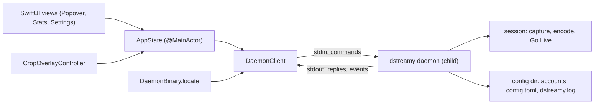

# macOS app

D-Streamy.app is a SwiftUI menu bar app for macOS 14 and later. It is a thin frontend: it spawns the bundled `dstreamy daemon` as a child process and drives it over protocol 1, JSON lines on stdin and stdout. Capture, encoding and Discord all run in Rust; the app only shows state and sends commands ([ADR 0003](../adr/0003-macos-menu-bar-on-rust-daemon.md)). The app has no Dock icon (`LSUIElement` in `scripts/build.sh`).

## What the user sees

- **Menu bar icon.** A video symbol, filled while a session is live. A small dot shows the health level; it blinks every 0.5 s when the level is bad (`App/DStreamyApp.swift`, `AppState.updateBlink`). Right-click opens a menu with Quit D-Streamy.
- **Popover** (`App/Popover/PopoverView.swift`), 300 points wide:
  - Header: login state, and Connecting, Reconnecting or Live while a session runs.
  - Login: the user pastes a Discord token (the `Authorization` header value) into a secure field. A leading `Authorization:` is stripped (`normalizeDiscordToken`). "Change token" replaces it.
  - Source: a menu of the daemon's targets, grouped into Displays and Windows, plus Refresh. It is locked while a session runs. The last target is restored on launch, by id, else by the same app and window title; another window of the same app is never picked instead (`AppState.restoredTarget`).
  - Crop button, enabled only for window targets. It opens the crop overlay.
  - Discord: a server picker and a channel picker. The last pick is kept in `UserDefaults`.
  - Settings (gear): resolution 720p/900p/1080p, fps 15/30/60, codec H.264/H.265, bitrate 1–15 Mbps, volume 0–300 % (`App/Popover/SettingsView.swift`). Values persist in `UserDefaults`.
  - Start, Cancel (while connecting) or Stop. Start stays disabled until login, target, server and channel are set; its tooltip names what is missing.
- **While live** (`App/Popover/StatsView.swift`): target, uptime, end-to-end encryption state with the DAVE protocol version ("DAVE protocol not reported" when the daemon names none), video and audio health scores, fps, jitter p95/max, bitrate, drop counters split into source and transport. While a session is connecting or live, an unencrypted session shows a warning under the popover header: "This session is not end-to-end encrypted. Discord can read its audio and video." (`PopoverView.swift`).
- **Crop overlay** (`App/CropOverlay/`): a borderless floating panel over the target window with eight resize handles, a 100-point minimum size and an Apply button. It follows the window every 0.5 s. Crops are stored per app and window title.

## Architecture



`AppState` is the single source of truth. It owns one `DaemonClient` at a time, launches it on first need (`ensureDaemon`) and ignores callbacks from a client it has replaced. `DaemonClient` owns the `Process`, the pipes, request ids, per-request timeouts and the pending-reply table.

## Key files

| Path | Role |
|---|---|
| `Package.swift` | SwiftPM package: executable `DStreamyApp` from `App/`, test target `DStreamyAppTests` from `AppTests/`, macOS 14. |
| `App/DStreamyApp.swift` | `MenuBarExtra` scene, menu bar icon, right-click Quit, graceful quit (`applicationShouldTerminate`). |
| `App/AppState.swift` | App state, daemon lifecycle, start/stop reconciliation, event handling, crop persistence, legacy Keychain token migration. |
| `App/Daemon/DaemonClient.swift` | Spawns `dstreamy daemon`, writes commands, matches replies by id, forwards events, handles exit. |
| `App/Daemon/DaemonProtocol.swift` | Protocol 1 types: commands, replies, `SessionEvent`, `StreamStats`, health, stop reasons; snake_case coding. |
| `App/Daemon/DaemonBinary.swift` | Finds the `dstreamy` binary. |
| `App/Popover/*.swift` | Popover, target picker, server/channel picker, settings, live stats, health rows. |
| `App/CropOverlay/*.swift` | Crop panel, view, window tracking, and `sourcePixelCrop` (overlay points to source pixels). |
| `App/Assets.xcassets` | App icon. |
| `AppTests/` | XCTest suite (see Testing). |
| `scripts/build.sh` | Builds and assembles `bin/D-Streamy.app`; dev signing. |
| `scripts/release.sh` | Universal build with Developer ID signing and hardened runtime. |
| `scripts/check-universal.sh` | Fails unless a binary has both `arm64` and `x86_64` slices. |
| `Casks/d-streamy.rb` | Homebrew cask template. |

## Protocol 1

The full contract is in [ADR 0003](../adr/0003-macos-menu-bar-on-rust-daemon.md#protocol-version-1). The golden fixtures in `rust/crates/dstreamy-cli/tests/fixtures/daemon/` pin it; Rust produces them and the Swift tests decode the same files.

### Child process lifecycle

1. **Locate.** `DaemonBinary.locate` takes `Contents/MacOS/dstreamy` inside the bundle, else `$DSTREAMY_BIN`, else the first `rust/target/debug/dstreamy` found walking up from the executable or the working directory.
2. **Launch.** `DaemonClient.launch` runs `dstreamy daemon` with no other arguments, so the daemon uses the default config directory and the default account. SIGPIPE is ignored. stderr lines go to the unified log (subsystem `me.harke.d-streamy`, category `daemon`).
3. **Handshake.** `hello` with a 10 s timeout. A reply with `protocol` other than 1 fails with `incompatibleProtocol`, and the app shows "Could not start dstreamy: …".
4. **Bootstrap** (`AppState.bootstrap`): `logged_in`; if not logged in and an older app version left a token in the Keychain (service `dstreamy`, account `discord-token`), the app sends it with `set_token` and deletes the Keychain item. Then `targets`, and `guilds` when logged in.
5. **Quit.** `shutdownForQuit` hides the overlay, stops a live session (5 s), then `DaemonClient.shutdown`: send `shutdown`, close stdin, wait 3 s, SIGTERM, wait 3 s, SIGKILL. Closing stdin alone also makes the daemon stop any stream and exit (ADR 0003).

The app sends one command per user action and waits for its reply. Ids are increasing decimal strings. Replies may arrive out of order; `DaemonClient` matches them by id.

### Commands the app sends

| `cmd` | When | Timeout |
|---|---|---|
| `hello` | after each launch | 10 s |
| `logged_in` | bootstrap | 10 s |
| `set_token` | Login / Change token; Keychain migration (shows "Logging in to Discord...") | 55 s |
| `guilds` | after login, on bootstrap (picker shows "Loading servers...") | 55 s |
| `channels` (`guild_id`) | server picked (picker shows "Loading channels...") | 55 s |
| `targets` | popover opens, Refresh, before Start, before each crop update | 15 s |
| `start` (`guild_id`, `channel_id`, `target`, `crop`, `codec`, `fps`, `resolution`, `bitrate_kbps`, `gain`) | Start | 90 s |
| `update` (`crop` only) | crop changed while live, debounced 300 ms | 10 s |
| `stop` | Stop or Cancel | 15 s; 5 s after a timed-out stop |
| `shutdown` | quit, or to reconcile an unconfirmed start or stop | 3 s (1 s when reconciling) |

The requests that can make the daemon log in to Discord (`set_token`, `guilds`, `channels`, `start`) wait longer than its 45 s budget for a first login, so the daemon's own error, which names the cause, arrives before the app gives up. `start` also covers joining voice and creating Go Live after that login; its local timeout only shows a notice and keeps Cancel.

The app does not send `require_e2ee` or `audio_source`; the daemon then uses `config.toml` (ADR 0003). `resolution` is sent as `WIDTHxHEIGHT`, `codec` in lower case, bitrate in kbps. `crop` is in source pixels with a top-left origin, converted by `sourcePixelCrop` and sent only for window targets.

### Events the app handles

Events arrive as `{"type":"event","event":<SessionEvent>}` (`AppState.handle`):

| `event` | Effect |
|---|---|
| `state` | `connecting`, `streaming`, `reconnecting` update the header and Stop; `stopped` with reason `requested` returns to idle, any other reason shows its message (for example `voice_taken_over`, `e2ee_unavailable`, or `identify_limit`: "Discord kept ending the session; D-Streamy stopped logging in again to protect the account. Try again in about 3 h 12 min.", from its optional `retry_after_secs`, else "Try again later."). `task_ended` (the engine's session task ended without a stop reason) shows "The stream stopped unexpectedly. Press Start to go live again.". `invalid_token` (token rejected mid-stream) returns to idle and logs the app out with "Discord rejected the token. Log in again or change the token.". An unknown reason shows "Stopped: <reason>"; extra fields are ignored. |
| `health` | Updates stats, health level and menu dot; also carries `e2ee` in its stats. |
| `e2ee` | Updates the encryption row. `unknown` is never shown as encrypted. |
| `channel_moved` | Selects the new channel if it is in the loaded list. |
| `resumed` | Logged only. |
| `error` | A non-fatal error while connecting or reconnecting is shown under the header as "Last attempt failed: <message>" until the session streams or ends. A fatal error during an active or pending session keeps Stop available and asks the user to stop first. That advice is cleared when the session ends; the stop reason stays as the error. |

Unknown events, states and stop reasons decode into `unknown` cases and are logged, not dropped as undecodable (`AppTests/DaemonFixtureTests.swift`, fixture `unknown.ndjson`).

### Example

From `session.in.ndjson` and `session.out.ndjson` (numbers normalised to 0, events shown after the replies):

```json
{"id":"1","cmd":"hello"}
{"type":"result","id":"1","data":{"protocol":1,"version":"<version>","platform":"<platform>"}}
{"id":"8","cmd":"start","guild_id":"200000000000000001","channel_id":"300000000000000001","target":"test-pattern","codec":"h264","fps":15,"resolution":"320x180","bitrate_kbps":1000,"gain":0.5}
{"type":"result","id":"8","data":null}
{"type":"event","event":{"event":"state","state":{"state":"streaming"}}}
{"id":"10","cmd":"stop"}
{"type":"result","id":"10","data":{"video_frames_sent":0,"bytes_sent":0,"e2ee":"encrypted","dave_protocol_version":0,"…":"…"}}
{"type":"event","event":{"event":"state","state":{"state":"stopped","reason":{"reason":"requested"}}}}
```

An error reply looks like ``{"type":"error","id":"7","code":"not_logged_in","message":"not logged in: use Log in, or run `dstreamy login`"}`` (`errors.out.ndjson`).

### Errors and crashes

- **Server switch.** Only the latest `channels` request may set the list (it is numbered before the daemon is launched, if needed): an earlier reply or error, or one for a server that is no longer selected, is dropped. The channel list is cleared when the server changes.
- **Login errors.** Only `not_logged_in` and `invalid_token` mark the app logged out and clear servers and channels (`AppState.report`); they are shown once, as the login error, also when Start is refused with them. For `not_logged_in` the app keeps the daemon's message (which names the account when it has no saved token), says "use Edit token" for the button the header shows, rewrites its `dstreamy …` command to the bundled binary's quoted full path, and adds "After logging in from Terminal, open the D-Streamy menu again." Opening the menu re-checks `logged_in` (`AppState.recheckLogin`) only while logged out with no login error or with this not-logged-in notice, so a CLI login is picked up without restarting the app. After `invalid_token` there is no re-check, because a rejected token still counts as logged in; saving a token or reopening the app recovers. `set_token`'s `account_mismatch` is shown as login guidance (below). Every other error is shown as a daemon error and keeps the login.
- **Rejected start.** An error reply to `start` is shown as "Start was rejected: <message>". Refusals the daemon sends before any session exists keep the daemon, which needs no relaunch for them (the IDENTIFY count is kept on disk per token, so a relaunch would not reset it either): `identify_limit`, `invalid_params`, `unknown_guild`, `unknown_channel`, `guild_unavailable`, `already_running`, `busy`, `not_logged_in`, `invalid_token`, `gateway` (the first Discord login failed or ran out of time) (`AppState.refusalsThatKeepDaemon`). The IDENTIFY-limit refusal arrives as `gateway` from a daemon built before its own code existed (047d9a8) and as `identify_limit` from later ones, so both stay in the list. On `already_running` the app sends `stop`: if a stream of its own daemon answers, it is stopped and the user is told to press Start again; `not_running` means another process holds the account's session lock (ADR 0004 and 0005) and the message says to stop that stream first; any other Stop failure or timeout keeps Stop and live updates while the session is still live, and the message says to press Stop again; if its stopped event already arrived, the session ends as stopped. `cancelled` (Stop was pressed before the stream started) is the user's own outcome: the app returns to idle with no message and keeps the daemon; a Stop that answers `not_running` while that start request is on the wire leaves the outcome to its reply; before the request is sent, or after its local timeout, the start ends at once. If such a start still succeeds, the app sends `stop` for it, also when the success arrives while a second Stop is in flight and that Stop then answers `not_running`. A `not_running` reply to that `stop`, or a stopped event that already arrived, settles it and keeps the daemon and the stop reason; a timeout or other error terminates the daemon. Any other error code, including `shutting_down`, terminates the daemon before another Start is allowed; the next action launches a new one.
- **Unconfirmed start.** A local start timeout shows "Start has not been confirmed. It may still complete. Cancel before retrying." and keeps Cancel available; the start may still complete. A `streaming` state resolves it and clears the notice, so a later Stop keeps the daemon. Cancel sends `stop`: a `not_running` reply ends the start and keeps the daemon; a successful reply, a timeout or any other error terminates the daemon to settle it.
- **Token of another Discord user.** `set_token` refuses with `account_mismatch` when the token's user is not the default account's. The app keeps the current login and explains both ways out, with the bundled CLI's full path: paste the saved account's token, or run `"<path>/dstreamy" login --token` in Terminal, then `"<path>/dstreamy" account use NAME` with the name it prints, and reopen the app. The guidance clears when a token is saved or a Start begins.
- **Unconfirmed stop.** Stop control stays until a `stopped` state arrives or the process is confirmed gone. A stop reply without that state, or a timed-out stop, shows a message; the second attempt terminates the daemon. If it still runs after that, the app says so and keeps Stop.
- **Child exit.** `DaemonClient` fails pending requests and calls `onExit` only after both process exit and stdout EOF, so no late reply is lost. A live session becomes an error state. A nonzero status shows "dstreamy exited unexpectedly (status N). It restarts with the next action."; the next action launches a new daemon.
- **Undecodable lines** are logged and ignored. A partial last line at EOF is logged.

These rules are pinned in [specs.md](../specs.md) and tested in `AppTests/PendingStartTests.swift`.

### Start and Stop state

`AppState` tracks a Start and its abandonment in two enums, plus two Stop values.

`startPhase` (it replaced the `startInFlight` and `startAwaitingConfirmation` flags):

| Phase | Meaning | Entered by |
|---|---|---|
| `idle` | No `startStream` call runs and no Start awaits confirmation. Start is allowed if nothing else blocks it. | initial; `starting` when `startStream` returns; `unresolved` when confirmed |
| `starting` | `startStream` runs, preparing (daemon launch, `targets`), or its Start was confirmed while the call still runs. | Start pressed; `awaitingReply` when confirmed |
| `awaitingReply` | `startStream` waits for the reply to a Start that no `streaming` state has confirmed. | the `start` request is sent |
| `unresolved` | `startStream` returned, but its Start is neither confirmed nor refused (local timeout, or a reply after a cancel). | `awaitingReply` when `startStream` returns |

"Confirmed" means a successful `start` reply that nothing abandoned, a `streaming` state that is not dropped, the end of the session (`endStream`), or an own session kept stoppable after `already_running`. Confirming takes `awaitingReply` to `starting` and `unresolved` to `idle`; any phase other than `idle` makes Stop settle the Start (`mustTerminate`) and makes a fatal session error keep Stop.

`abandonment` (it replaced the `sessionAbandoned` and `cancelledStartWentLive` flags):

| Value | Meaning | Entered by |
|---|---|---|
| `notAbandoned` | Session events are applied. | initial; Start pressed; an own session kept stoppable after `already_running` |
| `abandoned` | `connecting`, `streaming` and `reconnecting` states, health and encryption updates and connect errors are dropped; `stopped` states and fatal errors still apply. | Stop pressed while the phase is not `idle`; the session ends (`endStream`); `stopCancelledStart` |
| `abandonedButWentLive` | Also abandoned; a cancelled Start succeeded while a Stop was in flight, so a `not_running` reply to that Stop sends `stop` for it. | a successful `start` reply after abandonment while a Stop is in flight |

`abandonedButWentLive` can't be derived from the phase: it survives `endStream` arriving before the late success, and it lives on in `idle` and `unresolved` until the Stop in flight reads it.

The Stop values stay independent of both enums. `stopInFlight` blocks a second Stop and a Start while a Stop runs. `unconfirmedStops` counts Stops in a row without a confirmed end: the first warns and shortens the next Stop's timeout to 5 s, the second terminates the daemon. Starting, ending the session and an own session kept stoppable (which sets it to 1) reset it.

## Permissions

- **Screen Recording.** Capture runs in the bundled `dstreamy`. When `targets` fails with code `capture`, the target picker shows the error, "Allow D-Streamy under Screen Recording, then choose Refresh.", and a link to System Settings (Privacy > Screen Recording) (`App/Popover/WindowPickerView.swift`). Refresh (`retryTargets`) relaunches the daemon first, because a daemon that was denied keeps failing after the grant until it restarts. The app does not do this while a session is active.
- **Usage descriptions** in `Info.plist` (`scripts/build.sh`): `NSScreenCaptureUsageDescription`, `NSMicrophoneUsageDescription`, `NSAudioCaptureUsageDescription`.
- **Entitlements** for release (`scripts/release.sh`): no App Sandbox, `network.client`, `device.audio-input`.
- **Stable signing.** Dev builds sign with a fixed identity and identifier so macOS keeps permissions across rebuilds.

## Building, signing and notarization

### Dev build

```sh
bash scripts/build.sh
```

`scripts/build.sh`:

1. `swift build -c release` (with `--arch arm64 --arch x86_64` when `UNIVERSAL=1`).
2. `cargo build --release --locked -p dstreamy-cli` in `rust/`, unless `DSTREAMY_DAEMON` points at a prebuilt binary.
3. Assembles `bin/D-Streamy.app`: app binary and `dstreamy` in `Contents/MacOS/`, `LICENSE` and a generated `THIRD_PARTY_NOTICES.txt` (`scripts/third-party-notices.py`) in `Contents/Resources/`, the compiled asset catalog, and `Info.plist` (bundle id `me.harke.d-streamy`, version from `VERSION`, default `0.0.0`).
4. Signs `dstreamy` (identifier `me.harke.d-streamy.dstreamy`), then the app, with `CODESIGN_IDENTITY` or the default Apple Development identity. `SKIP_SIGN=1` skips signing.

### Release build

`scripts/release.sh` needs `DSTREAMY_DAEMON` set to a universal `dstreamy` (checked with `scripts/check-universal.sh`). It runs `build.sh` with `UNIVERSAL=1 SKIP_SIGN=1`, then signs inside-out:

1. The nested `dstreamy` with hardened runtime (`--options runtime`) and a secure timestamp.
2. The app last, with the entitlements above, hardened runtime and timestamp.
3. `codesign --verify --deep --strict`.

`NO_TIMESTAMP=1` allows offline local signing; notarization needs the timestamp. Without `CODESIGN_IDENTITY` the script picks an Apple Development identity from the keychain or asks. The script itself does not notarize.

### Release workflow

The `app` job in `.github/workflows/release.yml` runs on `xcode-27` with Xcode 27.1:

1. Refuses a bundled daemon that pulls in `test-hooks`, `test-rtp-start`, `test-support`, `test-pattern` or `openh264` (`cargo tree` per target).
2. Builds `dstreamy` for `aarch64-apple-darwin` and `x86_64-apple-darwin` with `MACOSX_DEPLOYMENT_TARGET=14.0`, merges them with `lipo`, checks with `check-universal.sh`, and runs both slices (x86_64 under Rosetta) to check that both report `dstreamy <version>`.
3. With signing secrets: imports the Developer ID certificate, runs `scripts/release.sh`, zips the app, notarizes it with `notarytool` (`.github/actions/macos-notarize`) and staples it. Without secrets it builds unsigned, and a publishing run fails.
4. Packages `D-Streamy-<version>-macos-universal.zip` with a `.sha256`.

The `release` job uploads the zip to the GitHub release, attests its provenance, fills the cask's `version` and `sha256` from the checksum (`scripts/fill-cask.sh`) and pushes it to the `lkshrk/homebrew-tap` repository.

### Homebrew cask

`Casks/d-streamy.rb` is a template with a placeholder checksum. It installs `D-Streamy.app` from the GitHub release zip, requires macOS Sonoma, and its `zap` removes `~/Library/Preferences/me.harke.d-streamy.plist` and the daemon's config directory `~/Library/Application Support/me.harke.dstreamy` (accounts with their saved Discord tokens, `config.toml`, `dstreamy.log`). The `dstreamy` CLI and the macOS OBS plugin's `serve` use the same directory, so the zap logs them out too.

## Testing

`swift test` runs `AppTests/`:

| File | Covers |
|---|---|
| `DaemonFixtureTests.swift` | Decodes every golden fixture; requests decode and re-encode identically; unknown values decode into `unknown` cases. |
| `DaemonClientTests.swift` | snake_case encoding, out-of-order replies by id, SIGKILL after ignored SIGTERM, pending requests fail on exit (with `/bin/sh` scripts as fake daemons). |
| `PendingStartTests.swift` | Start and stop reconciliation, late replies, crashes, fatal errors. |
| `AppRecoveryTests.swift` | Refused starts keep the daemon, stale notices clear, token of another user, late channel replies, source restore. |
| `FullWidthPickerTests.swift` | Picker menus keep items with duplicate titles. |
| `EncryptionTests.swift`, `SourceDropTests.swift` | `StreamStats` and `e2ee` decoding, no encryption inferred from a version number, drop accounting. |
| `CropGeometryTests.swift` | Point-to-pixel crop conversion, clamping, empty crops. |
| `DaemonBinaryTests.swift`, `AuthFeedbackTests.swift` | Binary lookup order; token normalisation. |
| `DaemonIntegrationTests.swift` | A real `dstreamy daemon` against `mock-discord`: hello, login, guilds, channels, targets, start, update, stop. |

The integration test starts `mock-discord`, reads its gateway URL and token, then runs `dstreamy -v --config-dir <tmp> --gateway-url <mock> daemon --skip-platform` and streams the `test-pattern` target. Binaries come from `DSTREAMY_BIN` and `DSTREAMY_MOCK_BIN`, else `rust/target/debug/`. Missing binaries skip the test, or fail it when `DSTREAMY_INTEGRATION=1`.

CI (`.github/workflows/ci.yml`, job `build-test` on `xcode-27`) builds both binaries and runs the suite:

```sh
cd rust && cargo build --locked -p dstreamy-cli --features test-hooks -p dstreamy-mock-discord
cd .. && DSTREAMY_INTEGRATION=1 swift test
```

The `test-hooks` feature includes `test-pattern` (`rust/crates/dstreamy-cli/Cargo.toml`), which the integration test needs.

## Related decisions

- [ADR 0003](../adr/0003-macos-menu-bar-on-rust-daemon.md): the app as a frontend to `dstreamy daemon`; protocol 1.
- [ADR 0004](../adr/0004-persistent-service-and-external-producers.md): shared command engine; the session lock applies to `daemon`, so `start` can fail with `already_running`.
- [ADR 0005](../adr/0005-multiple-accounts.md): `daemon` uses the default account; `set_token` saves into it, or into a new account named after the token's user when there is no default; a token of another user than the default account's is refused.
- [ADR 0008](../adr/0008-browser-login-webview.md): browser login for `dstreamy login --browser`; the app logs in by token instead.
- [specs.md](../specs.md): pinned daemon limits, shutdown bounds and the app's start/stop reconciliation.
