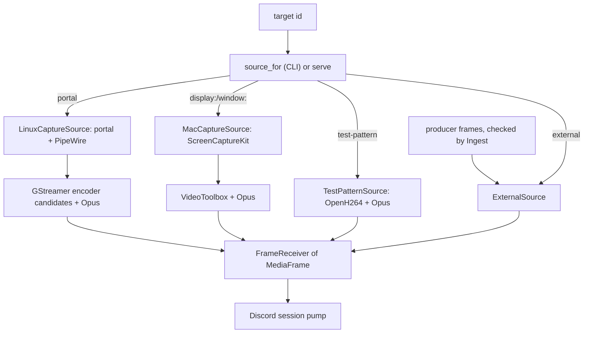

# Media and capture

## Overview

This component turns a target into encoded media for a session. Every source implements one trait, `CaptureSource`, and hands the session H.264 (or H.265) access units in Annex B form plus 20 ms Opus packets, on one timeline, through a bounded channel. Four sources exist: Linux capture through the xdg-desktop-portal ScreenCast and GStreamer, macOS capture through ScreenCaptureKit and VideoToolbox, the test pattern (test builds only), and the external source that `serve` feeds with producer media. The shared types live in `rust/crates/dstreamy-media`; the platform backends live in `rust/crates/dstreamy-capture-linux` and `rust/crates/dstreamy-capture-macos`. Windows has no native capture: there, `dstreamy` streams only from external producers such as the OBS plugin (`platform_source` returns `None` outside Linux and macOS, `rust/crates/dstreamy-cli/src/capture.rs`).

## Responsibilities

- Define the source interface (`CaptureSource`, `CaptureConfig`, `MediaFrame`) and the error type `MediaError`.
- List targets and audio devices per platform.
- Capture, scale, crop and encode video at the requested size, frame rate and bitrate, with a 2 s keyframe interval and no B-frames.
- Capture system audio and encode it as 48 kHz stereo Opus in 20 ms frames.
- Answer keyframe requests from the session.
- Validate producer media and turn it into session media on a continuous timeline (external source).
- Bound every queue between capture and the session and count what is lost.
- Report capture drops and audio activity for health.

## Architecture

`source_for` in `rust/crates/dstreamy-cli/src/capture.rs` picks the test pattern for `test-pattern` and the platform source otherwise. `serve` builds an `ExternalSource` for the `external` target (`rust/crates/dstreamy-cli/src/engine.rs`). The session reads the receiver in `rust/crates/dstreamy-discord/src/stream/pump.rs`.

## Key files

`rust/crates/dstreamy-media`:

- `src/source.rs`: `CaptureSource`, `CaptureConfig`, `CaptureDrops`, `FRAME_CHANNEL_CAPACITY` (64).
- `src/frame.rs`: `MediaFrame`, `EncodedVideoFrame`, `AudioFrame`, `VideoCodec` and the Opus constants.
- `src/target.rs`: `CaptureTarget`, `TargetKind`, `AudioSource`, `AudioSourceKind`.
- `src/encoder.rs`: `VideoEncoder` and `AudioEncoder` traits for backends that encode raw frames, plus the crate-private `I420Frame`, which exists only with the `openh264` feature.
- `src/opus.rs`: `OpusEncoder` over `unsafe-libopus`.
- `src/audio_clock.rs`: `AudioClock`, forward-only sample-count pts for captured audio.
- `src/h264.rs`: `OpenH264Encoder`, only with the `openh264` feature.
- `src/test_pattern.rs`, `src/test_pattern/generator.rs`: `TestPatternSource` and its generator thread.
- `src/external.rs`: `ExternalSource`, `ExternalHandle`, `Attachment`, timeline, grace, stall, idle and queue policy.
- `src/ingest.rs`: `Ingest`, the per-attachment checks on producer frames.
- `src/annexb.rs`: Annex B helpers (NAL iteration, AVCC conversion, keyframe detection).
- `src/activity.rs`: `AudioActivity`, silence and device-loss tracking.
- `src/error.rs`: `MediaError`.

`rust/crates/dstreamy-capture-linux`:

- `src/source.rs`: `LinuxCaptureSource`, the single `portal` target, restore token handling.
- `src/portal.rs`: `PortalStream`, the ScreenCast session through `ashpd`.
- `src/encoder.rs`: encoder order (`H264_ORDER`, `H265_ORDER`), per-element properties and the installed candidates.
- `src/pipeline.rs`: the GStreamer pipeline and candidate fallback.
- `src/pipeline/caps.rs`, `src/pipeline/elements.rs`: config checks, caps and element helpers.
- `src/pipeline/audio_branch.rs`: the audio branch, its rebuilds and device pinning.
- `src/pipeline/bus.rs`: the bus watcher.
- `src/audio.rs`: audio device listing and device-name checks.

`rust/crates/dstreamy-capture-macos`:

- `src/source.rs`: `MacCaptureSource`, ScreenCaptureKit stream and output handlers.
- `src/vt.rs`: `VtEncoder`, the VideoToolbox compression session.
- `src/video.rs`: `VideoState`, the last-frame re-encode for keyframes and static screens.
- `src/sink.rs`: the encoder sink that drops deltas after a loss, and `KeyframePacer`.
- `src/liveness.rs`: `PresenceWatch` and `Presence`, when and on which thread to check that the captured target still exists.
- `src/audio.rs`: float-to-stereo conversion and `AudioPacketizer`.
- `src/dimensions.rs`: `CaptureDimensions`, output size and crop region.
- `src/targets.rs`: `TargetId` (`display:<id>`, `window:<id>`) and the window filter.

## The source interface

`CaptureSource` (`rust/crates/dstreamy-media/src/source.rs`) has these methods:

| Method | Meaning |
|---|---|
| `list_targets` | Targets this backend can capture. |
| `list_audio_sources` | Audio devices `CaptureConfig::audio_source` may name; empty by default. |
| `audio_activity` | An `AudioActivity` handle, or `None` if the backend cannot tell. |
| `capture_drops` | Video and audio frames lost inside the source since the latest successful start; kept while idle. |
| `start(config)` | Starts capture and returns a `FrameReceiver`. Fails with `MediaError::AlreadyRunning` if not stopped first. |
| `stop` | Stops capture and closes the receiver; a no-op when idle. |
| `request_keyframe` | Asks the encoder for a keyframe as soon as possible. |

There is no restart method. A restart is `stop` followed by `start` on the same value. The receiver closes when the source stops or fails. On Linux and macOS, `stop` then returns the failure that ended the capture.

`CaptureConfig` carries `target_id`, `crop`, `width`, `height`, `fps`, `bitrate_bps`, `codec`, `audio`, `audio_source` and `audio_gain`. The default is 1280x720, 30 fps, 2.5 Mbit/s, H.264, audio on. `keyframe_interval_frames` is `fps * 2`.

What the session gets from every source (`rust/crates/dstreamy-media/src/frame.rs`):

- `EncodedVideoFrame`: one access unit in Annex B form; keyframes carry their parameter sets. `pts_us` is nonnegative microseconds on the source's timeline.
- `AudioFrame`: one Opus packet of 20 ms, 48 kHz stereo (`OPUS_SAMPLE_RATE`, `OPUS_CHANNELS`, `OPUS_FRAME_SAMPLES` = 960), on the same timeline as video.
- H.264 output is Constrained Baseline or Baseline from native encoders; H.265 is Main. The CLI labels H.265 experimental (`rust/crates/dstreamy-cli/src/stream.rs`). The external source accepts H.264 only.

The pump calls `request_keyframe` on viewer PLIs, at most once per 500 ms, and again 500 ms after DAVE comes up (`VIEWER_KEYFRAME_INTERVAL`, `DAVE_KEYFRAME_DELAY` in `pump.rs`). It also asks on attach and after lost or overflowing video, at most once per second, or 250 ms after a lost keyframe (`KEYFRAME_RETRY`, `KEYFRAME_RETRY_SOON`).

## Linux

### Portal flow

Linux offers one target, `portal`; the ScreenCast dialog picks the monitor or window (`PORTAL_TARGET_ID`, `rust/crates/dstreamy-capture-linux/src/source.rs`). Any other `target_id` is an `InvalidConfig` error.

`PortalStream::open` (`src/portal.rs`):

1. Connects to the ScreenCast portal and creates a session. A connect failure names the portal backends to install (`xdg-desktop-portal-gnome`, `-kde`, `-wlr`, `-hyprland`).
2. Subscribes to the session's `Closed` signal before the picker shows.
3. Selects sources: monitor or window, one stream, cursor `Embedded` if the portal offers it, else `Hidden`, persist mode `ExplicitlyRevoked`, and the restore token if one is held.
4. Starts the session and takes the first stream's PipeWire node id and size.
5. Opens the PipeWire remote and returns its fd.

Dismissing the dialog maps to `MediaError::Cancelled`.

Restore tokens: `with_restore_token` passes a saved token, so a still-valid token skips the picker. After each portal start the source replaces its token with the one the portal returned, even when that is none and even when the pipeline then fails, because the portal spends the token it was given. The CLI wraps the source in `TokenReporting`, which reports the token after every start (also a failed one) and stop. Every frontend saves a changed token into `config.toml` when the session stops, which also covers a capture that fails to start, because the session accepts the start before the source runs and reports the failure as a stop as `CaptureTarget::Portal { restore_token }` (`remember_portal_token`, `PortalBook` in `rust/crates/dstreamy-cli/src/capture.rs`).

When the portal session closes on its own (window closed, "stop sharing", revoked permission), a watch task ends the capture with "the shared window or screen went away; start again to pick a new one" (`SOURCE_GONE`, `src/pipeline.rs`). The source then forgets its restore token, so the next start shows the picker rather than restoring the same monitor.

### Pipeline

The video chain (`build` in `src/pipeline.rs`):

`pipewiresrc` → leaky `queue` (3 buffers, `leaky=downstream`) → `videorate` → optional `videocrop` + caps → `videoconvert` → `videoscale` → caps (fit inside the configured size, never upscale, square pixels, even sizes, the configured fps) → encoder → profile caps → `h264parse`/`h265parse` (`config-interval=-1`) → byte-stream, access-unit caps → `appsink`.

`pipewiresrc` gets the portal fd and node id, `do-timestamp=true`, a keepalive of one frame interval and `on-disconnect=error`, so a destroyed link ends the capture instead of repeating the last frame ([specs](../specs.md#platform)). The appsink stamps each access unit with its running time in microseconds, never going backwards, and marks a buffer without `DELTA_UNIT` as a keyframe. `request_keyframe` pushes an upstream force-key-unit event with all headers.

Config checks before start: fps in 1..=240, output and crop at least 2x2. A crop that does not fit the source is an `InvalidConfig` error.

### Encoder selection

Candidates are tried best first, limited to installed factories (`src/encoder.rs`):

| Codec | Order |
|---|---|
| H.264 | `vah264enc`, `vah264lpenc`, `vaapih264enc`, `nvh264enc`, `x264enc` |
| H.265 | `vah265enc`, `vah265lpenc`, `vaapih265enc`, `nvh265enc`, `x265enc` |

The GPU's VA plugin comes first, its low-power entrypoint second (the only one Intel Gen12+ and Arc expose), the older `vaapi` elements next, NVENC after that and software last ([ADR 0006](../adr/0006-gstreamer-element-selection.md)). Each element gets CBR at the configured bitrate, a GOP of `fps * 2`, zero B-frames and its low-latency preset (VA `target-usage=7`, `vaapi` `tune=low-power`, NVENC `zerolatency` and `low-latency-hq`, x264 and x265 `zerolatency` and `ultrafast`). Hardware elements take NV12, software elements I420. A property the installed element lacks is skipped.

`Capture::start_with` builds a pipeline per candidate, each with its own channel so frames of a failed attempt never reach the receiver. A candidate is accepted once the first encoded frame (and the first audio buffer, if audio is on) arrives or 3 s pass without an error (`PROBE_TIMEOUT`). A negotiation or encoder error moves on to the next candidate. A bad crop, a vanished source, an audio failure or a capture that ends before its first frame is fatal and stops the search. With no candidate installed, the error names the packages to install (`no_encoder`).

### Audio

System audio comes from `pulsesrc` (through pipewire-pulse) when installed, else `pipewiresrc` (`AudioInput::select`). Without a chosen device, `pulsesrc` captures `@DEFAULT_MONITOR@` and `pipewiresrc` the default sink. The branch is source → `audioconvert` → `volume` (`audio_gain`) → `audioresample` → appsink at S16LE, 48 kHz, stereo. `AudioPacketizer` cuts the PCM into 20 ms frames timestamped by sample count (`AudioClock` in `dstreamy-media`). When the buffer timestamps run more than 40 ms ahead, the clock jumps forward; when they fall 40 ms to 1 s behind, the overlapping samples are dropped, so audio pts never go backwards. A step back of more than 1 s is taken as a reset of the buffer clock: the clock re-anchors to the new timestamps instead of muting that long (`AUDIO_REANCHOR_US`), and drops that offset again once timestamps line up with the original timeline, so a single stray buffer leaves no lasting shift. Every generation of the Linux audio branch shares one clock, so a rebuilt branch continues after the last pts sent. Opus runs at 128 kbit/s.

`list_audio_sources` asks GStreamer's `pulsedeviceprovider`, monitors of output devices first (`src/audio.rs`).

A chosen device (`--audio-source`, `audio_source`) is pinned with `node.dont-fallback`, `node.dont-reconnect` and `node.dont-move`. Aliases such as `@DEFAULT_SOURCE@` are refused, and on `pulsesrc` so is a name that pipewire-pulse would read as a device index. On `pulsesrc` the sink also checks `current-device` and drops buffers once the server moved the stream elsewhere. Audio sources run with `provide-clock=false`, so the audio branch can be replaced while video keeps running.

After a device that was delivering audio is lost, the bus watcher rebuilds the audio branch by name with backoff from 500 ms up to 5 s, and logs "audio source … is back" under the `dstreamy::audio_device` target when samples return (`watch_bus`). A failure before any audio flowed ends the capture.

### Failure modes

| Case | Result |
|---|---|
| Portal missing or no backend | `Backend` error naming the portal packages. |
| Dialog dismissed | `MediaError::Cancelled`. |
| No encoder installed | `Unsupported` error naming the packages. |
| Every candidate fails | The last candidate's error. |
| Share ended by compositor or user | Capture ends with `SOURCE_GONE`. |
| Chosen audio device missing at start | Capture fails with an error; it never falls back to the default source. |
| Chosen audio device lost mid-stream | Audio reconnects by name; video keeps running. |
| Converter or encoder too slow | The leaky queue drops frames; a warning every 10 s at most. |

## macOS

### Permissions and targets

`MacCaptureSource` needs macOS 14 or later and the Screen Recording permission (`rust/crates/dstreamy-capture-macos/src/source.rs`). Listing shareable content without permission fails with "SCShareableContent (Screen Recording permission?)". Targets are displays (`display:<CGDirectDisplayID>`) and on-screen user windows (`window:<CGWindowID>`); `is_user_window` drops system chrome and windows smaller than 50 points (`src/targets.rs`). Without a `target_id` the first display is captured.

### ScreenCaptureKit configuration

`start` resolves the content filter, computes `CaptureDimensions` (fit the source or crop into the requested size, keep aspect, never upscale, even sizes) and configures the stream:

- Output width and height from `CaptureDimensions`, BGRA pixels, `scales_to_fit`, cursor shown.
- Queue depth 4 (`QUEUE_DEPTH`), one more than the default, so the retained last frame does not starve capture.
- Minimum frame interval `1/fps`.
- Audio when `config.audio` is set: 48 kHz, 2 channels, the process's own audio excluded.
- A crop becomes the stream's `source_rect`, in points.

Only complete frames are encoded. Both outputs share one clock: pts are microseconds since the first sample of either kind.

### VideoToolbox settings

`VtEncoder` (`src/vt.rs`) sets these required properties:

| Property | Value |
|---|---|
| `ProfileLevel` | H.264 Baseline AutoLevel, or HEVC Main AutoLevel |
| `AverageBitRate` | `bitrate_bps` |
| `RealTime` | true |
| `AllowFrameReordering` | false |
| `MaxKeyFrameInterval` | `fps * 2` |

`DataRateLimits` (1.5x the bitrate per second) and `ExpectedFrameRate` are set as hints; their failure is ignored. Output is converted from AVCC to Annex B, with the parameter sets prepended on sync samples. A keyframe is forced on request and after a frame was lost to back-pressure, at most once per 500 ms for losses (`MIN_FORCED_KEYFRAME_GAP` in `src/sink.rs`). After a lost access unit the sink drops every later one until the encoder delivers a keyframe, because those deltas reference the lost frame.

ScreenCaptureKit sends no frames while the screen is static. A refresher thread polls every 50 ms and re-encodes the last frame as a keyframe after 2 s idle, or 100 ms after a keyframe request that no new frame served (`IDLE_KEYFRAME`, `REQUEST_GRACE` in `src/video.rs`). Whether ScreenCaptureKit reports an error when a captured window closes is not verified, so the capture also checks for itself: once no complete frame has arrived for 2 s, or right after a frame with status `Stopped`, the target is looked up in `SCShareableContent`, then every 2 s while frames stay away. Lookups run on a thread of their own, one at a time, so a slow one never delays keyframes; a `Stopped` frame seen during a lookup makes another one run right after, and a lookup that fails or panics counts as inconclusive. Once a requested stop begins, lookup results are ignored, so the stop returns cleanly. Only a lookup that succeeds without listing the target ends the capture; off-screen windows count as listed, so a minimized window keeps streaming (`src/liveness.rs`). Known limit: an app that hides its window instead of closing it (to the menu bar or tray) keeps it listed, so the last picture stays up until the window comes back or the stream is stopped.

### Audio

Core Audio float buffers become interleaved stereo `i16` (mono is duplicated) with `audio_gain` applied (`stereo_i16_from_f32`). `AudioPacketizer` cuts them into 20 ms frames with continuous timestamps, using the same forward-only `AudioClock` as Linux; Opus runs at 128 kbit/s (`src/audio.rs`). Microphone output is ignored. Choosing an audio device is not supported: a set `audio_source` fails start with an `InvalidConfig` error that says to remove it.

### Failure modes

| Case | Result |
|---|---|
| No Screen Recording permission | `Backend` error from `SCShareableContent`. |
| Target gone | `InvalidConfig` "capture target … not found". |
| Stream stops with an error | The delegate records it and closes the receiver; `stop` returns it. |
| Captured window or display goes away | Capture ends with "the shared window or display went away; pick another one and start again" (`SOURCE_GONE`) once a lookup no longer lists it, about 2 s after the last frame. A window hidden to the menu bar or tray is still listed and is not detected. |
| 30 encodes fail in a row | Capture ends ("video encoding failed … times in a row"); a single failure asks for a keyframe. |
| 30 encoder callbacks in a row with no usable frame | The encode returns an error (`LOST_FRAME_LIMIT`). |
| A failed source started again | The dead stream is shut down first; no `AlreadyRunning`. |

## Test pattern

`TestPatternSource` (`rust/crates/dstreamy-media/src/test_pattern.rs`) streams a moving pattern encoded as H.264 Baseline by `OpenH264Encoder`, plus a 440 Hz tone as Opus at 128 kbit/s. It offers one 1280x720 display target, `test-pattern`. `new` paces frames in real time; `unpaced` produces as fast as the receiver reads. It encodes H.264 only.

The encoder is a source build of OpenH264 and exists only with the `dstreamy-media/openh264` feature, which `dstreamy-cli`'s `test-pattern` feature (and `test-hooks`) turns on. Release builds ship no OpenH264, because Cisco's royalty coverage applies only to its own binary module ([ADR 0010](../adr/0010-openh264-licensing.md)). Without the feature `TEST_PATTERN_AVAILABLE` is false, `list_targets` is empty, and `start` fails with "this build has no H.264 software encoder, so the test pattern is unavailable; stream a display, window or portal target instead".

## External source

The external source is the `external` target that only `serve` accepts (`EXTERNAL_TARGET_ID`, `rust/crates/dstreamy-media/src/external.rs`). Producers reach it through the IPC producer role; the transport and the plugin side are in [service-and-ipc.md](service-and-ipc.md) and [obs-plugin.md](obs-plugin.md). Design: [ADR 0004](../adr/0004-persistent-service-and-external-producers.md).

Path of one producer frame:

1. `serve` reads a frame and runs it through `Ingest` (`admit` in `rust/crates/dstreamy-cli/src/serve/producer.rs`). A failed check detaches the producer with the error message.
2. The checked frame becomes a `ProducerFrame` and goes to `Attachment::send`, which never blocks.
3. The source rewrites pts onto its outgoing timeline and queues a `MediaFrame`.
4. A drive task moves queued frames into a one-slot channel, the receiver the session reads.

`Ingest` checks (`src/ingest.rs`):

- Video starts with an Annex B start code. A keyframe carries an IDR slice with SPS and PPS before it; an IDR in a frame not flagged as a keyframe is refused.
- Video pts strictly increase, so B-frames are refused.
- Audio is valid Opus of exactly 20 ms, at most 1500 bytes, with strictly increasing pts.
- No pts jumps more than 10 s from the previous frame.

Attach rules (`ExternalHandle::attach`, `check_producer`): the producer's `hello` must declare H.264 and a size and fps that `Resolution` and `Fps` accept. One producer attaches at a time; a second gets `Busy` unless the first is fully stalled, in which case the first is closed as `Replaced`. Every attach bumps the keyframe request counter that the producer watches.

Timeline and gating:

- Frames before the source's `start`, and video before the first keyframe of an attachment, are skipped.
- The first frames of an attachment are held until both tracks have a first pts or 500 ms pass (`FIRST_FRAMES_WAIT`). Then one offset for both tracks is fixed, so each track continues at or after its wall-clock-carried previous pts, rounded up to a whole millisecond.
- Output pts never go backwards per track: each is at least one RTP tick after the last (12 µs video, 21 µs audio).
- After video loss the gate closes and asks for a keyframe. Without a keyframe within 2 s (`RESYNC_BOUND`) the producer is detached with "no keyframe within 2 s after video loss; restart the producer and set its keyframe interval to at most 2 s".

Absence, stall and idle (`ExternalOptions`, from `[serve]`):

- `stall` (default 2 s, between 500 ms and 600 s): no media for that long marks the producer stalled. Audio arriving `stall` after the last video frame marks a video-only stall.
- `grace` (default 30 s, at most 3600 s): time allowed with no producer, or a fully stalled one, before the capture ends. Each source `start` resets it. A video-only stall does not consume it.
- `idle` after a detach: `Documented` (default) sends up to five Opus silence packets `F8 FF FE` 20 ms apart; `None` sends nothing; `Continuous` sends one every 20 ms. Silence is stamped on the same timeline.

`crop`, `audio_gain` and a non-`external` `target_id` are ignored for this source and logged once. `SourceState` (`Detached`, `Producing`, `Interrupted` with `Detached`, `Stalled` or `VideoStalled`) feeds `status` and `source` events through `ExternalHandle::state`.

## Bounded queues, drops and back-pressure

| Queue | Bound | When full | Counted in |
|---|---|---|---|
| Source frame channel (native sources, test pattern) | 64 frames (`FRAME_CHANNEL_CAPACITY`) | Linux appsink retries every 1 ms until stop; macOS drops the frame and the video after it until the next keyframe; the test pattern retries every 1 ms | macOS `capture_drops` |
| Linux pre-encode `queue` | 3 buffers, `leaky=downstream` | Drops one buffer per overrun | `capture_drops().video_frames` |
| External source queue | 63 frames or 64 MiB of payload (`QUEUE_MAX_BYTES`) | Drops queued video up to a keyframe, else the oldest audio; idle silence never displaces video | `SourceStats`, `AttachmentStats` |
| External source output channel | 1 frame | The drive task waits | — |
| External held first frames | Same as the queue | Released early | — |

On the external queue, a non-keyframe that meets a full queue is dropped with all queued video. A keyframe can displace older video and audio. Losing the current attachment's video without a newer queued keyframe closes the gate and requests a keyframe; the count is `overflow_keyframe_requests`. These sizes follow [ADR 0009](../adr/0009-bounded-queues.md); the plugin's own ring is described in [obs-plugin.md](obs-plugin.md).

What feeds health:

- `capture_drops`: Linux reports pre-encode video drops; macOS reports video frames and Opus packets lost to a full channel. The pump samples them (`sample_capture_drops` in `pump.rs`).
- `AudioActivity`: when audio last carried sound (samples at or below 32, about -60 dBFS, count as silence) and device losses and recoveries. Linux provides it; macOS and the test pattern do not.
- `ExternalHandle::stats`: lost frames per attachment and track, queue length now and at its highest, overflow keyframe requests.
- The pump's own keyframe request count.

## Testing

Unit tests sit next to the code in each crate. Integration tests:

- `rust/crates/dstreamy-media/tests/test_pattern.rs`: decodable keyframe-led H.264, 20 ms Opus, forced IDR, stop and restart, pacing, rejected configs. Runs with the `openh264` dev feature.
- `rust/crates/dstreamy-media/src/external/tests.rs` with `proptest-regressions/external/tests.txt`: timeline, gating, grace, stall, idle and queue policy.
- `rust/crates/dstreamy-media/tests/ingest_recovery.rs`: a rejected packet does not poison the pts history; the 10 s jump boundary.
- `rust/crates/dstreamy-media/tests/obs_traces.rs`: parses `obs/tests/traces` and checks them against the OBS rows of [specs.md](../specs.md#obs): Annex B with SPS/PPS on every IDR, IDR spacing, pts = dts with `bf=0`, 20 ms Opus with priming, and that every Opus trace without B-frames passes `Ingest`.
- `rust/crates/dstreamy-cli/tests/trace_replay.rs`: `serve`, mock Discord and `mock-producer --replay` stream the same traces end to end. CI runs it outside nextest with `DSTREAMY_TRACE_REPLAY_STRICT=1`.
- `rust/crates/dstreamy-capture-linux/tests/portal.rs`: ignored by default; needs a desktop session and a pick in the dialog. Checks decodable video, audio and a restore token.
- `rust/crates/dstreamy-capture-macos/tests/videotoolbox.rs`: H.264 and H.265 keyframes with parameter sets, forced keyframes, sink delivery, size checks.
- `rust/crates/dstreamy-capture-macos/tests/screencapture.rs`: ignored by default; needs Screen Recording permission.

The Linux pipeline tests in `src/pipeline.rs` and `src/pipeline/` use `videotestsrc` and `audiotestsrc` in place of the portal.

## Related decisions

- [ADR 0001: Rust rewrite](../adr/0001-rust-rewrite.md) — PipeWire + GStreamer on Linux.
- [ADR 0004: Persistent service and external producers](../adr/0004-persistent-service-and-external-producers.md) — external source, ingest rules, grace, stall, idle.
- [ADR 0006: GStreamer element selection](../adr/0006-gstreamer-element-selection.md) — encoder order, audio source, device pinning.
- [ADR 0009: Bounded queues](../adr/0009-bounded-queues.md) — ring and source queue sizes.
- [ADR 0010: OpenH264 licensing](../adr/0010-openh264-licensing.md) — test pattern in test builds only.
- [specs.md: Platform](../specs.md#platform) — `pipewiresrc` disconnect, portal `Closed`, gst-va low-power elements, leaky queue overruns, VideoToolbox teardown.
- [specs.md: H.264](../specs.md#h264) and [Opus](../specs.md#opus) — bitstream and packet rules.
