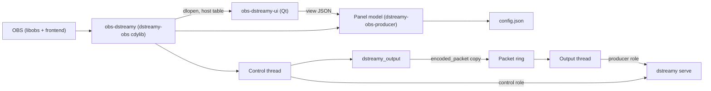
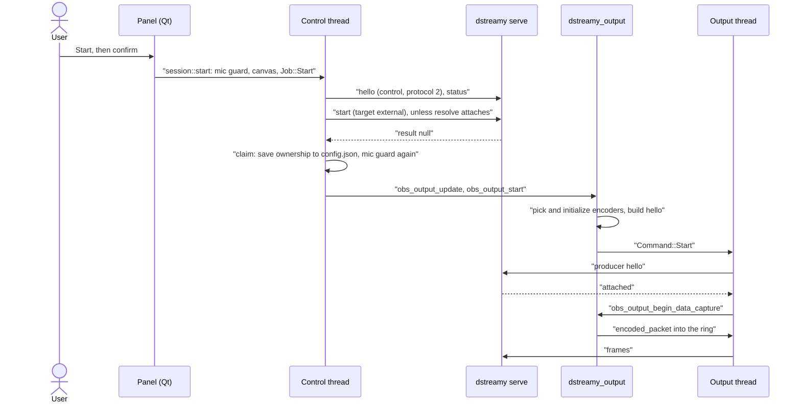
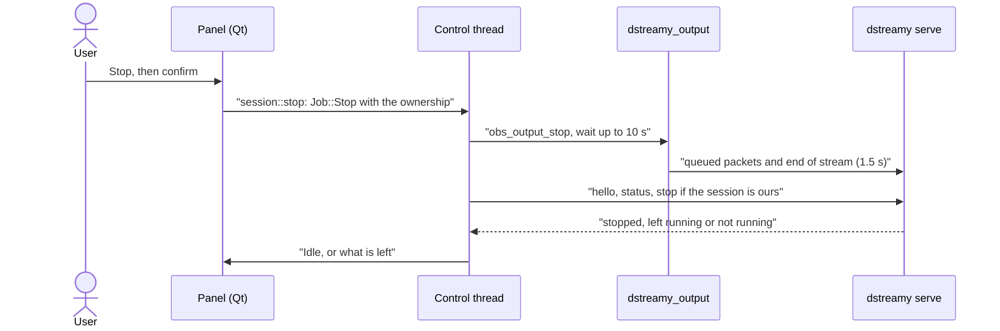

# OBS plugin

## Overview

D-Streamy for OBS is the module `obs-dstreamy`. It sends OBS's encoded H.264 and Opus to `dstreamy serve` over the local IPC endpoint. It registers its own encoded output, `dstreamy_output`, next to OBS's normal stream, so a Twitch or other stream keeps running untouched. The plugin holds no Discord code and no token: it is a control client that starts and stops the session, and a producer that feeds it (`rust/crates/dstreamy-obs/src/output.rs`, ADR 0004). It runs on stock OBS. libobs is never patched or forked (CLAUDE.md, "Stock OBS only").

What a user sees:

- **The panel's status-bar item.** One button in OBS's status bar (`statusBar()->addPermanentWidget`, `obs/ui/dstreamy-ui.cpp`). It shows a coloured state dot, four counters with monochrome icons (missed frames, audio state, reconnects, viewers) and the stream's duration last. Bitrate and fps are in the tooltip (`rust/crates/dstreamy-obs-producer/src/status_bar.rs`, ADR 0007).
- **The panel's popup.** Clicking the item, or Tools > D-Streamy…, opens the popup. It has the state line with its fix (while live, a detail line with bitrate, fps and duration), the account row, the server and voice channel pickers, the managed track section and Start or Stop (`PanelView` in `rust/crates/dstreamy-obs-producer/src/panel.rs`). Start asks `Go live in <channel> on <server>?` (with `as <account>` when serve has several accounts); Stop asks `Stop the Discord stream?`.
- **The settings dialog fallback.** When the Qt library is missing or refuses to load, Tools > D-Streamy… opens OBS's stock properties dialog for the private source `dstreamy_settings` instead. It shows the same model: account, login, server, channel, track and sources (`rust/crates/dstreamy-obs/src/settings_source.rs`, `frontend.rs`).
- **The managed track and the takeover confirm.** The plugin asks before it takes over the managed track (Track 6 by default) on the audio sources of a scene collection. Go Live is held back while that track is unmanaged and a microphone feeds it (see [Audio and the managed track](#audio-and-the-managed-track)).

## Architecture

- **libobs module** (`dstreamy-obs`): the entry points libobs looks up, the output, the settings source, the audio track logic and the frontend hooks. It links libobs only. It looks up obs-frontend-api at runtime, so a libobs-only host still loads it (`frontend.rs`).
- **Qt UI library** (`obs-dstreamy-ui`): the status-bar item and the panel, in C++/Qt (`obs/ui/dstreamy-ui.cpp`). The module loads it at runtime and hands it a host table of callbacks. The UI renders the JSON view the Rust model builds.
- **Producer half** (`dstreamy-obs-producer`): everything that needs no libobs. That is the panel model, the control client, the producer client, the packet ring, the settings rules and the Windows launcher.
- **Control thread** (`dstreamy control`, `session.rs`): runs every service call (lists, start, stop, login, account changes) and alone creates, starts, stops and releases the output.
- **Output thread** (`dstreamy output`, `worker.rs`): one per output. It connects as a producer, begins data capture, writes packets from the ring and raises every stop signal. None of this runs on an OBS thread.

`obs_module_load` registers the output and the settings source, installs the audio hooks, installs the Windows launcher, starts the control thread, reads the saved settings and, when OBS's frontend is present, loads the UI and adds Tools > D-Streamy… (`rust/crates/dstreamy-obs/src/lib.rs`). Every function libobs calls goes through `guard`, which catches panics so none unwinds into OBS (`guard.rs`, ADR 0004).

## Crates and directories

| Path | What it is |
|---|---|
| `rust/crates/dstreamy-obs` | The libobs module, a `cdylib` named `dstreamy_obs`, laid out as `obs-dstreamy`. |
| `rust/crates/dstreamy-obs-sys` | bindgen bindings for the libobs headers, `obs/ui/dstreamy-ui.h` and, when present, `obs-frontend-api.h` (`wrapper.h`). |
| `rust/crates/dstreamy-obs-producer` | The libobs-free half: `ring`, `client`, `control` (`ObsControl`), `model` and `panel_config` (model and persistence), `panel`, `state_view`, `status_bar`, `live`, `mixer`, `settings`, `launch`. |
| `rust/crates/dstreamy-obs-packet` | Dependency-free conversion of OBS `encoder_packet`s to producer frames, shared with `mock-producer`. |
| `obs/` | The obs-plugintemplate CMake project: `CMakeLists.txt`, `CMakePresets.json`, `buildspec.json`, `cmake/` (with `cmake/common/rust_plugin.cmake` driving cargo). |
| `obs/ui/` | The Qt status-bar item and panel, its icons and its test (`tests/ui-test.cpp` with a fake frontend). |
| `obs/harness/` | `obs-harness`, a headless libobs host, plus two fake frontends (`fake-frontend.c`). |
| `obs/tests/` | Recorded traces (`traces/`), encoder settings fixtures (`encoder-settings/`), the frontend smoke test (`frontend/`) and the checker scripts. |

**Why its own workspace.** Building the module needs libobs, so `rust/crates/dstreamy-obs/Cargo.toml` declares its own `[workspace]` with `dstreamy-obs-sys` as a member. That keeps it out of `cargo test --workspace` in `rust/`. It is built only through `obs/`. `dstreamy-obs-producer` and `dstreamy-obs-packet` stay in the `rust/` workspace, so their tests run without libobs. The plugin workspace copies `[workspace.package]` and `[workspace.lints]` from `rust/Cargo.toml` by hand, because cargo cannot inherit across workspaces. `scripts/tag-release.sh` sets the version in both workspaces; the other fields are still copied by hand. Its release profile keeps `panic = "unwind"`, which `catch_unwind` needs (`docs/specs.md`, OBS).

**How bindgen finds OBS.** CMake writes `obs-config-<config>.txt` with the libobs include paths, defines and link library (`rust_plugin.cmake`). `dstreamy-obs-sys/build.rs` reads it from `DSTREAMY_OBS_CONFIG`. With `DSTREAMY_FRONTEND_ABI_CHECK` (on by default) the build fails unless `obs-frontend-api.h` is found, so the frontend calls are checked against OBS's own header (`obs/CMakeLists.txt`).

**Why the UI is a separate library.** The panel is made of `QWidget`s. The module itself never links Qt or obs-frontend-api. The Qt helper links the pinned Qt, and a helper built against a newer Qt minor than the user's OBS fails to `dlopen`. The plugin then still runs, with the settings dialog (`docs/specs.md`, obs-deps pin; `obs/README.md`).

**How the UI is found.** `ui.rs` takes the module's own path from `obs_get_module_binary_path` and loads:

| Platform | Path next to the module |
|---|---|
| Linux | `dstreamy-ui/obs-dstreamy-ui.so` |
| Windows | `dstreamy-ui/obs-dstreamy-ui.dll` |
| macOS | `obs-dstreamy-ui.dylib` in the bundle's `Contents/MacOS/` |

The subfolder exists because libobs tries every library in the module's own folder as a module (`obs/ui/CMakeLists.txt`). The UI loads only when the frontend exports `obs_frontend_get_main_window`. Both sides check `DSTREAMY_UI_ABI_VERSION`, now 6 (`obs/ui/dstreamy-ui.h`). A library and a plugin of different versions refuse each other, and Tools > D-Streamy… opens the settings dialog instead (ADR 0005, ADR 0007).

## How Start works

Step by step:

1. **On the UI thread** (`session::start`). If the session is idle and the mic guard holds, Start does nothing but log the reason and refresh the view. Without OBS video (`obs_get_video_info` fails) it shows "OBS has no video running…". Otherwise the model builds a `StartRequest` (server, channel, the canvas output size fitted to 1920×1080, the target fps and the per-start `grace_secs`) and queues `Job::Start` with the saved ownership.
2. **On the control thread** (`start_session`). `ObsControl::start_until` opens a fresh control connection. It sends `hello` with role `control` and protocol 2 and requires the feature `status_place`. It also requires `start_grace_secs` when a grace is set (`control/service.rs`). It reads `status` and then decides (`control::resolve`):
   - a live session this plugin started (same serve run, a matching `started_by`) is taken over wherever it is;
   - a live session elsewhere is refused (`Already live elsewhere`);
   - a live session in the picked channel with another target is refused too;
   - an external session in the picked channel is attached to without ownership;
   - with nothing live, it sends `start` with `target: "external"`, `resolution`, `fps`, `codec: "h264"` and optional `grace_secs`.

   `start`, `guilds` and `channels` may make serve log in to Discord first, so they wait 60 s for the reply (`DISCORD_TIMEOUT`), longer than serve's first-connect budget, and serve's own error shows instead of "Service not answering". `status`, `accounts` and the start's settle wait keep 10 s (`REPLY_TIMEOUT`), and `stop` 5 s (`STOP_TIMEOUT`). While the start waits on serve, the panel reads "Connecting to Discord…" and the status bar "D-Streamy connecting to Discord…"; once serve answered and the output starts, both say starting. The list loads run beside the serial control steps, so a slow one never holds up Start or Stop.

   **Cancel.** While starting, the main button reads "Cancel start". It, the status bar's button and the dialog's Stop ask "Cancel going live? D-Streamy ends the Discord session it is starting." with "Cancel start" and "Keep starting" (Enter keeps starting). On confirm the headline reads "Cancelling…" and the button is disabled until the start has ended. The control thread stops waiting on serve (`start_until`'s give-up future) or, if serve already answered, skips the output: it ends any session the start brought up and returns to Idle without a problem. If ending that session fails, the panel says it may still be live, keeps its ownership and asks for Start, then Stop.
3. **Ownership is saved before the reply.** Just before `start` goes out, the candidate ownership is recorded, because serve finishes a start whose connection went away. `claim` writes the ownership into `config.json`, checks the mic guard again against the track selected now and the sources' current mixer flags, and returns the output settings. The track picker and Advanced Audio Properties stay usable while the session comes up, so the check at Start isn't enough. If the guard holds, the output never starts (`refuse_mic`). The plugin ends a session it owns and leaves a session it only attached to running. The panel returns to Idle with the problem "Didn't start", the message "Go Live held back: <guard message>" and the fix "Manage the track, or take the microphone off it". The message ends with "Then press Start again" when no session it started is left running, and with "The Discord session it started is still live (<error>); press Start to use it again" when ending it failed; then its ownership stays saved. While the microphone still feeds the track, the panel and the dialog show the mic guard instead and Start stays disabled; a session left running is still named beside it: the panel's tooltip and the dialog add "The Discord session it started is still live (<error>); press Start to use it again" after the guard's message, without repeating the guard (`PanelModel::unended_start`, `MicGuard::beside`).
4. **The output starts** (`Output::start` in `session.rs`). The control thread creates `dstreamy_output` once, applies the settings and calls `obs_output_start`. libobs calls `output_start` on that thread. It picks the encoders, then calls `obs_output_can_begin_data_capture` and `obs_output_initialize_encoders` and checks the audio encoder. It builds the producer `hello` from the encoders and sends `Command::Start` to the output thread (`output.rs`).
5. **The output thread attaches** (`worker.rs`). It connects as a producer and waits for `attached`. Only then does it call `obs_output_begin_data_capture`. From there `client::run_reconnecting` writes the ring's packets and passes the service's viewer and health reports to the panel.
6. **Packets.** `encoded_packet` runs on OBS's encoder thread. It only counts the packet and copies it into the ring (`Output::enqueue`). The ring holds at most 256 packets or 32 MiB and evicts by the drop policy of ADR 0009 (`ring.rs`). A packet over the frame limit is kept as its size only and refused by the writer.
7. The model turns Live, and the status bar shows the counters (`live.rs`, `status_bar.rs`).

**Encoders** (`encoders.rs`). Audio is always the plugin's own `ffmpeg_opus`. Video is the plugin's own H.264 encoder (`obs_x264` and 6000 kbps by default), unless `mode` is `share` and the running stream's encoder passes the rules in `dstreamy-obs-producer/src/settings.rs`. Without a passing encoder, or with no stream running, it falls back to its own when `share_fallback` is set. Otherwise the start fails with the reason, for example "D-Streamy can share the stream's encoder only while streaming: start streaming first, or use D-Streamy's own encoder". These settings are fields of `config.json` (`mode`, `video_encoder`, `bitrate_kbps`, `share_fallback`) and properties of `dstreamy_output`. Neither the panel nor the settings dialog shows them. The rules and their sources are in [ADR 0004](../adr/0004-persistent-service-and-external-producers.md) and [docs/specs.md](../specs.md).

**Share mode follows OBS's stream** (`frontend.rs`, `encoders.rs`, `session.rs`):

- On `OBS_FRONTEND_EVENT_STREAMING_STARTING`, on the UI thread, the plugin takes `obs_frontend_get_streaming_output` and keeps only weak references to that output and its video encoder. It releases the output at once. So a Settings Apply that rebuilds the frontend's encoders frees the old ones, and the next start finds none.
- A start in share mode upgrades those weak references. It shares the encoder only while the streaming output is active (the stream has connected, which a recording on the same encoder doesn't fake), the encoder is active, and it passes the rules.
- A multitrack stream is never shared. Enhanced Broadcasting is recognised by a second video encoder, or, when the service configures one video track, by the names OBS gives its output (`rtmp multitrack video`, `flv …`, `mp4 …`) and encoders (`multitrack video video encoder N`) (`frontend/utility/MultitrackVideoOutput.cpp:134-152`, `:236`). The output type's multitrack flag doesn't count, since `rtmp_output` sets it for every stream. The start falls back or is refused with "D-Streamy can't share the encoders of a multitrack stream: turn off multitrack video (Enhanced Broadcasting) in Settings › Stream, or use D-Streamy's own encoder".
- On `_STOPPING`, or on `_STOPPED` alone (a failed or lost stream sends no `_STOPPING`), the plugin forgets the stream. A start that fails at once sends neither event; the inactive streaming output then keeps its encoder from being shared. If D-Streamy's output was started on the encoder, capturing or still attaching to serve, the control thread stops the output and starts it again with the same settings. It waits for both the output to go inactive and its stop signal, which libobs may send in either order, and that stop doesn't end the session. A stop with an error that comes before or during the restart ends the session with its own error instead. The new start finds no stream encoder, so it uses the plugin's own, and the Discord session stays live: the producer detaches and reattaches within serve's grace period, and video resumes at the next keyframe. With `share_fallback` off, the restart is refused and the plugin ends the Discord session with `D-Streamy stopped: <reason>. Press Start to go live again`.
- A stream that starts while D-Streamy is live on its own encoder does not move it to the shared one. The next Start shares it.
- Once the output is inactive, the control thread clears its video encoder, so the plugin never keeps a strong reference to the frontend's encoder between starts.
- Without a frontend (a libobs-only host such as `obs-harness` without `--fake-frontend`), the candidate is a video encoder the host attached to `dstreamy_output` itself.

**Start errors** name the OBS setting to change, using the frontend's own labels (`docs/specs.md`, "Settings paths in start errors"). If the output fails after serve started a session, the plugin ends that session. If ending it fails, the panel says the Discord session is still live and keeps Stop.

### Stop

1. Stop asks `Stop the Discord stream?`. `session::stop` takes the saved ownership from the model and queues `Job::Stop`.
2. `stop_session` stops the output first (`obs_output_stop`) and waits up to 10 s for it to end (`OUTPUT_STOP_WAIT`). The output thread sends the queued packets and the end of stream within 1.5 s (`client::STOP_DEADLINE`).
3. Then `ObsControl::stop` sends `stop`, but only while the live session is still the one the ownership names. A session someone else started keeps running (`Stopped::LeftRunning`). Stop never starts a serve. The `stop` waits 5 s for its reply (`STOP_TIMEOUT`).
4. If either part fails, the panel says what is left. For example: "The Discord session may still be live: press Start to take it over, then Stop again".

When the output stops without the plugin's own Stop, libobs signals `stop`. The control thread waits for the output to go inactive. The plugin's own stops leave Live before that signal is handled, so a stop that finds the session Live always gets a reason, and unless serve ended it, the plugin ends its Discord session if it still runs (`Job::OutputStopped`):

- An error code (an encoder error, a lost service) shows `D-Streamy stopped: <reason>. Press Start to go live again`.
- Serve ended the session (`detached` with `stopped` or `shutdown`): the output sets the panel's text as its last error, marks its stop signal as the service's and stops cleanly. The plugin sends no `stop`, since serve already ended the session and may still be tearing down. The panel goes Idle and picks its headline, fix and next step from the detach's `code` (`DetachReason::session_end` in `types.rs`): `invalid_token` asks to log in again and offers the login button, `identify_limit` says when to try again (from `retry_after_secs`) under the headline "Discord logins paused", the same one a start refused with `identify_limit` shows, `e2ee_unavailable` points at `require_e2ee`, `voice_taken_over` asks to leave voice on the other device, `gave_up` and `gateway_closed` to check the network, `capture_ended` to check OBS's output, `source_failed` and `task_ended` to read the D-Streamy log. A shutdown, `requested`, `grace_expired`, other and unknown codes end with "Press Start to go live again". The text names serve's reason, for example "The Discord session ended: another device of this account joined voice. Leave voice on the other device, then press Start"
- A clean stop the service didn't cause came from outside the plugin, for example obs-websocket's `StopOutput` or a script: the panel says so and the plugin ends the Discord session, which would otherwise stream a frozen picture until serve's grace period ran out. If ending it fails, the panel keeps Stop and says the session may still be live; a further stop signal then leaves that message alone.

The worker tags each stop signal with the start it ends, so a late signal from an earlier start (after a Stop that timed out) can't end a new session. A Stop or a share-mode restart that finds serve already ended the session (a marked signal of this start not handled yet) sends serve no `stop`, since serve may be tearing down and could not answer.

### OBS closing

The frontend's exit event comes before `obs_shutdown` stops audio and video. On it, `frontend.rs` calls `session::shutdown`. If the plugin is live, `stop_on_close` stops the output, then the Discord session. Service calls in flight get 5 s together (`CLOSING_GRACE`), and every control step, cleanup included, must finish within 10 s of the exit (`CLOSING_LIMIT`). If the session can't be ended in time, its ownership stays saved. The service's grace period then ends it, or the next Start takes it over and Stop ends it. On Windows, when the plugin started the service, unload shuts that service down, which ends the session, and the close log says so. A Start queued while OBS closes is refused ("OBS is closing, so D-Streamy did not start"). `obs_module_unload` shuts down the UI, the frontend hooks, the audio hooks and the control thread, and on Windows shuts down the serve the plugin started.

## Panel states and live figures

The model (`PanelModel` in `model.rs`) has four session states: `Idle`, `Starting`, `Live` and `Stopping`. The status-bar dot has five colours (`status_bar::State`):

| Dot | When |
|---|---|
| Idle | No session. |
| Busy | Starting or stopping. |
| Live | Live, and every counter is normal. |
| Degraded | Live, but a counter shows a problem or the service is reconnecting. |
| Error | Something needs the user: a service error, a failed start or output, the mic guard, or a settings file problem (`Tone::Attention` in `state_view.rs`). |

The Qt side polls the view every 500 ms (`poll_ms` in `obs/ui/dstreamy-ui.cpp`). `live.rs` takes rates from the output's own counters and adds the service's health reports. Each counter goes amber or red, and the tooltip says the same in words:

| Counter | Source | Amber | Red |
|---|---|---|---|
| Missed frames | Video dropped by the ring in OBS plus video lost in the service | Any in the last 10 s | 30 or more in the last 10 s |
| Audio | Opus frames per second reaching Discord, and whether a source feeds the track | No source feeds the track, or a dropout in the last 10 s | Fewer than 25 frames a second |
| Reconnects | The service's reconnect count | Reconnecting, or one in the last 60 s | 3 or more in the last 60 s |
| Viewers | The service's viewer count | – | – |

A figure nobody reported yet shows `–`. The tooltip also carries bitrate, fps and the encryption state: "End-to-end encrypted" or "Unencrypted: Discord can read this stream", with the DAVE version when serve reports one (`status_bar.rs`). Audio packets dropped in the OBS ring are listed apart from video losses (ADR 0004).

The output's `get_stats` proc returns its video and audio packet counts, caught panics and ring drops. The harness uses it to check that the plugin counted every video packet (`output.rs`, `docs/specs.md`).

## Accounts and login

The account row and the login button follow ADR 0005 (`session.rs`, `control.rs`):

- **Picking an account** sends `select_account`. It becomes the default account, for the CLI too. The pickers show the pending pick until serve answers, then reload the lists.
- **The server and channel are kept per account** in `config.json` (`account`, `picks`). On a switch, the plugin restores that account's last pick. A saved server the account is not in shows as not available, with "Pick the server again" and Start disabled.
- **Log out** asks `Log out <name>?` first, then sends `logout_account`.
- **Log in, Log in again, Add account…** send `login`, and serve opens its login window. "Log in again" names the active account, so it repairs that account. "Add account…" names none. The login runs as its own task, so the window can stay open without holding up Start, Stop or the lists. The plugin waits up to serve's 600 s window limit plus 30 s (`LOGIN_TIMEOUT`). While it waits, the login button turns into a cancel. Pressing it drops the request, and serve then closes the window.
- An older serve without the `accounts` feature gets no account row. The plugin keeps working with serve's active account.

## Audio and the managed track

The managed track is one of OBS's six mixer tracks. Discord hears every source that has it ticked. The plugin manages it so the mix has no microphone (ADR 0007, `rust/crates/dstreamy-obs/src/audio.rs`, `dstreamy-obs-producer/src/mixer.rs`).

- **Track 6 by default** (`DEFAULT_AUDIO_TRACK`). OBS's default stream and recording settings leave it unused (`model.rs`).
- **Per scene collection.** Which tracks are managed is saved in the collection's module data under `dstreamy.managed_mixers`, read in the frontend's preload callback and written in its save callback. A collection is never taken over without the confirm. A global "managed" flag was rejected: the mixer flags are per collection (ADR 0007).
- **Taking over.** The confirm says what changes (`take_over_effect`), with "Manage" and "Not now". On yes, the plugin turns the track off on every audio source and marks it managed. The user then ticks sources in the panel, and each tick changes the track in Edit › Advanced Audio Properties at once. Cancel in the dialog puts back the mixer flags it touched.
- **Mic guard.** `mixer::mic_guard` holds when the track Discord would hear is unmanaged and a microphone or Mic/Aux source feeds it. Start is then held back, with the headline "Discord would hear <names>" and the fix "Manage Track N". `claim` checks it once more just before the output starts, so a track picked or a microphone routed while the start is in progress can't slip through. Once live, the plugin never stops the stream for a microphone: if one reaches the track Discord hears (a mixer change, a new microphone source, or a switch to a scene collection where that track is unmanaged), it warns and keeps streaming. The status bar shows ⚠, the panel's headline says "Discord hears <names>" with the fix "Manage Track N", and the dialog shows the same warning. Video capture devices such as webcams are not checked (`MIC_CHECK`).
- **Stop managing.** A managed track that is not the one Discord hears offers "Stop managing Track N". That changes no mixer and says how to turn the track back on.
- **Migration.** Config version 2 moved settings still on Track 1, the old default, to Track 6 silently. A Track 1 picked or taken over on purpose stays (`PanelSettings::from_json`). A track managed under the old global setting is adopted by the first scene collection that loads without its own D-Streamy state, unless a microphone is on it (`adopt_managed_track`, `audio::collection_loaded`).

## Talking to serve

**Endpoint.** Both connections use `Endpoint::default_for_user()` (`dstreamy-ipc`). That is `$XDG_RUNTIME_DIR/dstreamy/serve.sock` on Linux, `dstreamy/serve.sock` under the per-user temporary directory on macOS, and the named pipe `\\.\pipe\dstreamy-serve-<user SID>` on Windows. The output's `endpoint` setting overrides it for the producer connection (`output.rs`). Flatpak OBS can't reach `$XDG_RUNTIME_DIR/dstreamy/` in its default sandbox, so Flatpak is not supported (`docs/specs.md`).

**Control client** (`ObsControl`). It opens a fresh control connection per call, so nothing outlives a call. Every call sends `hello` and requires `status_place`. Other features gate single actions:

| Feature | Without it |
|---|---|
| `start_grace_secs` | A start with a per-start grace fails with "Service out of date". |
| `browser_login` | No Log in button; the fix is `dstreamy login`. |
| `accounts` | The account row is hidden (ADR 0005). |

**Ownership across OBS restarts.** `Ownership` (`control.rs`) holds the serve run (`Instance`), the `started_by` connection ids of its starts and the place. On Unix the run is the socket file's device, inode and mtime, checked on both sides of the hello. On Windows it is the pid and start time that serve's hello names. Ownership is kept in `config.json` under `owned`, so a relaunched OBS still stops or takes over its session. Up to 8 lost starts of one serve run are remembered as candidates. Connection ids restart with serve, so only the same run's ids match.

**Saved settings.** `config.json` sits in libobs's per-module config folder (`obs_module_get_config_path`, `rust/crates/dstreamy-obs/src/config.rs`). It holds the server and channel per account (ADR 0005), the track, the encoder settings, `grace_secs` and the ownership. A corrupt or unreadable file, or a symbolic link, is never overwritten. The panel says why ("Settings file unreadable", "Settings file is a link") (`panel_config.rs`).

**Errors in the panel.** Each `ControlError` has a short headline and a fix (`control.rs`). Examples:

| Headline | Fix |
|---|---|
| Service not running | Run `dstreamy service install` (Linux), Run `dstreamy serve` (elsewhere) |
| Can't reach the service | Check that the service runs |
| Not logged in | Press Log in, or Run `dstreamy login` |
| Discord login expired | Press Log in again |
| Account in use | Stop the other D-Streamy first |
| Already live elsewhere | Stop that stream first |
| Server not found | Pick the server again |
| Service out of date | Update and restart the service |
| Service not answering | Run `dstreamy service status` (Linux), Check that `dstreamy serve` runs (elsewhere) |
| Try again | Press Start again |
| Service busy | Press Start again |
| Can't connect to Discord | Try again later |
| Discord logins paused | Try again later (the message names the wait) |
| Config problem | See the details, then press Start (the message names the cause: config.toml, a token file's permissions, I/O, a missing home directory or the service definition) |
| Capture failed | Press Start again |
| Start cancelled | Press Start again |
| Service stopping | Press Start again |
| Accounts unavailable | Unset DSTREAMY_TOKEN for serve |

A service code the plugin doesn't know shows "Service refused" with "See the OBS log"; the full message names the code.

**Reconnects.** When the producer connection closes, the output thread retries the attach. Each outage gets up to 5 s, with a backoff from 100 ms doubling to 1 s, and the ring is kept. A refusal from serve or the 5 s deadline ends the output (`client::run_reconnecting`). The status bar counts reconnects.

## Windows

The transport is the per-user named pipe above. The Windows zip ships `dstreamy.exe` next to `obs-dstreamy.dll`. At load, the plugin installs a `Launcher` for the default pipe, provided `dstreamy.exe` exists beside the DLL. If it is missing, the OBS log says so and tells the user to run `dstreamy serve` (`lib.rs`, `install_launcher`).

`rust/crates/dstreamy-obs-producer/src/launch.rs`:

- **When.** A control or producer connection to the default pipe finds no serve (`IpcError::NotRunning`). Other endpoints are left alone.
- **How.** It runs `dstreamy.exe serve` with stdin, stdout and stderr set to null, and the flags `CREATE_NEW_PROCESS_GROUP | CREATE_NO_WINDOW | CREATE_BREAKAWAY_FROM_JOB`, so there is no console and serve leaves OBS's job. If the job forbids breakaway (`ERROR_ACCESS_DENIED`), it starts again without that flag, and serve then ends with OBS.
- **Wait.** It polls the pipe every 100 ms for up to 10 s (`START_WAIT`). It gives up early if the child exited, and names the program and its exit status.
- **Rate.** At most one start per 30 s (`RELAUNCH_AFTER`), and none while the started child still runs.
- **Never on Stop.** `ObsControl::stop` connects without the launcher: with no serve there is nothing to stop.
- **On unload.** `obs_module_unload` sends the serve this launcher started a control `shutdown`, so serve ends its Discord session and leaves voice cleanly, and waits up to 5 s for it to exit (`SHUTDOWN_GRACE`). Only a serve still running then is killed, and the OBS log says that Discord may show the stream until it notices. A serve the user started is left alone. When the plugin's own session is gone but serve's `hello` reports a live session, that session is another client's (the CLI or the app on the plugin's serve), so serve keeps running and the OBS log says so.

ADR 0004 (Supervision) gives the reason: serve has no console there, so it could not otherwise be stopped, and a running `dstreamy.exe` could not be replaced by an update.

## Install layouts

OBS 32.2.2 is the build baseline (`obs/buildspec.json`). OBS CI also runs the Linux plugin job against 33.0.1; macOS and Windows use the baseline (`.github/workflows/obs-ci.yml`). `release.yml` packages the plugin for all three platforms on each `vX.Y.Z` tag.

| Platform | Release package | Layout |
|---|---|---|
| Linux x86_64 | `obs-dstreamy-<version>-linux-x86_64.tar.gz`, prefix-relative | `lib/x86_64-linux-gnu/obs-plugins/obs-dstreamy.so` and `lib/x86_64-linux-gnu/obs-plugins/dstreamy-ui/obs-dstreamy-ui.so` |
| macOS universal | `obs-dstreamy-<version>-macos-universal.zip` | `obs-dstreamy.plugin/Contents/MacOS/obs-dstreamy` and `obs-dstreamy-ui.dylib`, both `x86_64 arm64` |
| Windows x64 | `obs-dstreamy-<version>-windows-x64.zip` | `obs-dstreamy/bin/64bit/obs-dstreamy.dll`, `dstreamy.exe`, `dstreamy-ui/obs-dstreamy-ui.dll` |

- **Linux.** On Debian or Ubuntu with OBS in `/usr`, unpack the tarball's `lib/` into `/usr`. Otherwise copy both files into the per-user folder `~/.config/obs-studio/plugins/obs-dstreamy/bin/64bit/`, keeping `dstreamy-ui/` as a subfolder next to `obs-dstreamy.so` (README). The release job fails if any other `.so` sits beside `obs-dstreamy.so`, because libobs would try it as a module.
- **macOS.** Copy `obs-dstreamy.plugin` to `~/Library/Application Support/obs-studio/plugins/` (README). When signing secrets are set, the release signs the bundle with a Developer ID and the hardened runtime, notarizes it and staples it (`release.yml`). The module carries the rpath `@executable_path/../Frameworks` and the install name `@rpath/obs-dstreamy` (`dstreamy-obs/build.rs`).
- **Windows.** Unzip the `obs-dstreamy` folder into `%ProgramData%\obs-studio\plugins\`. `dstreamy.exe` must stay beside `obs-dstreamy.dll`. The release job checks that `obs-dstreamy.dll` is the only DLL in the module folder.

Each package carries a `THIRD_PARTY_NOTICES.txt`: next to the UI library on Linux and Windows, and in `Contents/Resources/` on macOS (`obs/ui/CMakeLists.txt`). Every platform's file also lists the plugin's Rust dependencies, and the Windows file also appends the CLI's notices (`release.yml`).

## Building from source

The plugin builds only through the CMake presets in `obs/`. A build needs cargo, CMake 3.28+, and an OBS build or development package that provides `libobs` and `obs-frontend-api`.

| OS | Configure and build | Generator |
|---|---|---|
| Linux | `cmake --preset ubuntu-x86_64` then `cmake --build --preset ubuntu-x86_64` | Ninja |
| macOS | `cmake --preset macos` then `cmake --build --preset macos` | Xcode, universal |
| Windows | `cmake --preset windows-x64` then `cmake --build --preset windows-x64` | Visual Studio 18 2026 |

The `*-ci` presets (`ubuntu-ci-x86_64`, `macos-ci`, `windows-ci-x64`) are what CI uses. Only the Ubuntu presets have test presets. Point `CMAKE_PREFIX_PATH` at the OBS prefix. CMake options:

| Option | Default | Effect |
|---|---|---|
| `DSTREAMY_UI` | `ON` | Build the Qt status-bar panel (needs Qt6 Widgets, Qt6 Svg, obs-frontend-api). |
| `DSTREAMY_FRONTEND_ABI_CHECK` | `ON` | Check the frontend calls against `obs-frontend-api.h`. |
| `DSTREAMY_PLUGIN_TEST_HOOKS` | `OFF` | Build with the `test-hooks` feature; never shipped. |

`rust_plugin.cmake` runs `cargo build --release --locked` into `<build>/cargo` and copies the result into `<build>/rundir`: `obs-dstreamy.so`, `obs-dstreamy.dll` with its `.pdb`, or the lipo'd `obs-dstreamy.plugin`. `cmake --install` lays it out as in the table above.

When bumping the OBS tag in `buildspec.json`, keep the `qt6` and `prebuilt` versions equal to that OBS release's own pins, because a helper linked against a newer Qt minor may not load (`obs/README.md`).

[CONTRIBUTING.md](../../CONTRIBUTING.md) has the full development setup and the gates CI runs. CLAUDE.md lists the exact CI commands.

## Test hooks and testing

**Test hooks.** The `test-hooks` cargo feature (`rust/crates/dstreamy-obs/src/hooks.rs`) reads output settings (`panic_at_packet`, `panic_in`, `test_destroy_delay_ms`) and `DSTREAMY_TEST_*` variables. These force panics, delays, gated starts and list loads, and simulated clicks on Tools > D-Streamy…, Start and Stop. The hooks also emit observation events that the tests read. Without the feature every hook is a no-op and none of these names is in the binary. The CMake option `DSTREAMY_PLUGIN_TEST_HOOKS=ON` turns the feature on. After every build, `obs/cmake/common/check_test_hooks.cmake` scans the built library: with hooks on, every listed hook must be present; with hooks off, none may be, nor any `DSTREAMY_TEST_` string. The release jobs run the same check with hooks off.

**Tests by layer:**

| Layer | Where | What it covers |
|---|---|---|
| Producer half | `rust/crates/dstreamy-obs-producer/tests/` | Fake services, `obs_control.rs`, `serve.rs` against a real serve, `launch.rs`, `encoder_settings.rs`, SIGPIPE |
| Packet conversion | `rust/crates/dstreamy-obs-packet/src/tests.rs` | Annex B, extra data, B-frames, timebases, over the recorded traces |
| Module | `cargo test --workspace` in `rust/crates/dstreamy-obs` (needs `DSTREAMY_OBS_CONFIG`) | Module unit tests, under `xvfb-run` on Linux |
| Qt UI | ctest `dstreamy-ui` (`obs/ui/tests/ui-test.cpp`) | The panel against a fake frontend, offscreen where Qt has it |
| Harness | ctest `harness-trace`, `rust-plugin` (`obs/tests/rust-plugin.sh`) | libobs headless; start errors without a service |
| Checkers | ctest `encoder-settings-checker`, `trace-drift-checker` | The Python checkers in `obs/tests/` |
| Frontend smoke | `obs/tests/frontend/frontend-smoke.sh` | Real OBS frontend start with the plugin |
| Linux e2e | `rust/crates/dstreamy-cli/tests/obs_plugin.rs` | `obs-harness` loads `obs-dstreamy` and streams to `serve` and mock Discord |
| Windows e2e | `rust/crates/dstreamy-cli/tests/obs_windows.rs` | Real `obs64.exe` with the plugin installed under `%ProgramData%`: it starts the bundled serve, streams, and ends serve on exit |

Both e2e tests are `#[ignore]`d and run only in `obs-ci.yml`, with the paths of the harness, the plugin build and OBS passed in environment variables.

**Traces.** `obs/tests/traces/<name>/` holds packets recorded by `obs-harness` (`packets.bin`, `trace.json`, the extra data) with a `PROVENANCE.md` each. They are golden fixtures (CLAUDE.md): changing one needs new provenance, not a regenerate. They feed `dstreamy-obs-packet`, `dstreamy-obs-producer/tests/serve.rs`, `dstreamy-media/tests/obs_traces.rs` and `dstreamy-cli/tests/trace_replay.rs`. OBS CI records fresh traces and compares their metadata and packet counts with the committed ones. Drift gives a warning and a step summary. After an OBS, x264, FFmpeg or runner-image change, re-record (`obs/tests/record-traces.sh`, `check-trace-drift.py`).

**Encoder settings fixtures.** `obs/tests/encoder-settings/` has one JSON file per H.264 encoder id at 32.2.2. `captured` files come from `obs-harness --dump-encoder-settings` on CI and must match the defaults and property names exactly. `source` files are derived by hand for encoders the runners can't register, and the checker lists them as partial (`PROVENANCE.md`, `check-encoder-settings.py`).

## Related decisions

- [ADR 0004: persistent service and external producers](../adr/0004-persistent-service-and-external-producers.md): the plugin's design, encoders, threads, Windows supervision.
- [ADR 0005: multiple accounts](../adr/0005-multiple-accounts.md): the account row, per-account server and channel, UI ABI 6.
- [ADR 0007: OBS status-bar panel](../adr/0007-obs-status-bar-panel.md): the panel, the status-bar design, the managed track.
- [ADR 0009: bounded queues](../adr/0009-bounded-queues.md): the ring's limits and drop policy.
- [docs/specs.md](../specs.md), sections Pins and OBS: every libobs, frontend and Qt behaviour the plugin relies on.
- [Service and IPC](service-and-ipc.md): the protocol on the other end.
