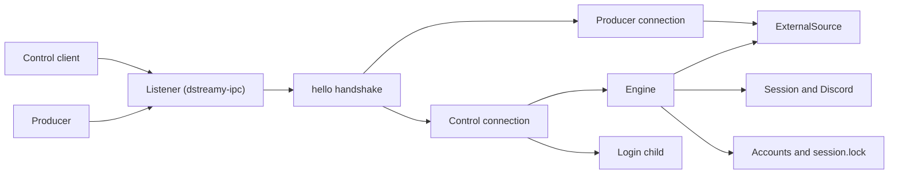
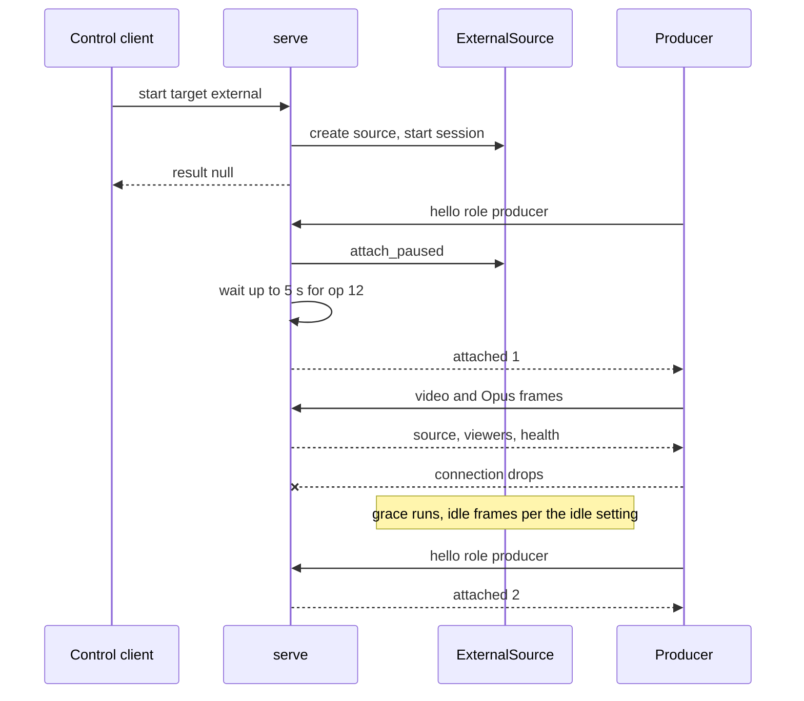

# Service and IPC

## Overview

The service is `dstreamy serve`: a long-running process that holds at most one session and listens on a local endpoint. Control clients connect to it to log in, pick an account, list servers and channels, and start and stop sessions. Producers connect to it to feed encoded H.264 and Opus into a session with target `external`. The OBS plugin is both: it opens one control connection and, while it streams, one producer connection. `dstreamy service status` is a short-lived control client. A client disconnecting never stops the service or its session; only `shutdown`, SIGINT or SIGTERM do (`rust/crates/dstreamy-cli/src/main.rs`, `Serve`).

The transport and the wire codecs live in `rust/crates/dstreamy-ipc`. The service itself lives in `rust/crates/dstreamy-cli/src/serve.rs` and drives the same command engine (`src/engine.rs`) as the protocol 1 `daemon`.

## Responsibilities

- Bind a per-user endpoint that only the same user can reach, and refuse to start when another service already listens there.
- Accept connections, read the first `hello` line within 10 s, and route the connection to the control or the producer role.
- Run protocol 2 commands on the shared engine, with bounded per-connection work and a bounded event buffer per subscriber.
- Create the external source on a control `start` with target `external`, and attach producers to it.
- Hold the session lock of the account a session streams with.
- Follow the default account, or the account pinned with `--account`, and run the account commands of ADR 0005.
- Open the browser login window in a child process on a control `login`.
- On shutdown: stop admitting, abort orphaned commands, shut the engine down, remove the socket file, then close connections.

## Architecture



- The listener drops peers of another user before reading anything (`Listener::accept` in `rust/crates/dstreamy-ipc/src/lib.rs`).
- Each admitted connection gets an id (`connection`, counting from 1) and one of 64 connection slots (`MAX_CONNECTIONS` in `serve.rs`).
- A control connection runs each engine, account and login command as its own task and queues replies and events in one outgoing queue.
- A producer connection switches its reader from NDJSON to the binary `ProducerCodec` after `attached` (`Connection::producer` in `serve.rs`).
- The engine owns the Discord connection, the session, the external source, the session lock and the stats cache (`Engine` in `engine.rs`).

## Key files

| Path | What it holds |
|---|---|
| `rust/crates/dstreamy-cli/src/serve.rs` | Accept loop, admission limits, `hello`, control role, `features`, `instance`, shutdown |
| `rust/crates/dstreamy-cli/src/serve/producer.rs` | Producer `hello` validation, frame ingest loop, producer events, detach reasons |
| `rust/crates/dstreamy-cli/src/serve/login.rs` | `login`: the browser login child, its `env` and `account` parameters |
| `rust/crates/dstreamy-cli/src/engine.rs` | Shared command engine, `status`, error code mapping, account commands, `[serve]` options |
| `rust/crates/dstreamy-cli/src/daemon.rs` | Protocol 1 command list and the `id`/`cmd` parsing both roles share |
| `rust/crates/dstreamy-cli/src/lock.rs` | `SessionLock`: `session.lock` plus `session.pid` |
| `rust/crates/dstreamy-cli/src/accounts.rs` | Token resolution, per-account session lock, removal lock, legacy token migration |
| `rust/crates/dstreamy-cli/src/service.rs` | `dstreamy service install\|uninstall\|status\|print` |
| `rust/crates/dstreamy-cli/src/service/systemd.rs` | The systemd user unit and the `systemctl` steps |
| `rust/crates/dstreamy-ipc/src/lib.rs` | `Endpoint`, `Listener`, `connect`, `Peer`, server verification |
| `rust/crates/dstreamy-ipc/src/unix.rs` | Socket path selection, directory trust checks, stale socket handling, peer credentials |
| `rust/crates/dstreamy-ipc/src/windows.rs` | Named pipe, DACL, first-instance check, peer token checks |
| `rust/crates/dstreamy-ipc/src/control.rs` | `ControlCodec` (NDJSON, 1 MiB lines), `LOGIN_ENV` |
| `rust/crates/dstreamy-ipc/src/producer.rs` | `ProducerCodec` (binary frames, 8 MiB) |
| `rust/crates/dstreamy-ipc/src/error.rs` | `IpcError`: already running, not running, impostor, insecure directory |
| `rust/crates/dstreamy-obs-producer/src/launch.rs` | Windows: the plugin starts the bundled `dstreamy.exe serve` |

## Transport per platform

### Linux and macOS

The endpoint is a Unix socket named `serve.sock` in a directory named `dstreamy` (`rust/crates/dstreamy-ipc/src/unix.rs`).

| Platform | Default base | Fallback base |
|---|---|---|
| Linux | `$XDG_RUNTIME_DIR` | `~/.local/state` |
| macOS | `confstr(_CS_DARWIN_USER_TEMP_DIR)`, not `TMPDIR` | `~/Library/Application Support` |

- The runtime base is used only when it is absolute, exists, passes the trust check, and the full socket path fits `sun_path` (107 bytes on Linux, 103 on macOS).
- Otherwise the fallback under home is used. Home comes from the user database (`getpwuid_r`), not `$HOME`. A fallback that fails the trust check is `InsecureDirectory`; one that is too long is `PathTooLong`.
- The trust check (`check_base`) walks every existing component: each must be owned by this user or root, must not be writable by group or others, and may not contain `..`. Symbolic links are followed, at most 40 per check.
- On bind, the socket directory is created with mode 0700, or must already exist. It must then be a real directory (opened with `O_NOFOLLOW`), owned by this user, with mode exactly 0700 (`check_private_dir`).
- A lock file `serve.lock` (mode 0600, `O_NOFOLLOW`) in that directory is held from the stale check until bind returns. A second `serve` that finds it locked fails with `AlreadyRunning`.
- A leftover socket file is removed only when connecting to it gives `ECONNREFUSED`. A socket that accepts means `AlreadyRunning`; a non-socket file at the path is `NotASocket`.
- The server reads the peer's effective uid at connect (`peer_cred` on Linux, `getpeereid` on macOS) and drops any other uid before reading. Root is not exempt: only the same uid is authorized (`authorize` in `src/auth.rs`).
- The client checks the socket directory the same way, then checks the server's uid. A server of another user is `ImpostorServer`; one whose credentials cannot be read is `UnverifiedServer`. A missing directory or socket is `NotRunning`.
- A Unix socket supports half-close (`HALF_CLOSE`), so a control client can stop writing and still read its replies.

### Windows

- The default endpoint is the named pipe `\\.\pipe\dstreamy-serve-<user SID>`; the SID keeps users apart in the global pipe namespace (`default_location` in `src/windows.rs`).
- The pipe is created with the DACL `D:P(A;;GA;;;<own SID>)`, `first_pipe_instance` on the first instance, and remote clients rejected.
- If the first instance fails with `ERROR_ACCESS_DENIED`, a pipe of that name exists and bind fails with `AlreadyRunning`.
- The server gets the client's process id with `GetNamedPipeClientProcessId` and compares the user SID of its token. The client does the same with `GetNamedPipeServerProcessId`.
- A client retries `ERROR_PIPE_BUSY` for up to 5 s. `ERROR_FILE_NOT_FOUND` is `NotRunning`.
- A pipe has no half-close. When a control client stops writing, the service treats the connection as gone.

### Explicit `--endpoint`

`dstreamy serve --endpoint PATH` and `dstreamy service status --endpoint PATH` replace the default (`Endpoint::new`). Bind and connect still check the socket directory (`check_private_dir`), the lock, stale sockets and peer credentials, and walk the directory's ancestors (`check_ancestors`): each must be owned by you or root and writable by no one else, except that a sticky directory such as `/tmp` may be shared. Bind checks the ancestors that exist before it creates any directory, and all of them again afterwards. Only the runtime-base selection applies to the default endpoint alone.

- Unix: the immediate parent of the path is created with mode 0700 or must already be yours with mode 0700, so `/tmp` itself is refused. The path must fit `sun_path`.
- Windows: the path must be `\\.\pipe\<name>` with no further `\` or `/` in the name; anything else is refused (`check_pipe_path`).

## Protocol

Every connection starts with one JSON `hello` line. All lines on the control role, and the reverse channel of the producer role, are NDJSON as encoded by `ControlCodec`.

### Lines and framing

- A line holds at most 1 MiB (`MAX_LINE`), not counting `\n` and one optional trailing `\r`.
- Blank lines are skipped. A malformed line is answered and skipped; later lines still decode.
- A message is `{"type":"result","id","data"}`, `{"type":"error","id","code","message"}` or `{"type":"event","event"}`. An error for a line without a string `id` has `"id":null`.
- The service must receive `hello` within 10 s (`HELLO_TIMEOUT`), or it closes the connection without a reply.

### `hello` and roles

`hello` needs a string `id`, `cmd: "hello"`, an integer `protocol` and a `role` (`handshake` in `serve.rs`).

- `protocol` 1 or 2 is accepted. Anything else is `unsupported_protocol`.
- `role` is `control` or `producer`. An unknown or missing role is `malformed`.
- A first line that is not `hello` is `malformed` with `the first line must be hello`.
- A refused `hello` gets its error, and the connection is closed.

The control `hello` reply `data` is:

| Field | Meaning |
|---|---|
| `protocol` | `2` |
| `version` | The crate version; every build reports the same one |
| `platform` | `std::env::consts::OS` |
| `connection` | This connection's id; `status.started_by` refers to it |
| `instance` | `{pid, started}`: process id and start time in Unix nanoseconds, to tell serve runs apart where the endpoint is not a file |
| `features` | Additions beyond protocol 2 as first released |
| `status` | The same object a `status` command returns |

`features` always holds `start_grace_secs` and `status_place`. It adds `browser_login` when `login` can open the window: a build with browser login on Linux or macOS, without `DSTREAMY_TOKEN`. It adds `accounts` unless the token comes from `DSTREAMY_TOKEN` (`hello_data` in `serve.rs`).

A real exchange from `rust/crates/dstreamy-cli/tests/fixtures/serve/` (`version`, `platform`, `connection` and `instance` normalised):

```json
{"id":"1","cmd":"hello","role":"control","protocol":2}
{"data":{"connection":"<connection>","features":["start_grace_secs","status_place","accounts"],"instance":"<instance>","platform":"<platform>","protocol":2,"status":{"account":null,"session":null,"source":null,"started_by":null,"stats":null},"version":"<version>"},"id":"1","type":"result"}
{"id":"14","cmd":"start","guild_id":"200000000000000001","channel_id":"300000000000000001","target":"external","codec":"h265"}
{"code":"invalid_params","id":"14","message":"an external session always streams h264","type":"error"}
{"id":"19","cmd":"stop"}
{"code":"not_running","id":"19","message":"no stream is running","type":"error"}
```

### Control commands

The control role accepts the protocol 1 commands (`COMMANDS` in `daemon.rs`) plus `status`, `subscribe`, `login` and the account commands (`Request::parse` in `serve.rs`). An unknown `cmd` is `unknown_cmd`; fields that do not parse are `invalid_params`.

| Command | Purpose | Reply `data` and notable errors |
|---|---|---|
| `hello` | Repeat the handshake | Same as the first `hello` reply |
| `status` | Current state | `{session, source, stats, started_by, account}`, each `null` when absent, plus `connect_error` (the last connection attempt's error) while a live session is not streaming after a failed attempt, and after it gave up until the next start |
| `subscribe` | Receive session and source events | `null`; then `event` messages |
| `set_token` | Save a token into the selected or default account; the login that validates it holds up no other command | `null`; `streaming` while live, `invalid_token`, `invalid_params` for an empty token, `account_mismatch` when the account belongs to another Discord user |
| `logged_in` | Whether a token resolves | `{logged_in}` |
| `guilds` | The account's servers | `[{id, name}]`; `not_logged_in` |
| `channels` | Voice channels of `guild_id` | `[{id, name}]`; `unknown_guild`, `guild_unavailable` |
| `targets` | Capture targets | `[{id, kind, title, app, width, height}]` |
| `start` | Start a session in `guild_id`/`channel_id` on `target` | `null`; `already_running`, `unknown_channel`, `invalid_params`, `busy`, `gateway` when the Discord login fails or takes over 45 s, `cancelled` when a `stop` was received after this `start` and before its session began |
| `update` | Change fps, resolution, bitrate or crop of the session running when it was received | `null`; `invalid_params` on an external session; `not_running` without a live session or once that session has stopped |
| `stop` | Stop the session | Terminal `StreamStats`; `not_running`, `busy`. It cancels every `start` received before it whose session has not begun, and replies `not_running` at once when nothing is live or committed, without waiting for a login in progress. A `start` received after the `stop` is not affected. |
| `shutdown` | Stop the service | `null`, sent once the service has shut down |
| `login` | Open the browser login window | `{username, global_name, account}`; `login_cancelled`, `login_failed`, `login_running`, `login_unavailable`, `streaming` |
| `accounts` | List saved accounts | `{active, accounts: [{name, username, global_name, has_token, active, token_error?}]}`; `accounts_unavailable` |
| `select_account` | Make `account` the default | The `accounts` reply; `not_logged_in`, `unknown_account`, `streaming`, `config` |
| `logout_account` | Delete `account` | The `accounts` reply; `unknown_account`, `streaming`, `already_running` |

Notes on `start` for target `external` (`Engine::start` in `engine.rs`):

- The codec is always H.264; another `codec` is `invalid_params`. `crop`, a gain other than 1 and `audio_source` are `invalid_params`.
- `grace_secs` replaces `[serve] grace_secs` for that session. Above 3600 it is `invalid_params`; on any other target it is `invalid_params` too. The protocol 1 daemon ignores it.
- `busy` means either that events of the previous run are still being delivered (the client waits for `stopped` and retries), or that the command waited the whole 45 s login budget behind another command's Discord login (`another command is still connecting to Discord…`). The second case also applies to `guilds` and `channels`.

`status.source` is `{state: "detached"|"producing"|"interrupted", attachment?, reason?, for_ms?, stats?}`. `reason` is `detached`, `stalled` or `video_stalled`. Only `status` adds `stats` (`skipped`, `dropped_video`, `dropped_audio`, `queued`, `max_queued`, `overflow_keyframe_requests`) (`SourceView` in `engine.rs`).

`login` takes an optional `env` object limited to `DISPLAY`, `WAYLAND_DISPLAY`, `XAUTHORITY`, `XDG_SESSION_TYPE`, `XDG_CURRENT_DESKTOP` and `DBUS_SESSION_BUS_ADDRESS`. Values are checked to look like a graphical session's; D-Bus `unixexec:` and `autolaunch:` are refused (`login_env_value_ok` in `dstreamy-ipc/src/login.rs`). The window runs `dstreamy --json --gateway-url <url> --config-dir <dir> login --browser --window-only [--account NAME]` without `DSTREAMY_TOKEN`. It closes when the requesting client disconnects; `LOGIN_WINDOW_LIMIT` is 10 minutes.

### Events

After `subscribe`, the connection receives:

- Session events, as the session emits them: `state` (`connecting`, `streaming`, `reconnecting`, `stopped` with a `reason`), `health`, and others from `SessionEvent`.
- Source events: the `status.source` shape without `stats`, with `"event":"source"`.

Each subscriber has a buffer of 256 events (`DEFAULT_EVENT_CAPACITY`). A subscriber that falls behind gets `{"type":"error","id":null,"code":"lagged"}` and is disconnected after up to 10 s to read it.

### Limits

| Limit | Value | Source |
|---|---|---|
| Admitted connections | 64; further ones get `busy` and are closed | `MAX_CONNECTIONS` |
| Connections being refused | 64; beyond that they are dropped unanswered | `MAX_REFUSING` |
| Queued replies plus running commands per connection | 64; the service stops reading until it drops | `MAX_IN_FLIGHT` |
| Time for `hello` | 10 s | `HELLO_TIMEOUT` |
| Control line | 1 MiB | `MAX_LINE` |
| Producer frame `length` | 8 MiB | `MAX_FRAME_LEN` |

A connection's slot stays taken while its orphaned commands, a lag flush or a login follow-up still run, so reconnecting does not bypass the limit.

### Error codes

| Code | When |
|---|---|
| `malformed` | Not JSON, not UTF-8, over 1 MiB, missing `id`/`cmd`, bad `hello` fields, first line not `hello` |
| `unsupported_protocol` | `hello` with protocol 0 or above 2 |
| `unknown_cmd` | Unknown `cmd` |
| `invalid_params` | Fields that do not parse or are out of range; a producer `hello` with missing or mistyped `video`/`audio` |
| `incompatible` | Producer media the service does not take |
| `no_session` | Producer `hello` while no live session has target `external` |
| `busy` | Another producer attached; too many connections; previous events still being delivered; a command waited the whole 45 s login budget behind another command's Discord login |
| `lagged` | Subscriber fell behind |
| `already_running` | A session runs here, or another process holds the account's session lock (message names the PID) |
| `not_running` | `stop` or `update` without a live session, including a `stop` that cancelled a pending `start`; an `update` whose session stopped before it applied, even if another has started since |
| `not_logged_in`, `invalid_token` | No token, or Discord rejected it |
| `unknown_guild`, `unknown_channel`, `guild_unavailable` | Bad place for `channels` or `start` |
| `streaming` | `set_token`, `login` or `select_account` while a session is live; `logout_account` while that account's session is live |
| `login_cancelled`, `login_failed`, `login_running`, `login_unavailable` | `login` outcomes |
| `accounts_unavailable`, `unknown_account` | Account commands with `DSTREAMY_TOKEN`, or a name that does not exist |
| `account_mismatch` | `set_token` with a token of another Discord user than the account's |
| `identify_limit` | The gateway client reached its daily IDENTIFY limit; the message says when to try again |
| `config`, `gateway`, `remote_auth`, `capture`, `no_platform_capture` | Mapped from the engine's errors (`impl From<CliError> for Failure`); `gateway` also when a new Discord login does not finish within 45 s, or keeps failing for 30 s before its first READY (the message names the cause and a next step). 45 s because READY normally arrives within a few seconds even for large accounts, a link too slow for that can't carry Go Live either, and the clients waiting on the reply need an actionable answer |
| `cancelled` | `start` whose stream had not begun when a `stop` arrived; that `stop` replies `not_running` at once instead of waiting for the login |
| `shutting_down` | A command cut off by shutdown, including a Discord login or a `start` waiting for one (the daemon sends it too) |
| `internal` | Anything else |

## Producer role

### `hello`

A producer `hello` declares its media (`hello` in `serve/producer.rs`). From `rust/crates/dstreamy-ipc/tests/fixtures/control/hello.ndjson`:

```json
{"audio":{"channels":2,"codec":"opus","frame_ms":20,"sample_rate":48000},"client":{"name":"obs-dstreamy","obs_version":"32.2.2","version":"0.1.0"},"cmd":"hello","id":"1","protocol":2,"role":"producer","video":{"codec":"h264","fps":30,"height":720,"width":1280}}
```

- `video.codec` must be `h264`; the size even and at most 1920×1080; `fps` 15, 30 or 60.
- `audio` must be Opus, 48000 Hz, 2 channels, 20 ms frames.
- A violation is `incompatible`, for example `video.fps 25: must be 15, 30 or 60` (`producer_hello_replies.ndjson`).
- On success the service replies `{"attached":<id>}` with no `type` or `id` wrapper.

### Attach lifecycle

1. The service attaches the producer to the live session's external source with its stall timer paused (`attach_paused`).
2. If a producer is attached and not stalled, the new one gets `busy`. If the attached one is fully stalled, it is detached with reason `replaced` and the new one takes over (`rust/crates/dstreamy-media/src/external.rs`).
3. The service waits up to 5 s for Discord to announce the producer's width, height and fps (op 12) (`ANNOUNCE_WAIT`), starts the stall timer, and sends `attached`.
4. The producer sends binary frames: `u32 BE length | u8 kind | i64 BE pts_us | u8 flags | payload`. Kind 1 is an Annex B access unit, kind 2 an Opus packet, kind 3 end of stream. Flag bit 0 marks a video keyframe; other bits must be 0.
5. The service sends NDJSON events: `keyframe_request`, `source`, `viewers` (`count` or `null`) and `health`. Only one event is buffered while the producer does not read.
6. The attachment ends with `detached` and a `message`, then the service closes the connection. An end-of-stream frame, or the connection ending mid-frame, closes it without `detached`.

| Detach `reason` | Cause |
|---|---|
| `stopped` | The session let go of the source. The `message` says why in words. `code`, when present, names it: the session's stop reason as `status` names it (for example `voice_taken_over`, `requested` for a control client's `stop`), or `grace_expired`. It is absent when the source ended for another reason. `retry_after_secs` comes with a stop reason that has it |
| `shutdown` | The service is shutting down |
| `replaced` | A new producer replaced this stalled one |
| `incompatible` | A frame error or an ingest rule failed, for example B-frames |
| `oversized` | A frame over 8 MiB |

Ingest rules and the timeline are part of the external source; see [ADR 0004](../adr/0004-persistent-service-and-external-producers.md) (External source, IPC).

### Grace and idle

The `[serve]` settings (`rust/crates/dstreamy-core/src/config.rs`, checked by `external_options` in `engine.rs`):

| Setting | Default | Bounds |
|---|---|---|
| `grace_secs` | 30 | at most 3600 (`MAX_GRACE`) |
| `stall_ms` | 2000 | 500 to 600 000 (`FIRST_FRAMES_WAIT`, `MAX_STALL`) |
| `idle` | `documented` | `documented`, `none`, `continuous` |

- Grace runs while no producer is attached and while an attached producer is fully stalled. When it runs out, the source closes and the session stops.
- Each explicit source start grants a full fresh grace period. Grace starts counting only when the session starts the source, not at the control `start`.
- Video-only interruption with audio still arriving reports `interrupted` with `video_stalled` and does not consume grace.
- Idle frames go to Discord only after a producer detached: `documented` sends five Opus silence frames 20 ms apart, `none` sends nothing, `continuous` sends one every 20 ms. While an attached producer is stalled, nothing is sent.
- A producer may attach as soon as the control `start` created the source, before Discord is connected; frames before the source starts are dropped.



## Session lock and accounts

- A `start` takes the session lock before it starts the session, if serve does not hold it yet (`Engine::start`). The lock directory is `<config-dir>/accounts/<name>/` for an account, or `<config-dir>/` for `DSTREAMY_TOKEN` or the legacy token (`lock_dir` in `rust/crates/dstreamy-core/src/accounts.rs`).
- The lock is `File::try_lock` on `session.lock`; the holder's PID goes into `session.pid` (`SessionLock::acquire` in `lock.rs`). A held lock is `already_running` with `another dstreamy session is live (pid N)`.
- The lock is released when the session state becomes `Stopped`, including a session that stops on its own (`release_if_stopped`). The OS releases it when the process dies.
- serve follows the default account at each connection unless started with `--account`. `select_account` writes the default under `accounts.lock` and refuses an account without a token. A login through serve makes its account the default.
- A command that needs Discord and finds the idle connection on another account than the selected one replaces it. A live session keeps its connection; the change applies once it stops.
- `logout_account` takes the account's removal lock, so it fails with `already_running` while another process streams that account.
- serve migrates a legacy `<config-dir>/token` into an account at start, with a 5 s limit so the socket is not held back (`SHORT_MIGRATION_LIMIT` in `accounts.rs`).

## Supervision

### Linux: `dstreamy service`

`dstreamy service` manages a systemd user unit (`src/service.rs`, `src/service/systemd.rs`). On every other platform it fails with `unsupported_platform`.

| Action | What it does |
|---|---|
| `install [--dry-run]` | Writes `dstreamy.service` to `$XDG_CONFIG_HOME/systemd/user` (else `~/.config/systemd/user`) only when it changed, then `daemon-reload`, `try-restart`, `enable --now` |
| `uninstall [--dry-run]` | `disable --now`, removes the unit, `daemon-reload` |
| `status [--endpoint PATH]` | Reports the unit file, the manager state and whether the socket answers a control `hello`; exits non-zero unless all are healthy |
| `print` | Prints the unit `install` would write |

The unit runs `<exe> serve` with `Restart=on-failure`, `RestartSec=2` and `WantedBy=default.target`. A restart of a running service ends its Discord session. `install` refuses a unit path that is a symbolic link and warns when the executable sits in a temporary or Cargo target directory. `status` reads the service manager's `XDG_RUNTIME_DIR` to find the socket the service uses and notes when it differs from the shell's.

### Windows: the OBS plugin

The Windows plugin ships `dstreamy.exe` next to its DLL and installs a `Launcher` (`rust/crates/dstreamy-obs-producer/src/launch.rs`). When a connection to the default pipe finds no service, it starts `dstreamy.exe serve` with `CREATE_NO_WINDOW` and `CREATE_NEW_PROCESS_GROUP`, and with `CREATE_BREAKAWAY_FROM_JOB` where the job allows it. It waits up to 10 s for the pipe and starts the service at most once every 30 s. `stop_started` ends only a service the launcher started: it asks it to `shutdown` and kills it only if it is still running after the grace. Asked to keep a live session, it leaves a serve whose `hello` reports one running. A failed start names the program and, if it exited, its exit status.

On macOS the user runs `dstreamy serve` by hand.

## Errors and edge cases

- **Already running.** A second `serve` on the same endpoint fails with `already running at <path>`: the directory lock, a live socket, or on Windows the first-instance check.
- **Stale socket.** A socket file left by a crashed service is removed when connecting to it is refused, then bound again.
- **Impostor server.** A client refuses a service that runs as another user (`the service at <path> runs as <owner>, not as this user`), and one whose owner it cannot verify.
- **Insecure directory.** A socket directory that is a symlink, not owned by you or not mode 0700 is refused, as is a runtime or fallback base another user can write.
- **Restarted serve.** No session state survives the process. Clients see the connection close; `instance` in the next `hello` tells the new run apart. The OBS plugin on Windows starts a new one when needed.
- **Client disconnect.** Running commands of a disconnected client keep running as orphans; shutdown aborts and awaits them before the engine shuts down. Its login window is closed.
- **Shutdown.** The service stops admitting, answers commands cut off with `shutting_down`: `service shutting down`, or `the service is shutting down` for a command that was in or waiting for a Discord login. It answers every `shutdown` with `null`, detaches producers with `shutdown`, removes the socket file and exits 0. A second signal during shutdown forces exit.
- **Producer without a session.** A producer `hello` before a live external session is `no_session`; the producer starts the session through a control `start` first.

## Testing

- `rust/crates/dstreamy-cli/tests/serve.rs`: the service end to end against the mock Discord server, including the golden scenarios, limits, lagged subscribers, shutdown, the session lock against `stream`, login and accounts.
- `rust/crates/dstreamy-cli/tests/fixtures/serve/`: `control` and `handshake` scenarios, with the normalisation in its `README.md`. Regenerate with `DSTREAMY_UPDATE_FIXTURES=1`, which needs a protocol bump or new provenance.
- `rust/crates/dstreamy-ipc/tests/golden.rs` with `tests/fixtures/`: control lines, producer events, producer `hello` replies, and binary frame streams including every frame error and ingest rule.
- `rust/crates/dstreamy-ipc/tests/unix_socket.rs`, `socket_frames.rs`, `endpoint_env.rs`: socket trust, framing over real sockets, default endpoint selection.
- `rust/crates/dstreamy-ipc/tests/cross_user.rs`: another OS user against real sockets; run with `--ignored` on disposable hosts.
- `rust/crates/dstreamy-ipc/tests/codec_props.rs`: property tests of both codecs.
- `rust/crates/dstreamy-cli/tests/producer.rs`, `service.rs`, `lock.rs`, `accounts.rs`, `obs_windows.rs`: producers, the systemd installer, the session lock, accounts and the Windows plugin path.

## Related decisions

- [ADR 0004: persistent service and external producers](../adr/0004-persistent-service-and-external-producers.md)
- [ADR 0005: multiple accounts](../adr/0005-multiple-accounts.md)
- [ADR 0009: bounded queues](../adr/0009-bounded-queues.md)
- [ADR 0003: macOS menu bar on the Rust daemon](../adr/0003-macos-menu-bar-on-rust-daemon.md) (protocol 1 commands)
- [External specifications](../specs.md): Platform and Service managers sections
- [Glossary](../../CONTEXT.md)
