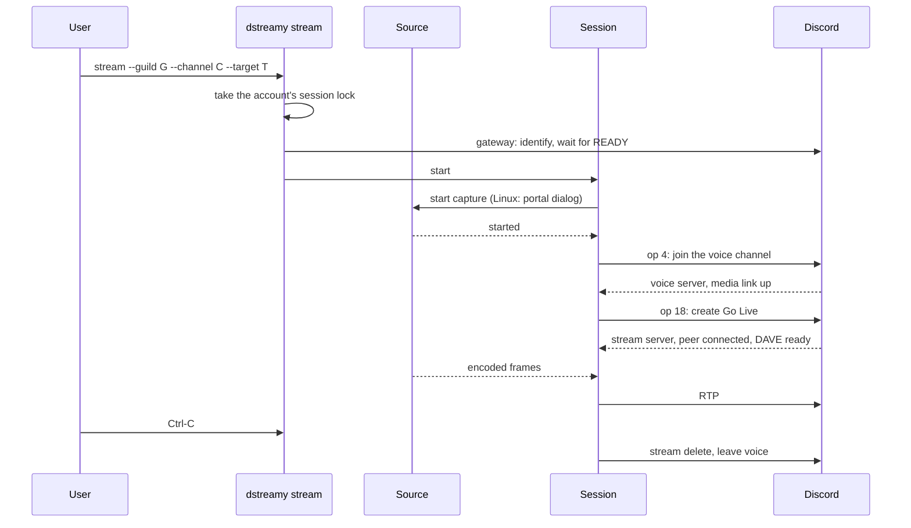
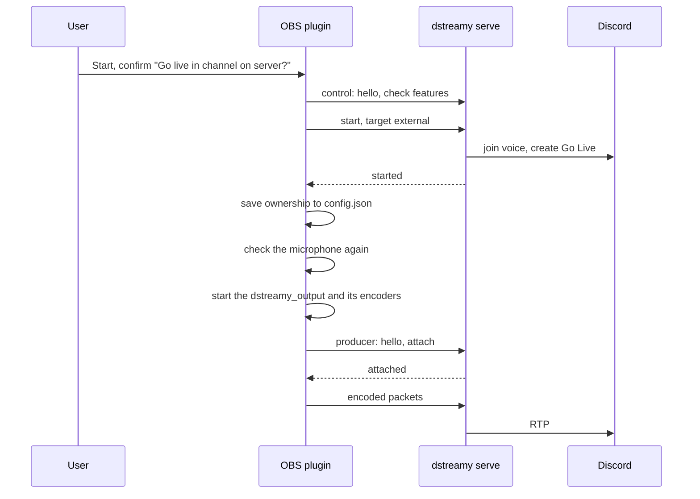

# Workflows

This page follows the main flows end to end. The component chapters have the details: [Discord session](components/discord-session.md), [Service and IPC](components/service-and-ipc.md), [OBS plugin](components/obs-plugin.md), [Command line and core](components/cli-and-core.md).

## Logging in

A login saves an [account](../CONTEXT.md): a token plus the Discord user it belongs to, under `<config-dir>/accounts/<name>/`.

| Method | How | Where |
|---|---|---|
| QR code | `dstreamy login` shows a QR code; scanning it with the Discord mobile app approves the login | `dstreamy-discord` `remote_auth` |
| Token | `dstreamy login --token` prompts for it; a token piped on stdin is read without a prompt | `dstreamy-cli` |
| Browser | `dstreamy login --browser` opens Discord's login page in a webview window. Only builds with the `browser-login` feature have it: the release CLI archives for Linux and macOS do, the daemon inside the macOS app does not | `dstreamy-cli` `browser_login/`, [ADR 0008](adr/0008-browser-login-webview.md) |

Every token is checked with one brief gateway connection before it is saved. The account is named after the Discord username unless `--account <name>` is given, and logging in again as the same user updates that account. A login into an account that belongs to another Discord user is refused (`account_mismatch`) and saves nothing. The first account saved becomes the default account. A CLI login never changes the default after that; `dstreamy account use <name>` does, and so does a pick or login in the OBS panel. `DSTREAMY_TOKEN` overrides the saved accounts.

The OBS panel logs in through serve: its Log in button sends `login`, and serve opens the browser login window when it can. The macOS app logs in by a pasted token.

## Streaming from the command line

1. `stream` resolves the account, takes its session lock and connects the gateway.
2. The source starts first, before anything reaches Discord. On Linux the portal dialog asks which window or screen to share; the choice is remembered for next time. On macOS the target is `display:<id>` or `window:<id>` from `dstreamy targets`. The source has up to 300 s to start. If it fails or takes longer, the session stops before it joins voice, so no empty Go Live appears.
3. The session joins the voice channel and waits for the voice media link, then creates the Go Live stream and waits for its peer connection. Each step has 30 s.
4. It waits up to 10 s for DAVE. With `require_e2ee` it refuses to stream if DAVE is not ready.
5. The media pump sends frames as RTP. Health figures arrive once a second.
6. Ctrl-C stops the session: it deletes the stream and leaves voice, so nothing is left behind in Discord. A second Ctrl-C exits at once with code 130.

`dstreamy tui` runs the same session with a terminal UI for picking the server, channel and target and watching health.

## Streaming from OBS

serve must be running: on Linux `dstreamy service install` keeps it running, on macOS the user runs `dstreamy serve`, and on Windows the plugin starts its bundled `dstreamy.exe`.

1. Start asks for confirmation, then checks that a microphone won't leak into the stream and that OBS has a video canvas.
2. The plugin's control thread connects to serve. It takes over its own earlier session if one still runs, attaches to an external session in the same channel, or sends `start` with target `external`.
3. Once serve replies, the plugin saves which session it owns before starting its output, so a restarted OBS can still stop it. It then checks the microphone again, since the track or the mixer may have changed while it connected. If one would now leak, the output never starts: the plugin ends a session it owns, leaves a session it attached to running, and shows "Didn't start" with "Go Live held back: <guard message>" and the fix "Manage the track, or take the microphone off it". The message ends with "Then press Start again" when no session it started is left running; otherwise it says the Discord session is still live. A start that fails or is abandoned after it was sent keeps its provisional ownership, because serve may still carry it out.
4. OBS starts the plugin's own output with its own Opus encoder and, by default, its own x264 encoder. The user's normal stream is untouched.
5. The output connects as a producer. serve waits for Discord to announce the stream's video, then replies `attached`.
6. OBS's encoder callback only copies each packet into a bounded ring. A separate thread sends packets to serve, which checks them and feeds them into the session's external source.

While the start is in progress Start becomes Cancel start, and the panel shows "Connecting to Discord…" until serve answers, then "Starting…". After "Cancel going live?" the control thread stops waiting on serve, or skips the output if serve already answered, and ends any session the start brought up. If that end fails, the ownership stays saved and the panel says so.

The panel shows the session state, missed frames, audio state, reconnects, viewers and the stream's duration.

## When something goes wrong

**Discord connection lost.** The session moves to `Reconnecting`, detaches the media pump and retries with backoff from 1 s up to 30 s, at most 10 times. It recreates the Go Live stream, or rejoins voice when the voice connection is gone. The pump keeps its timeline; on reattach it asks the source for a keyframe. After 10 failed attempts the session stops with `GaveUp`.

**Moved to another channel.** When someone moves the account to another voice channel, the session recreates Go Live there without rejoining.

**Same account elsewhere.** If another device takes over the account's voice connection, the session stops with `VoiceTakenOver` and sends no gateway op, so it does not fight the other device. Before the session has joined voice, while its source is still starting, another device in voice is left alone, and a session that stops then sends no voice leave.

**Discord can't be reached at the start.** A new login retries for 30 s before its first READY, then fails with the cause of the last attempt and what to check (network, firewall, proxy or VPN). serve and the daemon answer a command that needs a new login within 45 s, with `gateway`.

**Discord rejects the token.** The session stops with `invalid_token`. Log in again.

**Too many logins.** Each token may send at most 100 IDENTIFYs in 24 h. Every process counts them in `<config-dir>/identify/`, and RESUMEs don't count. One more stops the session with `identify_limit` and says when logging in is allowed again.

**The capture source doesn't start.** A source that fails, or has not started within 300 s (for example a portal dialog left open), stops the session with `source_failed` before it joins voice.

**The session task dies.** The session stops with `task_ended` instead of staying live. Start again, and check the log if it repeats.

**OBS stops sending.** When the producer detaches or stalls completely, serve keeps the session alive for the grace period (`grace_secs`, 30 s by default) and sends Discord idle media (`[serve] idle`, by default up to five Opus silence packets). A producer that attaches again within grace continues the same Go Live stream. When grace runs out, the session stops. A stall of video alone, with audio still arriving, does not use grace.

**OBS restarts or crashes.** The session lives in serve, not in OBS. When the user presses Start within the grace period, the restarted plugin finds its saved ownership and takes the session over instead of starting a new one.

**serve restarts.** A session does not survive serve's process: a restart ends the Discord session. The plugin notices the new run, by the socket file on Unix and by the `instance` in serve's hello reply on Windows, and reports that the session ended.

When a running session stops while the plugin's output is attached, serve sends the producer `detached` with reason `stopped` and the stop code (or `grace_expired`), and the OBS panel shows a headline and next step for that code.

## Stopping

| Frontend | How it stops | What happens |
|---|---|---|
| `stream`, `tui` | Ctrl-C or SIGTERM | Stream delete and voice leave, then exit |
| macOS app | Stop | `stop` to the daemon; if the stop isn't confirmed, pressing Stop again terminates the daemon, which restarts on the next action |
| OBS panel | Stop, after confirming; Cancel start while starting | The output stops first, then `stop` goes to serve, but only if the session is still the plugin's own. Cancel start ends the session the start brought up, if any |
| OBS closing | Closing OBS | In-flight calls get 5 s, everything 10 s; if the session cannot be ended in time, serve's grace ends it |
| serve | `shutdown`, SIGINT, SIGTERM | Ends its session and exits; a client disconnecting never stops it |

On Windows, closing OBS also shuts down the `dstreamy.exe serve` the plugin started, unless another client's session is live on it. A serve the user started is left running.
